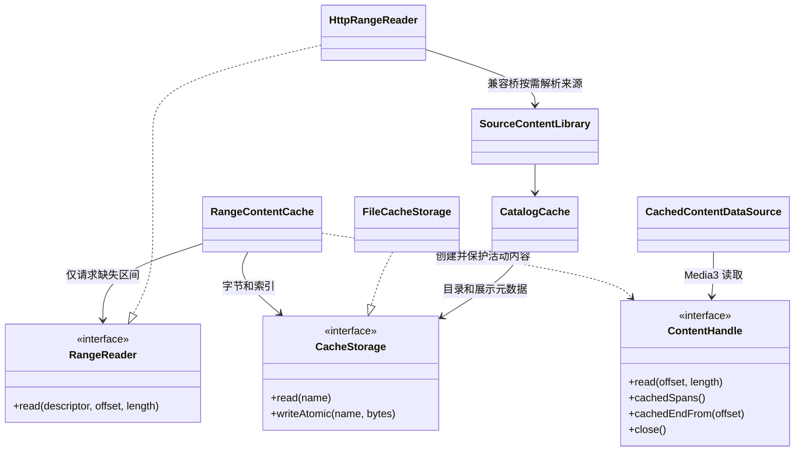
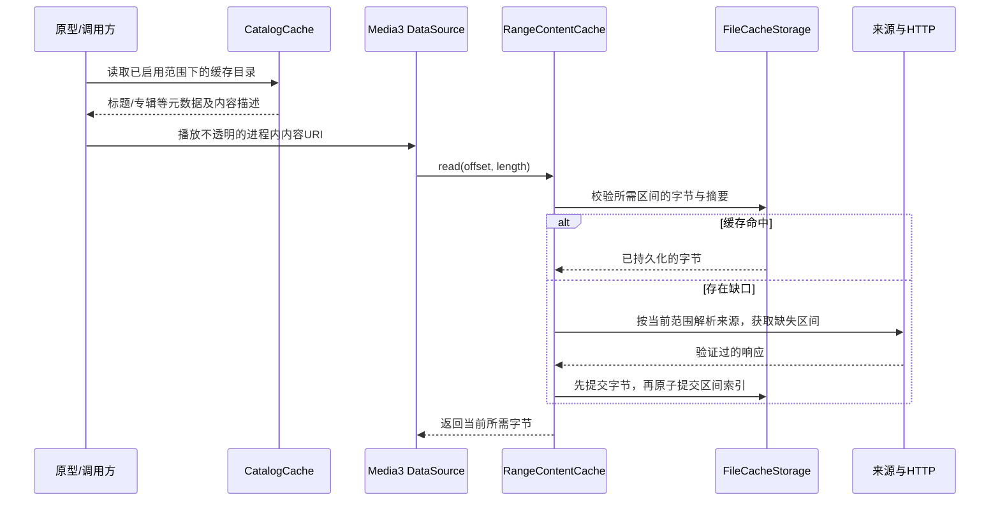

# P1：内容访问与通用缓存

分支：`codex/playback-core-prototype`。本阶段承接 P0，共享播放核心及正式播放页的选曲、歌词、进度、动画行为不改；不包含交叉淡化。

## 实际交付与边界

新增 `lmedia:lmedia-content`，把目录缓存、可定位的内容句柄、音频范围缓存与 HTTP 读取分开。模块依赖 lmedia-domain 的稳定 `MediaKey`，不依赖播放器、Compose、Room、Koin 注册或来源私有协议。它自身不初始化数据源。

Android 调试原型接入新的 Media3 DataSource，真正通过缓存读取字节，不只是展示缓存状态。正式播放器仍使用原路径；这次没有把新的范围缓存替换进全部生产入口。正式路径的唯一行为修正是 WebDAV 部分扫描不再冒充完整快照，避免误将未扫描目录中的旧歌曲移除。

通用接口对所有来源开放，当前旧来源桥接首先接入 WebDAV。无法提供可靠身份、内容版本和长度的来源暂时沿用原路径，不能拿变化的签名 URL 或文件名猜测缓存身份。

## 接口与所有权

| 接口 | 负责什么 | 明确不负责什么 |
| --- | --- | --- |
| `ContentDescriptor` | MediaKey、账户/服务器/根目录范围、内容版本、总长度、HTTP 校验信息 | URL、密码、签名地址、播放队列 |
| `ContentHandle` | 有界字节读取、实际缓存区间、当前位置之后的连续缓存终点、释放句柄 | 时间进度换算、曲目导航、播放意图 |
| `RangeReader` / `HttpRangeReader` | 缺失范围读取、获取最新连接信息、验证响应 | 持久化凭据、决定何时切歌 |
| `RangeContentCache` | 读穿缓存、区间校验、并发去重、活动句柄保护、容量淘汰 | 预选下一首、全曲预下载、系统音频缓冲 |
| `CacheStorage` / `FileCacheStorage` | 同目录临时文件和原子替换、磁盘读取 | 跨进程写入仲裁、浏览器存储后端 |
| `CatalogCache` | 目录及展示元数据、完整/部分结果提交、刷新代次、停用后的可见列表 | 来源认证、原始网络地址、数据库关系重建 |
| `SourceContentLibrary` | 将现有来源的身份/就绪/启用状态接入通用层 | 替代现有 MediaSourceBindingRepository 或 Room |

每个缓存根目录同一时刻只能由一个宿主拥有。调试入口使用 singleTask，目录位于应用 filesDir，音频位于 cacheDir。取消或退出时由原型释放播放器、句柄和 HTTP 客户端。

这里 `HttpRangeReader` 到 `SourceContentLibrary` 是原型注入的回调关系，HTTP 实现本身不硬依赖来源桥。

## 缓存优先的真实执行顺序

离线完整缓存读取不会先等待来源就绪。部分缓存允许读取已覆盖区间；遇到真实缺口才尝试联网，失败时如实报告，不把缺口当作 EOF 或有效静音。

## 关键规则

- **身份与连接分开。** 同来源歌曲使用 MediaKey；账户/服务器/根目录切换产生不同 scope，内容替换产生不同 revision。新签名 URL、密码刷新不会凭空生成新的同曲缓存。WebDAV 使用强 ETag，缺失时采用修改时间与长度；如果两者都没有则不接入持久范围缓存。修改时间的精度仍受服务器约束。
- **响应必须自洽。** HTTP 校验状态码、Content-Range 起止/总长、表示编码、ETag 或 Last-Modified、实际字节数；发出条件请求。服务器忽略 Range、截断、超长、返回其他版本时不写入缓存。普通 200 仅在请求正好是完整小文件时允许。
- **不填 seek 中间的空洞。** 通用层只请求缺失范围。Android 适配每次最多读取 64 KiB，缓冲给解码器的小块请求；从当前位置向后取，不补前面未播放部分。
- **实际落盘才算缓存。** 分片带 SHA-256 摘要；完整写入并原子替换后才登记索引。启动时清理中断写入与无索引片段，坏片段作为缺失重新获取。原子替换保证可见性，不宣称所有平台都提供掉电后的 fsync 持久性。
- **不同歌曲的网络请求不互相锁住。** 同一内容串行合并重复缺口请求，跨曲目只共享很短的存储锁。取消读取不发布未完成区间；停用/切换账户后不接受原请求的字节。
- **缓存不是播放的硬依赖。** 写盘 IO 错误时仍可返回已校验的网络字节，不伪造覆盖信息。读盘/目录读取错误保留为错误，不将其当成成功空目录。
- **容量可调。** 默认音频预算 512 MiB，按最近使用淘汰未被活动句柄保护的内容。活动内容允许临时超过预算，关闭后再淘汰；这个值是原型参数，后续应映射到用户设置和设备实测。展示目录独立保存，不随音频 LRU 一起消失。
- **目录提交有代次。** 新刷新、停用或已成功提交使旧令牌失效。Partial 只更新返回项；Complete 才移除缺失项。WebDAV 旧快照通道尚无 Partial 类型，因此子目录失败选择保留上次完整结果并报告扫描失败，不发布残缺列表。
- **停用与当前播放分开。** 目录投影按当前来源启用状态过滤，账户切换只读新 scope；不主动向正式播放器发送停止命令。新内容访问仍检查启用状态。
- **缓冲条与磁盘覆盖分开。** `cachedEndFrom(offset)` 只返回覆盖当前位置的连续区间终点；不能用所有分片总和画时间缓冲条。Media3 原型仍使用它自己当前加载窗口的 bufferedPosition。正式 UI 的时间映射与统一接入留在 P2。

## 原型操作

1. 正式应用照常启动，调试入口仍为 `PlaybackPrototypeActivity`。
2. “载入媒体库前 20 首”保持暂停，记录当前页；若某个来源已有成功完整快照，也保存该完整目录。旧缓存中的来源 URL/凭据不会被复制到新目录文件。
3. “读取缓存目录”不等待来源扫描，恢复已启用范围下有内容描述的歌曲；完整音频缓存可离线播放，不完整项会在实际缺口处尝试来源。
4. A/B/C 生成音频和原有快切/暂停/定位验证入口继续保留。

## 验证与后续边界

单元测试覆盖目录提交、账户/版本隔离、乱序和取消、缺口读取、并发、淘汰、损坏及 IO 故障；设备测试使用本地 HTTP 服务和自生成 WAV，包含真实网络播放及磁盘离线播放。最终执行结果在 [实施记录](implementation-plan.md) 中登记。

尚未迁移：生产旧前缀缓存、所有来源的身份适配、全局目录后台同步/Room 启动流程、用户缓存设置绑定、浏览器持久存储、iOS/桌面播放端、封面/歌词二进制缓存。这里缓存的元数据包含标题、副标题、专辑、歌手、时长等展示字段；不意味着已缓存所有封面和歌词文件。多端共享模块会编译验证，但真机断网、服务器差异、大型媒体库容量性能仍需后续实测。交叉淡化继续不实施。
