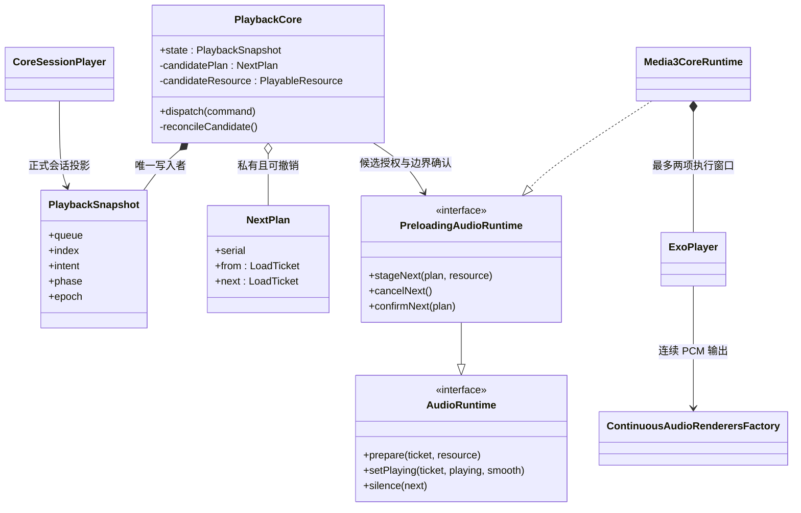
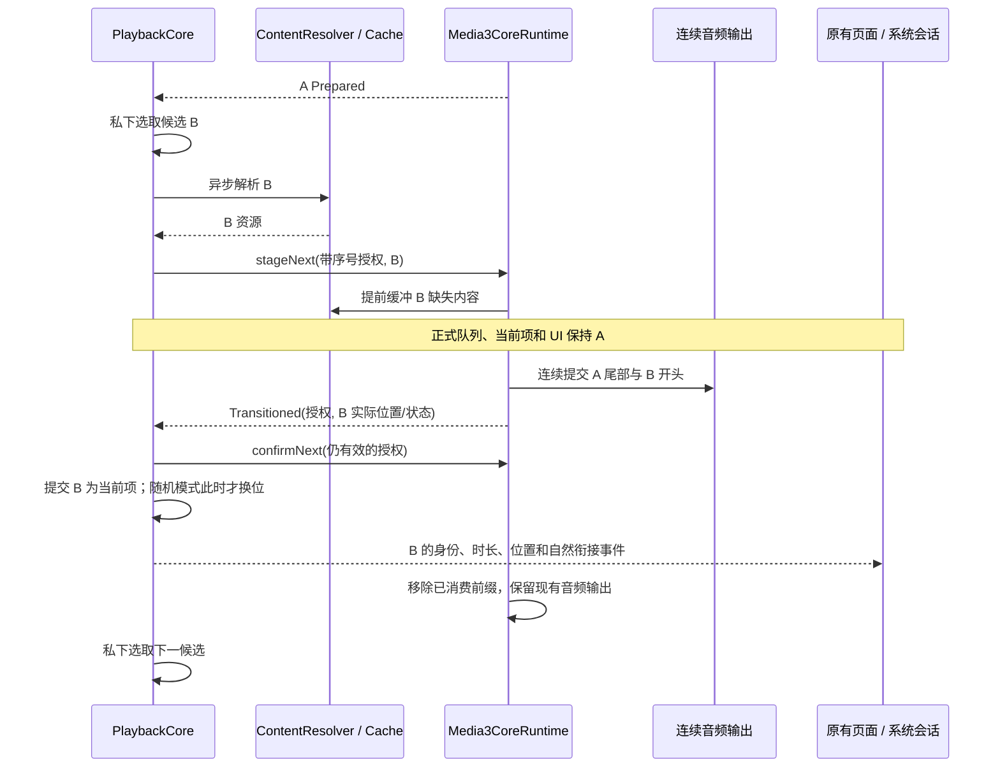

# P3：提前预加载与无缝播放

本阶段将 Android 正式音频链路从 P2 的“单项停止后重新准备”改为连续输出。共享核心仍是业务队列唯一决策者，现有播放页、歌词与短过渡组件没有重写。没有实现交叉淡化。

## 为什么使用两项执行列表

Media3 已经具备提前缓冲、解码器衔接、编码延迟/尾部填充处理和连续 AudioTrack 输出。如果仍然每首调用 stop/clear/setMediaItem，这些能力就会被拆断。P3 允许运行时保存“当前项＋一个核心授权的候选”，但不给它应用的完整业务队列，也不开启原生随机或原生循环规则。

| 状态 | 归属 | 用户是否可见 |
| --- | --- | --- |
| 完整播放队列、当前索引、模式、播放意图 | PlaybackCore | 可见，原 UI 与系统会话共同投影 |
| 随机“待播放”用户意图 | PlaybackCore | 可见，仍只有一个意图元素 |
| 自然下一首候选及异步解析任务 | PlaybackCore 私有状态 | 不可见，不提前换位或修改当前歌曲 |
| 当前＋已授权候选的短列表、5 秒目标预加载 | Media3CoreRuntime | 不作为系统或 UI 的播放列表暴露 |
| 当前解码、重采样和音频输出 | Media3 音频链路 | 通过真实播放状态和当前位置反映 |

5 秒是下一项的初始预加载目标，不是缓存容量，也不是每次必须下载完整歌曲。2026-10-26 更新：当前歌曲在通用分段缓存内后台补齐整首，播放/拖动的前台读取可取消并抢占后台网络块；当前文件完整后才将候选加入 Media3 执行窗口，下一首仍只准备开头。手动或自然接续后，新的当前歌曲接管整曲补齐。暂停时可以继续准备，不能因此自动发声。

## 授权与边界（UML 类图）

`NextPlan` 包含来源票据、目标票据和独立序号。同一首候选被撤销再重新指定，也不是同一次授权。来源解析和运行时准备都只能提交到仍有效的计划。核心通过能力接口接入预加载；没有该能力的后端继续使用原来的 Ended/prepare 行为，不靠空接口假装无缝。

## 正常自然衔接（UML 时序图）

不是等待 A 结束回调后再启动第二个播放器，也没有同时混合两首歌。正常自然衔接不调用 stop/clear、不执行音量淡入淡出。

## 撤销与异常

- 替换/增删/重排队列、模式变化、用户指定另一待播、选曲及停止使不再适用的计划失效。元数据刷新不改变计划依据。
- 随机候选只选择一次并保留到自然边界；准备未完成时也不在结束时重新随机，避免候选与实际选曲不一致。用户明确下一首优先于候选。
- 预解析/同步原生准备失败不会暂停当前歌，也不会提前失败跳歌。到实际选中时再按当前播放意图和失败规则处理。
- 暂停会关闭自动衔接授权的执行条件，保留最新暂停意图。原生边界与用户命令竞争时，尚未被核心确认的后继会停止，核心按最新规则处理已结束的原曲；不会让两个不同队列所有者各自决定下一首。
- 定位与未确认自然边界竞争时，优先执行用户对当前选中歌曲的定位。旧解析结果和旧票据不能覆盖新选曲。
- 下一首未准备好：当前歌结束后安静等待，正式状态切到新选曲/加载中；允许暂停或继续切歌，不重播上一首、不因为等待而跳过下一首。
- 单曲/列表循环也通过新的候选票据完成自然衔接，不依赖原生 repeatMode。顺序模式最后一首不授权后继；“播完暂停”会撤销候选。
- 手动切歌和播放/暂停仍使用短音量过渡。手动选曲可以复用已经写入通用缓存的字节，不把自然衔接强行当作手动切歌。

极晚的撤销或候选尚未准备好时，正确选曲/暂停优先，可能退回安静等待。无缝条件是有效后继已及时准备、输出链路未被系统打断，而不是网络永远不会停顿的承诺。

## 默认体验输出

不同采样率或声道布局直接交给 AudioTrack，可能要求重建音轨，破坏连续输出。`ContinuousAudioRenderersFactory` 在默认体验路径使用 Media3 的声道处理与 Sonic 重采样，固定输出 **48 kHz PCM**，单声道/立体声音乐固定为双声道。继承 Media3 的播放时间映射和延迟/填充裁剪，不用 UI 超时推测音频位置。

这条链路不是原样输出，也不宣称 Hi-Res/绕过 SRC。3–8 声道保留其声道数量，不擅自把空间声道折叠；声道布局发生变化时仍可能重建输出，留待 P4 的设备/空间输出能力验收。原样输出需要独立报告实际格式与设备支持，不能复用本模式名称做音质承诺。

## 验证方法与可复现范围

设备测试在音频裁剪之后观测 PCM，并记录真实 AudioTrack 初始化、释放和 underrun。它比仅监听切歌事件更接近音频链路，但仍是模拟器软件输出观测，不能替代真机声卡/DAC 的外部环回测量。

- 同格式 WAV 和 WAV→FLAC：衔接序列逐字节匹配源 PCM，验证没有丢样、重复或额外空白；AudioTrack 一个、衔接期间释放零次、欠载零次。
- WAV→MP3→WAV：中间 MP3 带 LAME 延迟/填充信息，验证裁剪后的总样本数与 WAV 前缀。MP3 是有损编码，不宣称其 PCM 与编码前逐位相同。单独作为最终曲目时 Media3 的尾部处理与有后继时不同，本测试没有用最终停播样本数冒充歌曲间无缝。
- 默认生产输出：16 kHz 单声道→44.1 kHz 双声道，测得 3 秒 × 48,000 × 2 声道 × 2 字节 = 576,000 字节；边界附近没有插入零样本，且同一个 AudioTrack 无欠载。
- 私有预加载：在当前项暂停、正式队列尚未改变时，已观察到下一项 LoadCompleted；不是仅测试列表里存在第二项。
- 候选被替换、准备中暂停、未就绪时继续选曲、坏候选不中断当前完整 PCM、单曲重复及系统会话/歌词/进度回归分别验证。

FLAC/MP3/跨采样率 WAV 是自行生成的合成音频，可由 [夹具脚本](../../scripts/generate-p3-audio-fixtures.py) 重建；没有引入音乐版权素材或生产编码依赖。具体测试数与输出见 [实施记录](implementation-plan.md)。

后续仍需真机路由变化、蓝牙/DAC、更多编码器/AAC/Opus、多声道布局、长播放漂移及高负载压力测量。交叉淡化和 AI 衔接不在本阶段。
