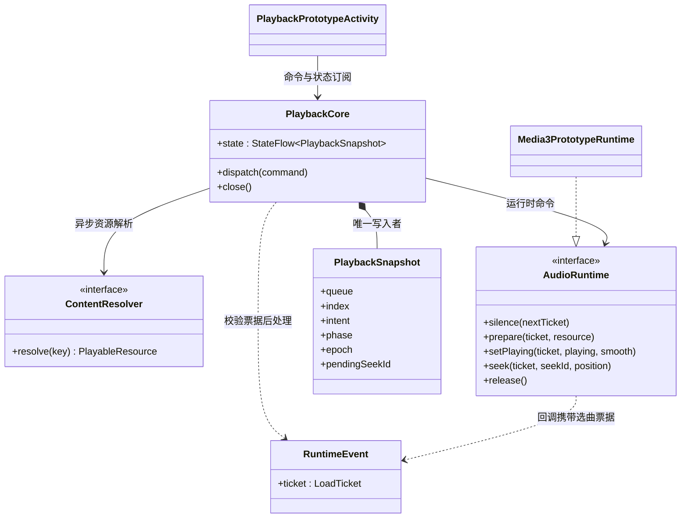
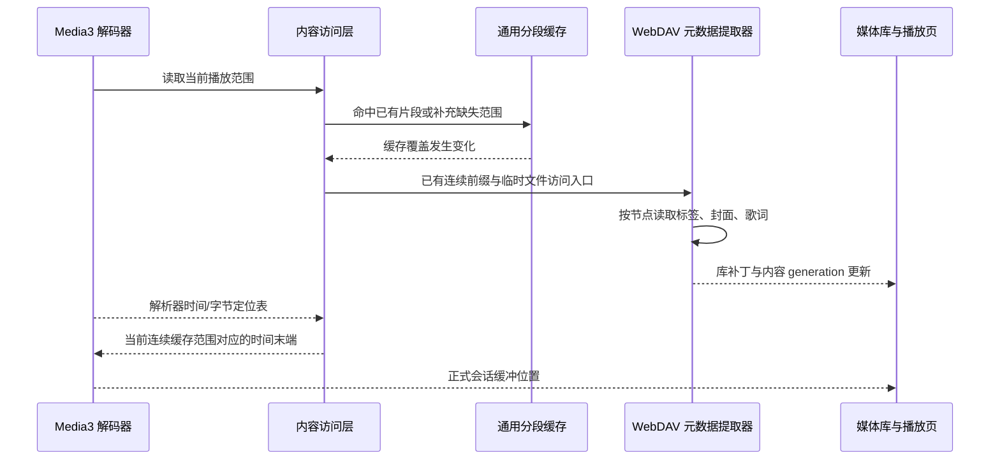
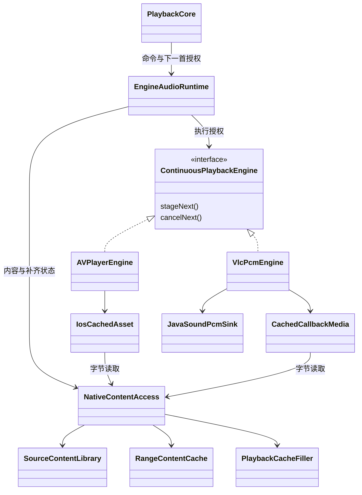

# 方案 B 实施计划与接口约定

状态：用户已认可方案 B，授权自主决策、持续推进及模拟器验证。分支：`codex/playback-core-prototype`。已完成 P4 多端核心接入和 P5 Android 首轮真机体验交付，当前补齐日常使用专项验证。下方 P0–P5 为分阶段历史记录；最新进度见文末及 [体验说明](android-experience-preview.md)。

## P0 最小闭环（历史记录）

先交付独立、可执行的共享播放核心及 Android 真实音频适配，在现有 Android 应用的 debug 专用入口验证。正式播放器、通知与播放页面保持原实现，不在尚未覆盖平台生命周期和行为契约时替换它们。这个入口不是最终产品 UI，也不宣称已完成生产迁移。

最小闭环包含：唯一队列状态、播放意图与准备状态分离、异步解析、过期结果隔离、播放/暂停、手动/自然导航、失败遍历、随机显式下一首、真实引擎定位及短渐变。交叉淡化不实现；单项 Media3 后端不宣称具备目标无缝衔接能力。

## 模块边界

| 模块/目录 | 依赖与责任 |
| --- | --- |
| `lplayer:playback-core` | 仅 Kotlin/协程；不依赖 Compose、Room、Koin、Media3、LAudio。定义稳定 TrackKey、命令、快照、Runtime 事件及纯决策逻辑。构建 Android/JVM/iOS/Web 目标。 |
| `androidApp/src/debug/.../prototype` | 临时 Android 运行时适配与手动验证入口，复用 Media3；将已有 lmedia 查询与解析映射为核心端口。仅 debug 构建包含。 |
| `androidApp/src/androidTest` | 原生 Media3 与新核心联合测试，使用测试生成的本地音频，不依赖用户媒体库或远端服务器。 |
| 现有 `lplayer` / `lmedia` | 第一阶段不改变其生产注册、存储格式与 UI；之后按报告逐项迁移。 |

## 核心接口契约

- `PlaybackCommand`：明确区分点选、手动 Next/Previous、Play/Pause、队列替换、模式、下一首意图、定位；自然结束使用独立的 Runtime 事件。点选同曲不重置状态；选曲不隐式强制播放。
- `PlaybackSnapshot`：完整去重队列、当前身份、播放意图、阶段、模式、选曲代次、定位序号、位置、时长、连续缓冲位置、失败原因、随机待播放意图；只由核心写入。
- `ContentResolver`：异步按 TrackKey 解析资源。任务被取消或迟到，不允许影响当前选曲；其内部可以保留缓存成果。
- `AudioRuntime`：命令为快速接受操作，不能等待网络或准备完成。回调包含完整选曲票据；不同曲目乃至同曲重新加载都有不同票据。原型资源为 URI，后续扩展 ContentHandle 不把来源协议搬进核心。
- `Prepared` 不等于 `Started`。核心根据最新意图授权开始，加载过程中 Pause 不取消必要的准备。
- `SeekSettled` 包含 seekId 和实际位置，不通过 UI 的固定延迟假定成功。旧定位确认不可覆盖新定位。
- 自然结束由运行时上报一次，只有核心决定继续哪首。未来添加 `armNext(plan)` 时另做契约与真实无缝验收，原型不提供虚假的 no-op 接口。
- 所有慢任务在命令循环之外；旧资源退出与新发声的顺序由运行时保障。取消解析不能阻塞新选曲。
- 恢复历史、系统焦点、设备能力及来源缓存分段属于下一阶段明确工作，不伪装成原型已支持。

## 实施顺序与验收

1. 完成契约与核心状态转换；JVM 确定性测试覆盖快切、暂停后准备/失败、失败去重、模式边界、下一首意图和定位票据。
2. 接入 debug Android 原型，提供测试音频和已有媒体库歌曲入口；关闭入口释放资源，进入前停止旧播放器，避免双路同时发声。
3. 编译 debug APK，安装到指定模拟器；运行真实解码、暂停保进度、快速切歌、准备中暂停、定位及自然结束的设备测试，并启动原型查看运行状态。
4. 根据结果修复，记录已验证与未验证项。模拟器不能验证 Hi-Res、绕过 SRC、实际 DAC 行为、音频主观手感或跨格式无缝。
5. 后续迁移 MediaLibrary/ContentAccess 的缓存优先与范围读取，再统一系统媒体会话和正式 UI 接入，最后推进 PCM 调度原型。每步保留现有播放器回退路径，但同一时刻只允许一个播放器拥有音频。

## 决策记录

- 采用 Kotlin Multiplatform 共享核心，暂不选择共享原生音频语言或解码库；先验证决策边界。
- 首个真实后端复用 Media3，只加载当前项，不用原生业务队列或原生随机规则。
- 原型界面为 debug 验证工具，正式播放页的歌词/封面/进度手感不改。迁移至正式入口之前必须补齐系统服务和视觉回归。
- 随机近期排除数原型取 3，在小队列中自动缩小；这是可调实现参数，不追加用户确认。

## 后续每步的交付边界

| 阶段 | 具体工作 | 进入下一步的条件 |
| --- | --- | --- |
| P0 本次原型 | 共享策略核心、单项 Media3 适配、已有来源解析桥、前台验证入口 | 核心行为测试与真实 Media3 测试通过，模拟器安装成功 |
| P1 内容访问 | 稳定来源身份、可缓存目录与元数据、ContentHandle 范围读取、来源禁用后的库更新 | 冷启动离线完整缓存可用；局部扫描失败不误删未访问数据；跳转后按需读取正确范围 |
| P2 正式接入 | 统一系统命令入口、音频焦点/耳机设置/生命周期、快照恢复、UI 队列投影与定位预览 | Android 系统会话和播放页回归通过；当前歌曲、歌词、进度一致；旧后端可回退 |
| P3 无缝音频链路 | 私有候选预选、提前准备、连续音频输出、编码器延迟/尾部填充处理 | 通过输出采样测量边界，覆盖同格式、跨格式、单曲循环、加载不及时与候选失效；不能用“听起来像”作为唯一验收 |
| P4 多端与输出能力 | 接入 iOS/桌面/Web 运行时；输出格式与设备能力探测；原样输出及明确回退状态 | 共享行为测试一致，各端独立报告真实输出能力；模拟器结果不能替代真机/DAC 测量 |

这些是逐步交付，不要求一次预建所有抽象。PCM 调度所需的语言、解码库与平台输出后端在 P3 做受控验证后确定；杜比/空间音频的能力与许可依赖需单独验证，不能因接口存在就宣称支持。交叉淡化与 AI 衔接不在当前实施范围。

## 本次原型依赖与事件关系（UML 类图）



完整现状/目标 UML 仍见 [架构对照报告](player-media-architecture-review.md)。该报告描述最终方向，本页描述已落地的第一步，不能把目标图中的所有能力视为现有实现。

## P0 验证结果（2026-10-26）

当时状态：最小原型已完成并安装到 `emulator-5554`。P1 的后续进展见下节；P2–P4 尚未实施。代码基线为 `8423ba72`，开发分支为 `codex/playback-core-prototype`。

- JVM 核心测试 **17/17 通过**，包括旧回调隔离、快切期间暂停、失败轮次、随机待播意图、随机上一首方向、重排保持进度、定位序号及自然/手动衔接差异。
- Android 真实 Media3 集成测试 **6/6 通过**：准备完成保持静音；播放后暂停保进度；准备期间快速选曲并暂停；连续定位确认；顺序自然结束与手动首尾导航；失败跳过与单曲循环失败停留。其中独立 Activity 检查确认页面显示 `ReadyPaused` / `Pause`，不是仅验证进程启动。
- `compileKotlinIosSimulatorArm64`、`compileKotlinWasmJs`、`assembleDebug` 和 `assembleDebugAndroidTest` 成功。
- debug APK 与测试 APK 安装成功；调试 Activity 冷启动返回 `Status: ok`。仅操作 Android 模拟器，未安装到连接的实体手机。
- 真实音频测试使用自动生成的 PCM WAV。已有媒体库入口已接通，但未据此宣称远端来源、所有格式或离线缓存已验收。
- 本次没有修改正式播放页/歌词/封面动画实现。未进行主观听感或完整正式 UI 视觉回归；Android Studio 的 Running Devices 未展示该模拟器，因此页面初始化由设备内测试断言确认，不以桌面截图代替运行结果。

构建期间存在工程已有的 Gradle 弃用等警告，未阻止上述构建。复现命令见 [模块 README](../../lplayer/playback-core/README.md)。下一阶段以 P1 内容访问契约和缓存行为测试为起点，不在共享核心中加入数据源专属补偿逻辑。

## P1 实施记录（2026-10-26）

内容访问与通用缓存已实现并接入 Android 调试原型；完整接口、实际 UML、执行顺序与限制见 [内容访问与通用缓存说明](content-access-cache.md)。本阶段不迁移正式播放 UI 和系统会话，也不实现交叉淡化。

新增内容：

- `lmedia:lmedia-content`：ContentDescriptor / ContentHandle / RangeReader / CacheStorage，以及范围缓存、原子文件存储、目录缓存和现有来源兼容桥。
- 目录与元数据缓存先于来源就绪读取，含跨来源与账户范围隔离；完整扫描可移除旧项，部分结果只更新返回项；旧刷新结果不能覆盖新状态。
- 分段音频按需读取；内容版本与 HTTP 响应验证、落盘摘要校验、同内容并发去重、缓存容量淘汰和活动句柄保护。写盘 IO 错误不阻断已取得的网络数据。
- WebDAV 声明账户/服务器/根目录范围及 ETag/修改时间版本；子目录失败保留之前完整库并报告错误，不提交残缺全量结果。
- 原型 Media3 DataSource 使用不透明 URI 和真实内容句柄，按最多 64 KiB 读取；缓存目录入口不等待来源扫描。成功来源的完整目录及当前页面元数据可持久化。

验证：内容模块 JVM 测试 **16 项**，WebDAV 回归 **18 项**，原共享播放核心 **17 项**；Android 设备测试包含新增 **4 项**内容访问场景与原有 **6 项**播放场景。最终执行结果与安装信息见下方验收记录。

决策：新缓存与旧缓存使用独立目录，不自动把旧连续前缀视为版本可靠的完整内容；未提供可靠身份/长度/版本的来源沿用原播放解析，不猜测缓存键。目录展示字段与连接凭据分离。范围缓存覆盖不是解码缓冲时间，保留 Media3 当前 bufferedPosition 的语义。

下一阶段仍为 P2：统一系统命令与正式入口、来源完整快照/元数据补丁的持续订阅、生产目录启动路径及用户缓存设置接入，再做正式播放页与歌词回归。其他来源适配、浏览器持久存储、封面/歌词文件缓存和大规模容量性能单独验收；P3 无缝音频链路尚未实施。

### P1 最终验收

| 检查 | 结果 |
| --- | --- |
| 内容模块 JVM | 16/16 通过，含真实磁盘重建测试 |
| WebDAV 来源回归 | 18/18 通过，含局部扫描失败保留旧库 |
| P0 播放核心 JVM | 17/17 通过 |
| Android 模拟器 | 10/10 通过：4 项新缓存测试 + 6 项原播放测试 |
| iOS Simulator / Wasm 共享模块 | 编译通过，未声明对应平台音频运行时已接入 |
| Android debug / androidTest APK | 构建通过，安装到 `emulator-5554` 成功 |

设备验收使用模拟器内部 HTTP 服务：分别验证精确区间读取、服务器忽略 Range 时拒绝缓存、Media3 从开头定位到 140 秒时未请求中间 3,000,000 字节位置，以及完整缓存后关闭服务器并重建存储/缓存/播放器对象仍可播放和定位。后一项是对象与磁盘重建验收，不冒充实际杀进程后全应用恢复测试；正式应用冷启动目录接入属于 P2。原型 Activity 初始化为 `ReadyPaused` / `Pause` 的检查也通过。

实际设备测试输出归档：[P1 Android 验证输出](verification/p1-android.txt)。复现命令见 [内容模块 README](../../lmedia/lmedia-content/README.md)。未触碰连接的实体手机，未运行跨格式无缝、Hi-Res 或主观听感验收。

发现并修复的验证问题：长 WAV 测试样本原先用 Int 中间乘法导致溢出，改为 Long 计算并限制测试时长；同时补充不同来源使用相同账户标识时目录隔离的回归测试。最后一轮安装与设备测试均在这些修正之后完成。


## P2 实施记录（2026-10-26）

Android 正式 `MService` 现持有共享核心；系统媒体会话、原有 `Playback` 入口与通用缓存已接通。模块边界、实际 UML、命令时序及限制见 [P2 正式播放说明](production-playback-session.md)。现有播放页、歌词、封面短过渡与定位预览沿用原组件；随机待播放增加独立意图行。未实现交叉淡化。

交付内容：

- 将原型运行时、范围 DataSource 与内容桥提升为 `lplayer` Android 正式组件，调试入口复用同一实现及独立缓存目录。
- 以 `CoreSessionPlayer` 投影完整共享队列，ExoPlayer 仅执行当前音频；移除应用侧重复的来源等待和失败遍历。
- 系统/应用命令统一，模式原子切换、随机单项待播、播完暂停、焦点抑制/暂停、耳机监听设置与历史位置恢复接入。
- 来源完整目录与补丁持续写入缓存目录；启动补充缺失元数据；缓存完整可用性、版本/停用失效、设置开关及容量变更接入正式 UI。
- Android 缓冲条以引擎连续缓冲位置为准，保留原进度拖动与歌词联动手感。

### P2 最终验收

| 检查 | 结果 |
| --- | --- |
| 共享播放核心 JVM | 20/20 通过，新增准备中恢复位置、系统抑制/暂停、Stop 后定位与播完暂停 |
| 通用内容缓存 JVM | 17/17 通过，新增运行时容量调整、活动句柄保护与淘汰可用性回撤 |
| 原有 UI/历史相关 JVM | 63/63 通过：进度/重组、歌词跟随、背景色、列表滚动、缓冲语义、历史恢复 |
| Android 模拟器 | 11/11 通过：1 个正式应用+系统会话综合场景、4 个缓存场景、6 个运行时场景 |
| 共享核心和内容模块 | iOS Simulator / Wasm 编译通过；不是这些平台音频运行时迁移完成的声明 |
| Android debug / androidTest APK | 构建并安装到 `emulator-5554` 成功，未操作实体手机 |
| 正式播放页 | 启动 MainActivity 并展开原播放页，检查实际截图中的曲目、队列与时间显示；歌词联动由既有测试回归 |

正式场景覆盖：应用替换队列并保持暂停、应用播放、系统暂停/定位、暂停时应用下一首、系统恢复/下一首、元数据归属、应用切换随机模式保持曲目和进度、随机待播替换且不提前改队列、待播实际发声后清除，以及自然单曲重复的媒体会话事件。测试生成带 RIFF 标题的独立 WAV 并导入沙盒来源，结束时恢复原队列/模式/来源启用设置并删除测试音频。

实际设备输出：[P2 Android 验证输出](verification/p2-android.txt)。正式播放页画面：[P2 播放页截图](verification/p2-player-paused.png)。

验证发现并修复：应用直接写模式设置与系统媒体命令竞争，改为所有 Android 操作都经过会话命令，设置仅保存服务确认值；补齐无专用事件的缓冲位置轮询；历史恢复不再在客户端等待来源就绪；Stop 后定位重新准备原歌曲，避免等待已释放运行时的定位回调。测试前置条件也固定来源启用、唯一音频内容及初始模式，避免来源去重或用户原有随机设置影响断言。

验证限制：模拟器拒绝应用及 shell 发送受保护的耳机断开广播，日志明确为系统 Permission Denial，因此没有把该模拟算作耳机断开验收；处理沿用 Media3 设置并映射到共享暂停事件，核心事件测试已通过，实际耳机/蓝牙/USB 断开和焦点打断仍需真机验证。截图与逻辑回归不替代主观听感或完整真实歌词素材的视觉验收。完整应用杀进程后的远端离线恢复与大库性能仍需专门验收。

P3 仍负责真实无缝链路，当前单曲后端自然切歌可能有准备间隙；P4 负责其他平台运行时。交叉淡化不在本次交付范围。

复现主要检查：

```sh
./gradlew :lplayer:playback-core:jvmTest :lmedia:lmedia-content:jvmTest
./gradlew :lplayer:jvmTest --tests 'com.lalilu.lplayer.screen.*Test' --tests 'com.lalilu.lplayer.components.PlaylistScrollPlanTest' --tests 'com.lalilu.lplayer.viewmodel.PlayerLyricContentTest' --tests 'com.lalilu.lplayer.playback.HistoryQueueRestorerTest' --tests 'com.lalilu.lplayer.playback.BufferedPositionResolverTest'
./gradlew :androidApp:assembleDebug :androidApp:assembleDebugAndroidTest
adb -s emulator-5554 install -r androidApp/build/outputs/apk/debug/androidApp-debug.apk
adb -s emulator-5554 install -r androidApp/build/outputs/apk/androidTest/debug/androidApp-debug-androidTest.apk
adb -s emulator-5554 shell am instrument -w -e class com.lalilu.lmusic.prototype.ProductionSessionDeviceTest,com.lalilu.lmusic.prototype.ContentCacheDeviceTest,com.lalilu.lmusic.prototype.PlaybackCoreDeviceTest com.lalilu.lmusic.kmp.test/androidx.test.runner.AndroidJUnitRunner
```

## P3 实施记录（2026-10-26）

实现私有候选预选、可撤销原生执行授权、真实提前缓冲、连续自然衔接，以及默认 48 kHz 体验输出。模块关系、UML 时序、输出格式和验收限制见 [P3 预加载与无缝说明](gapless-preloading.md)。原播放页、歌词、进度联动和短手动过渡组件没有修改；交叉淡化未实现。

P2 的单项音频限制在 Android 体验路径已由“当前＋一个已授权候选”的短执行窗口替代。完整业务队列仍只由共享核心持有，系统媒体会话继续投影核心快照。

### P3 最终验收

| 检查 | 结果 |
| --- | --- |
| 共享核心 JVM | 27/27 通过，含 7 项新预加载协议场景 |
| 内容缓存 JVM | 17/17 通过 |
| 播放页/歌词/历史相关 JVM | 63/63 通过 |
| Android 模拟器 | 20/20 通过：9 项 P3 测量/失效场景 + 11 项原正式会话、缓存及运行时场景 |
| iOS Simulator / Wasm 共享核心 | 编译通过；对应平台运行时仍属 P4 |
| Android debug / androidTest APK | 构建成功并安装到 `emulator-5554`；未操作连接的实体手机 |

实际音频测量：

- WAV→WAV 与 WAV→FLAC：各 96,000 字节 PCM，与合成源逐字节相同；1 个 AudioTrack，0 次中途释放，0 次欠载。当前项暂停时，候选已经 LoadCompleted，正式队列尚未变化。
- WAV→MP3→WAV：128,000 字节，确认中间 MP3 的编码延迟及尾部填充被裁剪；1 个 AudioTrack、0 次释放/欠载。没有把最终停播时的尾部行为当作歌曲间裁剪证明。
- 16 kHz 单声道→44.1 kHz 双声道：生产体验输出共 576,000 字节（3 秒、48 kHz、双声道、16-bit PCM），边界未插入零样本；1 个 AudioTrack、0 次释放/欠载。
- 单曲循环：前两轮 PCM 完整且逐字节相同，业务队列始终只有一项，执行窗口最多两项；1 个 AudioTrack、0 次释放/欠载。
- 原生候选读取失败时，当前曲完整 PCM 没有被截断；候选解析未完成和原生读取阻塞分别验证进入新曲加载状态，暂停或再次选曲不会被迟到准备结果覆盖。

归档：[完整设备结果](verification/p3-android.txt)、[音频测量值](verification/p3-audio-measurements.txt)、[正式播放页截图](verification/p3-player-paused.png)。合成编码夹具可由 [生成脚本](../../scripts/generate-p3-audio-fixtures.py) 重建。

决策与修正：使用 Media3 连续管线而非自行引入第二套解码/输出引擎；业务队列始终在共享核心。为不同采样率的连续输出固定默认体验格式，保留多声道原布局。补充原生边界确认，防止撤销与自动衔接竞争；预加载错误仅影响候选，不提前写入当前歌曲失败状态。没有加入 UI 超时推断或交叉淡化。

限制：这些是 Android 模拟器的软件输出测量，不是声卡/DAC 外部环回验收。更多编解码器、真机路由/蓝牙、多声道布局切换、长时间漂移和压力场景还需专项验证。当前默认 48 kHz 体验输出不是原样/Hi-Res 输出。候选未准备好或被极晚撤销时正确选曲和安静等待优先，不能保证无网络停顿。其他平台运行时继续进入 P4。

复现 P3 核心和音频场景见 [模块 README](../../lplayer/playback-core/README.md)。


## P4 实施记录（2026-10-26）

已把 iOS、桌面 VLC、Web 的正式 `Playback` 入口接入同一 `PlaybackCore`。新增 `CorePlayback` 投影与 `EngineAudioRuntime` 原生执行适配，移除这些入口各自的队列、随机与失败导航实现；Android 延续 P2/P3 的媒体会话及连续输出链路。保留页面、歌词、短元素过渡和约 60 ms 手动音量过渡；不实现交叉淡化。

输出能力采用“用户请求、后端支持、实际激活证明”分离模型。设置页新增原样输出请求和只读能力说明。Android 探测实际 AudioTrack 接口格式及独立的设备声明；iOS 探测会话配置和路由；其他后端无法确认的部分如实保留未知。当前未实现可验证原样输出的后端均正常回退体验模式，不更改当前歌曲/进度，不声称 SRC 旁路或 Hi-Res 已生效。

验证：核心 30＋缓存 17＋UI/歌词/历史 63＋共享适配 9 项 JVM 回归通过，另有 VLC 真实解码 5 项通过；iOS 模拟器 23 项通过；Android 模拟器 20 项通过并安装最终 APK。Wasm 编译通过，浏览器实播未验证。Android 输出报告实际为 48 kHz、双声道、PCM 16 bit，原样请求不会打断播放。

关键边界：P4 统一的是业务决策和输出状态契约；iOS/VLC/Web 仍为现有单项原生解码器，未冒充连续无缝能力。Android 的 P3 无缝能力已回归。各端独占/原样输出、其他端连续调度、硬件路由实测及非 Android 通用缓存运行时适配继续单独验收。

完整类图、顺序图、平台能力对照和证据见 [P4 多端与输出能力](multiplatform-output.md)。后续优先补齐各端连续输出与硬件测量，不进入交叉淡化。

## P5 首轮 Android 真机体验收敛（2026-10-26）

按用户“尽快达到可用并安装真机体验”的要求，近期交付优先 Android 正式入口，不等待其他端连续输出或高级音效全部完成。

本轮将正式点歌/替换列表和开始播放意图合并为一次标准媒体会话请求，消除瞬时失败时重复尝试首曲的窗口。修正未指定起点的列表替换、删除当前末项的选曲与即时 UI 队列，保留播放意图和当前进度。为当前歌曲的真实准备/缓冲增加小型等待提示，保持歌词、进度联动与元素短过渡。

验证包括 128 项相关 JVM 测试，以及 Android 21 项设备测试。正式入口场景增加后台、熄屏继续播放和系统暂停、同曲点击、队列替换及删除边界；既有无缝 PCM、预加载、缓存离线读取测试继续通过。公共代码的 iOS/Wasm 编译通过。

产物为可覆盖安装的 Android debug 体验包，位于 `build/experience/LMusic-plan-b-preview-20261026.apk`，附 SHA-256。仅安装验证模拟器；实体手机尚未覆盖安装。签名不匹配时不能通过卸载清数据来绕过，须先确认保留原数据的安装方式。

[体验说明、验收边界与下一步](android-experience-preview.md)。下一步优先吸收真机听感、耳机/蓝牙/USB 与后台限制反馈，并补完整应用冷启动、远端离线恢复及长时间运行验收，再继续其他端缓存和连续输出。交叉淡化仍不考虑。


## P5 后续：完整应用冷启动与离线恢复（2026-10-26）

此前已将 `98f7c882` 对应体验包覆盖安装到用户连接的 Android 真机，安装成功且未清除数据。本轮保留手机上的版本，只更新模拟器的测试包与验证记录，没有改动生产播放逻辑。

新增 `ColdStartDeviceTest` 和模拟器专用脚本 `scripts/test-android-cold-start.sh`。每个阶段由独立 instrumentation 进程执行，阶段之间真实 `force-stop` 应用；恢复验证额外确认进程 PID 与准备阶段不同。使用真实 MainActivity、LPlayer、MService、媒体会话及生产缓存目录，未使用原型播放器替代正式入口。

已验证：

- 三首合成 WAV 以真实 WebDAV 来源身份写入通用分段缓存和目录缓存；远端端点始终不可用。初始字节由测试直接填入缓存，HTTP 下载正确性仍由既有 ContentCacheDeviceTest 验证。
- 通过正式入口选中第二首，暂停并定位到 3.5 秒，等待正式历史记录器落盘；关闭进程后单独删除这三首的媒体库记录。
- 再次启动应用，仅凭目录缓存恢复歌曲元数据、完整队列、当前项、暂停状态和 3.5 秒进度；完整缓存的离线可用状态也被重建。
- 离线播放可推进；定位到 12 秒成功；连续 11 次切下一首后，最终项从头准备且保持暂停；恢复播放并定位临近结尾后可自然进入下一首。
- 再次关闭进程，删除当前曲的实际缓存片段但保留声称完整的索引。重启后不能把它标记为完整缓存，准备失败停留当前曲且保持暂停。用户主动播放才重试并自动进入后续可播歌曲。
- 清理阶段恢复原来源配置、启用状态、播放历史和相关设置，仅移除本轮歌曲与本轮创建的缓存文件；脚本拒绝实体设备序列号。

本轮六个跨进程阶段通过，清理后再跑正式入口设备回归 1 项通过（含播放页、队列、系统控制、后台及熄屏）。完整缓存/缺失缓存两个恢复场景均经过真实应用启动；这不是仅重新构造一个内存缓存对象。证据归档在 [冷启动设备结果](verification/cold-start-android.txt)。本轮不修改 UI、歌词、短过渡、音频输出或交叉淡化逻辑。

复现：先构建并安装 `:androidApp:assembleDebug` 和 `:androidApp:assembleDebugAndroidTest` 对应 APK 到模拟器，再运行 `scripts/test-android-cold-start.sh emulator-5554`。如果脚本遭遇外部强杀导致未清理，可在同一模拟器上单独执行 `ColdStartDeviceTest`，传入 `-e coldStartPhase cleanup`；不要在真实用户设备上运行夹具。

仍未验收：真实服务端认证失效、长时间断网再恢复、大库/长时间压力、厂商后台限制和真实蓝牙/耳机/USB 路由。自然下一首检查证明离线恢复后仍能继续调度；音频级无缝证明沿用 P3 PCM 测量，本轮没有新增硬件或主观听感结论。下一阶段先根据真机体验反馈处理实际问题，再推进非 Android 通用缓存和连续输出；交叉淡化继续暂缓。


## 真机反馈修复：WebDAV 元数据与缓存条（2026-10-26）

用户反馈全新安装 release 后，本地来源正常，WebDAV 封面/歌词不补全，缓冲条只比播放进度领先一段。定位为方案 B 接入遗漏，而非本地解码或页面过渡问题：播放字节已经进入 `RangeContentCache`，WebDAV 的提取触发与内嵌歌词读取仍依赖旧 `MediaCacheController`；同时正式会话只投影 ExoPlayer 的短期解码预读位置。

修复边界：

- `MediaDataSource.inspectCachedMedia` 是可选的缓存内容检查端口。Android 内容访问层合并缓存变化通知，提供已经缓存的连续前缀及按需临时本地文件；数据源决定是否达到提取节点。通用缓存不依赖 WebDAV 或 TagLib，不为提取另建长期音频副本。
- WebDAV 复用现有提取决策、标签存储和库补丁流程。内嵌歌词独立持久化，与外部 `.lrc` 分开；完整提取可以覆盖部分歌词。封面/歌词就绪后增加内容 generation，使库与播放页重新请求，保持既有短过渡。
- 缓存覆盖变化与访问时间更新分离，检查缓存或关闭句柄不会递归触发新的提取任务。提取工作在后台进行，来源切换或停用后拒绝迟到结果。
- `CachedBufferTimeline` 记录 Media3 原生解析器的 SeekMap，用时间定位对应的字节范围查找**当前位置所在的连续缓存片段**。完整缓存显示到时长末尾；不把分散片段相加，也不按文件字节比例猜时间。无法可靠映射的格式回退原生真实预读位置；本地来源仍不显示网络缓冲条。



验证使用全新隔离的 WebDAV 来源、真实 HTTP Range、真实 TagLib 和正式 `PlaybackContentAccess`/`Media3CoreRuntime`。合成 FLAC 自带封面和两行定时歌词，确认库标题补全、封面/歌词可读取、内容 generation 更新，旧缓存下载字节仍为零。另一项 180 秒 WAV 验证分散尾部缓存不会跨越中间空洞，以及磁盘完整时缓冲位置达到结尾，即使解码器预读仍小于 100 秒。

本轮 Android 设备回归 23 项通过（新增 2 项 + 原正式入口、无缝、预加载及缓存 21 项），随后完整应用冷启动六阶段回归也通过；缓存 JVM 18 项通过，WebDAV JVM 76 项通过、7 项需要外部服务的测试跳过；iOS Simulator/Wasm 编译通过。证据见 [WebDAV 修复验证](verification/webdav-content-bridge.txt)。没有加入交叉淡化，也未修改本地来源播放策略。

交付：修复版 release 已通过签名校验和模拟器冷启动检查，随后覆盖安装到用户真机并成功启动；未卸载、未清除数据。安装包为 `build/experience/LMusic-plan-b-release-webdav-fix-20261026.apk`，附 SHA-256，约 24 MiB，沿用本机调试证书签名的 release 构建。真实用户曲库的封面/歌词观感仍需继续收集反馈；设备自动化验证使用合成文件，没有操作用户的 WebDAV 服务端。


## 真机反馈二次修复：预加载刷新隔离与真实缓冲传递（2026-10-26）

上一轮修复恢复了 WebDAV 封面/歌词提取，但提取完成后刷新了整个来源，导致下一首预加载时当前页及队列封面一起重载。本轮将内容通知细化到歌曲：只有该歌曲的请求版本变化；真正的来源刷新仍可更新全部内容。当前歌曲流去重，歌词只订阅当前歌曲的内容版本，保留实际切歌和当前内容补全的短过渡。

真实 WebDAV 联调进一步暴露了上一轮验证盲区：MP3 已完整缓存，播放核心上报 195056 ms，但暂停时 MediaBrowser 的标准 bufferedPosition 仍为 0。Media3 在不播放且不加载时停止周期位置推送，单纯更新 CoreSessionPlayer 的缓冲字段不足以通知页面。因此正式媒体会话通过 session extras 传递实际缓存末端及对应歌曲身份；页面校验身份后读取，暂停时同样接收更新。没有伪造 loading 状态或推算固定预读时长。

缓冲条直接绘制真实范围末端，移除会造成“重新从头加载”观感的独立弹簧；播放进度、拖动歌词联动、切歌与元素短过渡保持原有策略。分段缓存仍只呈现当前位置所在的连续可播放范围，不跨越缓存空洞。无法可靠映射字节和时间的格式沿用真实解码预读作为保守回退。

联调也发现 Android WebDAV XML 解析遗漏 ENTITY_REF，文件名中的 `&amp;` 被丢弃后导致请求 404，已修复并增加回归测试。

新增可选的 `WebDavLiveBufferDeviceTest`：从通过 instrumentation 参数提供的只读服务选择小型 MP3/FLAC，通过生产内容访问层填充完整分段缓存，使用真实 MediaSession/MediaBrowser 验证暂停、定位和重新选曲均保留完整缓冲。账号和密码不写入仓库，测试不上传、不修改远端文件，只清理自身隔离的本地目录。它验证会话和缓冲数据链路，不替代真机主观听感及全部格式验收。

设备回归额外发现输出策略重置问题：Media3 清空播放窗口时会调用 SonicAudioProcessor.reset()，其内部会清除 48 kHz 目标配置，导致后续输出退回源采样率。现在在处理器重置时重新应用既定体验输出配置，并新增真实 PCM 观察测试，连续清空/重建队列后仍要求 48 kHz 双声道。保持原样输出不可用时的如实提示，没有新增独占或绕过 SRC 能力。

验证：JVM 163 项通过（播放页/歌词等 66、领域层 88、XML 9）；Android 25 项通过，包括新增输出重置测试和真实 WebDAV 会话测试，以及既有正式入口、无缝 PCM、预加载和缓存回归。真实文件为约 195 秒 MP3 与 37 秒 FLAC；不将两种格式的结果外推为全部编码/服务端均已验证。结果见 [二次修复验证](verification/webdav-refresh-buffer.txt)。

交付：最终 release 通过签名校验、模拟器覆盖安装和启动检查，并已覆盖安装到用户真机，启动成功。真机 firstInstallTime 仍为 2026-10-26 16:17:55，lastUpdateTime 为 17:43:29；未卸载、未清除数据。安装包 `build/experience/LMusic-plan-b-release-cache-refresh-20261026.apk`（25,389,400 字节），附 SHA-256；沿用本机调试证书签名的 release 构建。自动化验证通过，用户真实播放页的主观过渡观感继续由真机体验反馈确认。


## 真机反馈三次修复：恢复整曲缓存与独立选曲命令（2026-10-26）

用户明确确认新的调度优先级：当前位置附近读取优先，后台持续补齐当前整首，当前完整后才预加载下一首开头，候选成为当前歌曲后再补齐整首。之前 RangeContentCache 只保存播放器请求的范围，缺少旧实现的主动整曲下载行为；上一轮真实文件“完整缓存”测试由夹具主动读取填满，不能证明生产链路自动补齐。

本轮在通用内容模块新增 PlaybackCacheFiller，复用同一个 RangeContentCache。只为当前内容描述符持有补齐任务；前台读取取消正在等待的后台网络块，优先读取拖动落点，后台随后从该位置继续并回绕补缺。切歌取消旧任务，完成后保持当前缓存占用保护；后台失败只记录并退避重试，不改变正在播放的意图。当前完成前，Android 运行时只保存候选授权，不把候选交给原生加载器；完成后才放行已有短预加载。自然接续和手动选择都会更新缓存任务所有者。解码和缓存仍共用同一份字节，不恢复旧的双缓存链路。

点歌排查：普通完整本地队列测试正常，但“其他排队歌曲的库记录暂时缺失”可以复现用户描述的撤回现象。旧 playAudio 会把整个队列交给 onSetMediaItems 重新查询，任一无关项缺失会拒绝整次请求；UI 的乐观选曲随后被旧会话状态覆盖。改为通过媒体会话发送 source-qualified 歌曲身份和播放意图，由核心直接 Select；现有队列项无需重新查库，新插入项只解析该项。UI 只在会话确认选中后标记手动选择的过渡成因，不把短动画当作选曲成功。本轮没有读取到用户当次失败的真机日志，因此这个已复现路径不应被描述为已证明覆盖其所有触发条件。

新增验证涵盖前台读取抢占挂起的后台请求、切歌取消、背景失败重试、完整缓存复用、源库缺项时的正式点歌，以及手动/自然接续后接管缓存。真实 WebDAV 测试移除主动填满的测试代码，改为等待生产链路自动完成 MP3/FLAC 缓存，并检查暂停、拖动及再次选曲时的真实范围。

细化检查：为补齐任务加入选择版本，覆盖“清空后立刻重选同一首”的状态合并边界；通用缓存 URI 使用 64 KiB 的 progressive loading 检查粒度，避免原生默认 1 MiB 批量读取使短候选明显超出约 5 秒目标。候选不运行整曲任务；极短文件仍可能在原生必要预读内完整读入。缓存容量和预读秒数继续保留后续实测调优空间。

最终验证：JVM 98 项通过（内容缓存 22、播放页/歌词/队列等 76），Android 27 项通过，完整应用跨进程离线恢复 6 阶段通过；通用内容模块 iOS Simulator 与 Wasm 编译通过。两种接续场景中，当前 5,760,044 字节 WAV 完整后，下一首仅预读 262,144 字节，随后成为当前歌曲才完整补齐。真实 WebDAV MP3/FLAC 自动补齐验证不再由测试主动下载。证据见 [整曲缓存与选曲验证](verification/current-fill-selection.txt)。

交付：release 签名校验、模拟器覆盖安装及启动通过，随后通过无线调试覆盖安装到用户手机并成功启动。firstInstallTime 仍为 2026-10-26 16:17:55，lastUpdateTime 为 18:19:20；未卸载、未清数据。产物为 `build/experience/LMusic-plan-b-release-full-cache-selection-20261026.apk`，25,389,403 字节，附 SHA-256，沿用本机调试证书签名的 release 构建。交叉淡化未加入，播放页/歌词手感仍沿用既有组件。


## 真机反馈四次修复：补齐吞吐、缓冲平滑与歌词切歌隔离（2026-10-26）

核对当前实现及 `96b01709` 的时间轴改动后，定位三类问题：后台连续下载被拆成 64 KiB 串行请求，缓存命中也会打断后台；Seek 命令和未落地的位置事件把缓冲值直接写成 0；歌词读取了进度条用于切歌连续性的残差动画位置。

修复：

- 后台使用 1 MiB 连续范围请求，磁盘仍按不超过 64 KiB 的片段校验/读取，一批更新索引；缓存命中不等待或取消另一个句柄的网络块，缺失读取才抢占。无人工成功路径限速，错误重试仍有退避。
- 缓冲条恢复临界阻尼平滑跟随，显示值不得超过真实末端；范围收缩立即对齐，完整缓存立即显示末尾。没有以动画生成新的缓存事实。
- 新增可选运行时 `bufferedPositionAt` 查询，在 Seek 命令当下及等待期间依据目标位置的真实缓存计算末端；未知覆盖只报告目标位置，不保留不属于落点的旧范围。Android 使用同一 SeekMap/分段覆盖映射，解决先清零再恢复的一帧闪空。
- 时间轴单独提供歌词位置。曲目身份变化时新歌词先归零，并强制下一帧采样，不等待暂停状态下的低频轮询；歌词直接跟随新歌曲采样，进度条继续原短回滑。正常拖动、提交与取消拖动仍保持已有联动。

新增回归覆盖 8 MiB 内容在模拟 50 ms 请求延迟下只发出 8 次后台请求、后台网络挂起时已缓存读取直接返回、损坏/缺口不冒充命中、Seek 等待期间迟到位置事件不清空缓存、歌词切歌定位独立及拖动取消手感。真实 WebDAV 测试在 Seek 命令返回当下就检查完整范围，避免只等待最终恢复而漏掉中间闪空。

交付前冷启动检查首次出现队列恢复超时，未改代码复测通过。进一步构造延迟初始队列通知的确定性测试，确认旧通知会将已解析的恢复误标为 Cancelled 并取消准备；修复前该测试失败。现在队列观察者在恢复锁内核对通知是否仍为当前快照，过期通知不再取消新恢复。该竞态与设备超时表现一致，但缺少当次内部状态证据，不能将两者写成已证明的同一原因。冷启动夹具也加强了准备阶段的完整队列身份检查。

验证结果：JVM 117 项通过；Android 本轮较早完整回归 27/27 通过，最终构建后的完整回归为 26/27（WAV→MP3 一次多出 1408 PCM 字节），不改代码单独复测无缝套件 10/10 通过。保留该偶发失败作为待跟踪项，不宣称已彻底消除。修复恢复竞态后，跨进程冷启动/离线缓存六阶段全部通过。内容与核心模块 iOS Simulator/Wasm 编译通过。局域网真实文件经生产链路自动补齐：MP3 3.24 MB 约 311 ms，FLAC 3.91 MB 约 807 ms，计时包含准备，仅代表本次网络环境。详细证据见 [补齐速度与时间轴验证](verification/cache-speed-timeline.txt)。

交付：签名校验及模拟器 release 安装启动通过；已通过无线调试覆盖安装到用户手机并启动成功。firstInstallTime 仍为 2026-10-26 16:17:55，lastUpdateTime 为 19:02:37，未卸载或清除数据。产物 `build/experience/LMusic-plan-b-release-speed-lyrics-20261026.apk`，25,405,808 字节，SHA-256 见验证记录。

## 缓存完成误刷新与播放列表封面闪空（2026-10-26）

完整缓存会再次提取标签，原 publishRecord 无条件增加歌曲内容代次，导致即便封面/歌词字节相同也重新触发主封面、歌词和队列封面刷新。现在将库元数据补丁与内容刷新通知分开：提取器比较封面字节，内嵌歌词存储对相同字节去重，仅实际内容变化且仍为当前源身份时发送刷新；时长、complete 和提取时间仍正常入库。

SongCard 将已成功加载的 Painter 作为 AnimatedContent 的目标，加载中与失败保留上一张成功图片。新图约 180 ms 淡入，旧层保持不透明直到过渡完成；关闭 Coil 自身的二次 crossfade，图片按 64 dp 所需像素解码，共享元素和点击手势仍挂在单一外容器。保留状态以歌曲身份隔离。

验证新增分阶段相同媒体提取测试、重复歌词写入去重断言，以及 Compose 像素采样测试（加载中旧图仍在、过渡中两图混合且不透明）。

结果：31 项 JVM 测试与模拟器 5 项 WebDAV 内容桥接测试通过。像素测试在初版延迟零时长退出时检测到旧图提前消失，改为 ExitTransition.KeepUntilTransitionsFinished 后通过，确认加载中保留旧图、淡入中两层混合且不透明。证据见 [缓存完成与封面验证](verification/cache-completion-cover.txt)。

交付：签名校验通过，release 已覆盖安装到模拟器和用户手机，两端启动成功；手机原安装时间 16:17:55 保持不变，更新时间为 2026-10-26 19:24:11，未清除数据。产物 `build/experience/LMusic-plan-b-release-retained-cover-20261026.apk`，大小与 SHA-256 已记录。

## 移除副标题加载圈（2026-10-26）

按用户要求删除 PlayingHeader 的加载圈及其语义节点，移除 PlayingToolbar、手机与平板页面仅为该圈服务的参数传递与状态订阅。Playback.isLoading 及各端状态维护逻辑保留，等待后续 UI 设计。低风险纯展示删除，仅做编译和 release 安装启动验证，不新增镜像实现的测试。

验证与交付：assembleRelease 与签名校验通过；模拟器和手机覆盖安装、启动均成功。手机 firstInstallTime 保持 2026-10-26 16:17:55，lastUpdateTime 为 19:33:27，未清数据。产物 `build/experience/LMusic-plan-b-release-no-loading-ring-20261026.apk`，SHA-256 `3320d77d2a6d874245852704984ceb9f11d26d2830fafc55cf11705efae7a23a`。

## 持续推进目标：播放控制与中断稳定性（2026-10-26）

用户确认当前整体体验基本可用，本阶段优先恢复播放/暂停的可感知短音量过渡，而非进入交叉淡化。审计发现迁移后的运行时把播放/暂停与手动切歌统一为约 60 ms；旧实现使用更缓和的弹簧，迁移后虽存在音量变化，手感明显变短。

阶段目标与验收顺序：

1. 用正式会话播放器与真实 Media3 音量事件测量现状；区分播放/暂停、手动切歌、自然接续和系统强制中断的过渡策略。播放/暂停先采用约 220 ms，手动切歌维持约 60 ms，自然接续不淡化，系统强制暂停立即执行。时长是可根据真机听感调整的实现参数。
2. 统一 Android 与其他支持音量控制运行时的过渡参数，验证连续快速播放/暂停、暂停中切歌与迟到事件不覆盖最后意图。后台准备继续运行，过渡不阻塞命令。
3. 验证系统媒体会话和音频焦点中断路径，并保留“监听耳机拔出”设置。无实体路由证据时明确保留蓝牙/USB/厂商后台限制为待验收项。
4. 回归当前缓存、歌词/封面及自然无缝播放；构建 release 覆盖安装模拟器和已连接真机，保留数据，更新证据。

后续阶段继续按方案 B：真实服务端认证失效与断网恢复、长时间/大库压力 → 非 Android 通用缓存与连续输出 → 原样输出与硬件能力实测。交叉淡化、AI 衔接暂缓；加载圈保持移除。

实现：用 VolumeTransition 明确区分 UserControl / TrackChange / Immediate，由核心选择策略，Android 和通用 EngineAudioRuntime 共用基于单调时间的平滑音量函数。反向操作从当前音量继续，重复相同意图不重启正在执行的动画；取消任务不会在结束时迟到暂停。正在缓冲或被系统抑制时没有声音可淡出，暂停立即撤销原生 playWhenReady，防止焦点恢复时短暂发声。

专项检查还发现系统已经暂停后再次调用原生 pause，会在 Media3 焦点原因与用户原因之间产生重复回调。现在只在原生仍有播放意图时调用 pause，系统中断处理使用 Immediate。临时中断期间改选歌曲同时撤销自动恢复授权，明确 Play 才恢复；普通暂时中断未被用户干预时继续允许系统恢复。

基线：新增正式会话播放器测量测试在旧实现下失败，暂停仅 5 个音量变化事件，从第一个下降事件到归零约 50 ms。新实现设备事件约 200–210 ms，包含快速反向操作、末次暂停优先、暂停中选曲、系统焦点暂失/恢复及永久丢失。测量为软件/native 控制事件，不冒充声卡环回或用户主观听感。

最终验证：68 项 JVM 测试（核心 35、共享适配/界面与真实 VLC 33，包含 5 项 VLC dummy-output 原生控制）通过；31 项 Android 测试通过，包含新增 3 项控制/系统焦点测试、既有正式会话/队列/无缝及真实只读 WebDAV 缓存验证。iOS Simulator 与 Wasm 的 lplayer 编译通过。Android 临时焦点使用真实 AudioManager 请求验证恢复行为，不等同于真实来电、蓝牙或 USB 路由验收。完整证据见 [播放控制与中断验证](verification/playback-control-transitions.txt)。

交付状态：签名校验通过，同一 release 已在模拟器覆盖安装并启动成功。尝试安装手机时，原无线调试设备已断开，adb 与 mDNS 都无法发现手机；已请求重新连接，真机安装待完成，未清除数据。产物 `build/experience/LMusic-plan-b-release-control-fades-20261026.apk`（25,405,794 字节），SHA-256 已写入验证记录。

真机交付补记（2026-10-26 21:51）：用户重新通过 USB 连接手机后，已完成相同 release 的覆盖安装与启动验证（Success / Status ok）。firstInstallTime 保持 16:17:55，lastUpdateTime 为 21:51:28，数据与缓存未清除。先前连接阻塞已解除，本阶段修复、回归、模拟器与真机交付完成；实体蓝牙/USB 路由与厂商后台限制的专项验收仍按上述后续计划推进。


## Android 媒体通知封面修复（2026-10-26）

用户反馈系统媒体通知没有封面，优先于下一阶段处理。根因是通知仍将 MediaItem 直接交给 Coil，但当前没有该类型的图片适配器；正式会话元数据也没有封面，因此仅修复通知大图不足以覆盖新版 Android 的系统媒体卡片。

MService 现在观察当前歌曲和该歌曲的内容代次，复用播放页使用的 MediaCoverRequest 加载链路，在后台解码为限定尺寸的图片并写入 CoreSessionPlayer 的展示元数据。过期加载被取消，发布时再次核对歌曲身份；封面补齐不重建队列、不重新准备音频。通知直接复用会话提供的封面，每次播放/暂停刷新都保留图片，切到无封面歌曲则清除上一首图片。

新增正式服务设备测试验证 Media3 封面字节、Android 平台媒体会话 Bitmap 和已发布通知 largeIcon，并覆盖暂停/恢复、连续控制、切换到无封面歌曲再返回。测试同时发现旧合成 FLAC 中 PNG 的 IDAT CRC 无效，已修正生成器和夹具；原有字节提取测试未覆盖实际图片解码。

验证：封面专项通过；组合回归 21 项中 20 项通过，系统临时音频焦点测试在 transient suppression 处超时，未改代码单独复测控制套件 3/3 通过。保留组合执行下的焦点稳定性/测试隔离问题，不把单独通过解释为原因已确定。正式入口、10 项无缝测试、5 项 WebDAV 提取测试及选曲测试通过。证据见 [通知封面验证](verification/session-artwork.txt)。

release 签名校验通过，已覆盖安装模拟器与真机，两端启动正常；手机更新时间 22:21:00，首次安装时间仍为 16:17:55，数据与缓存保留。真机系统通知记录已确认 LMusic 通知包含 144×144 的 Bitmap 大图。产物为 build/experience/LMusic-plan-b-release-session-artwork-20261026.apk。交叉淡化未加入，下一阶段仍按既定稳定性计划推进。


## Android 日常使用稳定性：网络恢复与队列压力（2026-10-26）

用户确认通知封面效果后，继续按既定顺序推进。阶段目标为远端内容访问的断网/认证失效恢复、队列压力测试、组合焦点超时跟进，以及 release 交付；真实蓝牙/USB 路由、长期真机和其他端能力补齐继续作为后续任务。

审计发现通用 HTTP 范围读取把所有失败统一为普通异常，后台补齐对 401 等确定错误也每秒重试。已增加内容失败分类，并为 Android 通用内容加载接入有限前台重试：暂时网络故障允许恢复，认证/缺失/版本错误直接交还核心处理。后台只对临时故障逐步退避，对确定错误等待来源变化或明确重试；已有缓存继续可读，成功路径不加限速。参数和边界见 [内容访问说明](content-access-cache.md)。

新增真实套接字设备测试覆盖 503 恢复期间暂停、401 不反复请求且显式播放重试当前歌曲、seek 时连接中断后的目标位置和暂停意图、准备完成后持续故障的有限重试。新增共享测试覆盖认证失效后的缓存复用/新凭据、后台暂停与唤醒、临时故障退避、5000 首全失败只访问一轮，以及 10000 项队列中 3000 次模拟自然接续与迟到事件隔离。后两项是加速状态压力验证，不等同于真实连续运行数小时或大库 UI 性能验收。


恢复边界补充：来源刷新/前台读取成功可能先于旧失败进入等待状态；增加恢复版本核对并用确定性测试覆盖，旧失败不再吞掉刚发生的恢复信号。

焦点跟进：最终组合测试再次出现暂时焦点超时，抓取原生日志后确认测试 req=2 先于播放器 req=1 到达，播放器后续取得焦点；旧测试只等待乐观的 isPlaying，并未等待实际输出。现在测试等待 AudioTrack 开始推进的原生事件后再发起中断，同顺序组合测试通过。本次未添加生产焦点补丁，也不以此替代真实来电/蓝牙测试。

最终验证：68 项 JVM（内容模块 31、播放核心 37）通过；29 项相关 Android 设备回归通过；跨进程冷启动六阶段通过；真实只读 WebDAV MP3/FLAC 缓存回归通过；共享内容模块 iOS Simulator/Wasm 编译通过。首次冷启动缺失缓存检查的 20 秒测试窗口小于新重试时长，已按既有首次准备 30 秒上限将该处失败等待调整为 35 秒，实际失败/显式重试行为均验证通过。完整记录见 [网络恢复与压力验证](verification/network-recovery.txt)。

交付：release 签名校验、模拟器与真机覆盖安装/启动均通过。手机更新时间 2026-10-26 23:00:19，首次安装时间仍为 16:17:55，未卸载或清除数据。产物 build/experience/LMusic-plan-b-release-network-recovery-20261026.apk。本阶段网络恢复与队列压力目标完成；真实长期运行、大库 UI 性能和外设场景仍需继续推进，再逐步清理旧适配和补齐其他端能力。

## Android 资源与大队列稳定性（2026-10-26）

本阶段处理无效后台工作、大队列媒体会话开销和真实运行时资源释放。没有加入交叉淡化，也没有改变播放页、歌词、短过渡和下一首预加载策略。

缓存不可写时，原后台补齐仍将下载成功视为缓存成功，一秒内反复请求 101 次；分片已写入但索引提交失败时，还产生不在容量统计内的孤立文件。现在前台继续使用网络返回的字节，后台发现未落盘就等待明确重试或容量调整；索引失败清理未提交分片，保留原缓存。

原先每次进度更新都会重新构造整个 Media3 列表。现在复用列表投影，只在队列、选曲、时长或元数据变化时重建；异步队列命令结束后回收不再使用的歌曲元数据。释放后返回空状态，避免框架最后一次查询访问已清空的数据。

新增测试覆盖写盘与索引失败、10000 首队列进度更新、元数据刷新、随机外部下一首、替换队列后的回收，以及可指定时长的真实播放压力场景。最终数据与交付信息见 [资源与大队列验证](verification/resources-queue-soak.txt)。

后续继续推进真实外设与厂商后台场景、非 Android 通用缓存与连续输出、旧适配清理，以及原样输出的硬件能力实测。跨数小时真机运行和大库页面帧率不能由本轮短时播放器专项代替。

验证补记（2026-10-27）：内容模块 33 项 JVM 测试、32 项 Android 组合回归及跨进程冷启动六阶段通过，共享缓存 iOS Simulator/Wasm 编译通过。一万首队列的 100 次进度更新元数据查询从 110 万次降为 0；专项耗时从 1171 ms 降为 17–31 ms，不代表整页帧率。首次五分钟运行的播放、控制与句柄检查通过，但释放断言误算 Media3 进程级常驻线程而失败；核对源码并修正统计后，一分钟组合复测包括释放检查全部通过。详细失败原因和原始结果均保留在验证记录中。

正式包已保留数据覆盖安装真机并启动成功，更新时间 2026-10-27 00:02:33，首次安装时间仍为 2026-10-26 16:17:55。产物 build/experience/LMusic-plan-b-release-resources-20261026.apk（构建于 10 月 26 日）。

模拟器也已覆盖安装相同 release 并启动成功；本阶段代码、验证和双设备交付完成。

## iOS → Desktop → 遗留清理（2026-10-27）

用户明确调整顺序：先 iOS，再 Desktop，两端接入完成后清理旧架构；本轮不安排 Android 专项测试。沿用公共 PlaybackCore，交叉淡化继续暂缓。

共享边界：NativeContentAccess 接入现有 SourceContentLibrary、CatalogCache、RangeContentCache 和 PlaybackCacheFiller，统一原生端的内容身份、分段读取、缓存补齐、容量与失败恢复。系统字节桥只负责把原生读取请求转换为 ContentHandle 操作，不重新实现缓存算法。缓存开关、容量和元数据恢复可注入，正式应用沿用现有设置与数据库。

EngineAudioRuntime 接入核心已有的 NextPlan 授权，先等待当前缓存补齐再准备候选；不支持连续窗口的引擎仍走普通完成路径。ContinuousPlaybackEngine 只执行已授权的下一项、报告边界及撤销结果，不拥有随机、循环、队列或失败跳过策略。旧歌曲回调按 LoadTicket 隔离。

iOS 使用 AVAssetResourceLoader 读取公共分段缓存，AVQueuePlayer 只持有当前与候选两项；缓存完成后复用歌词/封面检查并恢复离线曲库元数据。原先依赖全局对象的 AVPlayer 状态监听迁入引擎自身生命周期。缓冲范围使用原生 loadedTimeRanges，完整缓存可直接报告整曲，不按文件大小推算播放时长。MusicKit 保持专有后端，不强行套用文件缓存。

Desktop 使用 VLC 解码、JavaSound 输出。当前歌曲和候选各有一个有界 PCM 队列，交给同一输出通道顺序播放；候选提前解码不会发声，也不会提前改变核心选曲或 UI。展示身份以输出推进到 B 的边界为准。定位保留输出通道并重新准备解码器，避免短曲已解码完毕时原生 drain 与 seek 相互等待。短音量过渡继续由共享运行时控制，不加入交叉淡化。

Desktop 体验模式当前输出为 48 kHz、16-bit、双声道；这是应用输出配置，不是物理 DAC 格式或 Hi-Res 原样输出证明。系统无法打开 PCM 输出时回退到 VLC 原生音频输出，并报告连续输出不可用。MusicKit 等专有后端不强行套用文件缓存或连续窗口。无缝能力仍保留 Unknown：固定 WAV 的样本连续性和 AVQueuePlayer 接续验证不能代表所有格式和硬件。

清理范围：删除无生产调用方的 AbstractPlayback、PlaybackEngineRouter、旧随机换位/下一首请求/失败遍历实现、Android 旧队列包装与准备协调器，以及 iOS 全局 AVPlayer 观察器。随实现删除仅验证这些旧类的测试；公共核心、正式会话及新原生引擎测试保留。UI 队列投影、编辑、历史恢复和必要的平台适配继续保留。VlcEngine 作为原生输出回退保留，不管理队列策略。

正式 Desktop 应用包验证还暴露了既有数据库相对路径问题：从 Finder 启动无法创建 `db/...`。新数据库改用 FileKit 应用数据目录并显式创建父目录；若当前工作目录中已有旧数据库，继续使用原文件，不复制、删除或分离 WAL。未知历史工作目录不会被全盘扫描迁移，已有开发数据库与新应用目录可能并存。

验证发现 Desktop 输出锁会使状态观察被连续音频写入饿死，已改用公平锁；共享层直接引用 Dispatchers.IO 导致 Wasm 编译失败，已改为平台注入调度器。最终测试和应用验证结果见 [iOS/Desktop 验证记录](verification/ios-desktop-content-output.txt)。

最终验证：90 项 JVM 测试通过（原生/Desktop 与共享适配 16、内容缓存 35、播放核心 37、正式包数据库路径 2），iOS 模拟器原生与历史恢复回归 63 项通过。Android 与 Wasm 编译一致性检查通过。完整 iOS 应用已覆盖安装并启动；macOS Desktop 可分发应用包已生成，并从非项目目录启动、确认首页与播放区域正常。应用界面检查使用空库；真实音频、定位、缓存及接续由上述原生测试覆盖，不冒充真机完整媒体库验收。

后续仍需真实 iPhone、Windows/Linux、外设输出及更多编码格式的验证。独占输出、Android SRC 旁路、杜比/空间音频和交叉淡化不在本阶段实现。Android 本轮只检查公共代码清理后的编译一致性，不运行设备专项测试。

当前原生端的 UML 类关系如下。公共核心决定“播哪首、什么时候允许切换”，平台引擎负责“如何把已授权的声音连续输出”。



## Desktop 大队列保存崩溃修复（2026-10-27）

真机体验报告 30c7edac 显示，点击歌曲后保存 155 项队列产生 10412 字符的 JSON，超过 Java Preferences 单条字符串 8192 字符上限。异常来自 HistoryStorage → KvSettingsSaver → Preferences，而非音频解码。此前原生播放测试没有覆盖正式桌面设置后端的大队列保存。

Desktop 设置入口增加大值文件存储：小值及旧设置继续走原 Preferences；大字符串写入应用数据目录，以同目录临时文件原子替换，完整保存队列，不截断或限制歌曲数量。已经使用文件的键缩小后继续更新同一记录，删除同时清除旧值。其他端沿用原设置实现。历史记录的后台写入隔离普通保存异常，保留协程取消语义，写入失败不会终止播放，后续采样仍可重试。

回归使用真实 Preferences 复现旧异常，覆盖一万项队列、文件重开、Unicode、大小值转换、删除、旧值兼容与写盘失败；同时通过正式 HistoryStorage/KvSettingsSaver 链路保存恢复队列及位置，并检查历史写入失败后继续记录。

验证完成：14 项相关 JVM 测试通过（设置大值/正式历史存储链路 2、保存失败隔离 1、历史策略 4、队列序列化 7）。重新生成 macOS 应用包并启动，使用现有 156 首歌曲库点击播放，观察进度从 00:04 推进至 00:45、歌词跟随和封面显示；读取实际落盘记录确认 156 项队列及进度均完整保存，未再次出现 Value too long。测试结束通过系统菜单暂停，保留应用和用户数据。首次打包时旧崩溃窗口仍打开，codesign 报 Operation not permitted；关闭窗口后重打包成功。本轮没有运行 Android 专项测试。

## 日常使用闭环与系统会话收敛（2026-10-27）

本轮原计划包含 Desktop、iOS、Windows/Linux 和遗留收敛四项。用户随后明确将本轮验收范围调整为 **iOS 模拟器与 macOS**，Windows 留到后续单独处理；允许推送开发分支并运行独立验证流程。没有安装或测试 iPhone 真机，没有运行 Android 专项测试，交叉淡化继续暂缓。

- 内容闭环：新增共用的真实 WebDAV 场景，从来源扫描、暂停准备、定位、切歌、随机指定下一首，到完整缓存后重建内容访问层、从目录缓存恢复元数据，并在拒绝所有内容网络请求时播放。JVM 与 iOS 运行同一行为检查，均验证 `offlineRequests=0`。这是访问层与核心重建测试，不冒充完整进程冷启动或系统离线体验。
- 系统会话：iOS 的播放/暂停指令不再依赖当前是否已发声，缓冲期间也能取消播放意图。中断使用立即暂停，耳机断开遵循现有开关；观察器和遥控回调绑定前先解绑，取消旧任务，防止重复响应。系统会话临时错误指针改为局部分配。
- 共用展示：新增 SystemMediaPresentation，iOS/macOS 复用歌曲、时长、暂停定位和播放状态采样，以及按歌曲内容代次更新的封面请求。旧歌曲封面迟到不能覆盖新歌曲；下一首内容刷新不重新请求当前封面。各端只负责转换系统对象和提交系统 API。macOS 只注册已实现的媒体命令，重新绑定会移除旧目标。
- 快速恢复：原生状态每 100 ms 采样，极短暂停/恢复可能发生在两次采样之间，原逻辑会漏报恢复并停在 Starting。共享运行时增加播放意图代次，确保每次恢复都有对应确认，不依赖采样恰好观察到暂停瞬间。
- 原生启动：VLC 初始化变为可等待并传播失败的单次任务，检查真实库和插件目录。原生链接错误转换为正常加载失败，不再将失败初始化伪装成 ready。Windows/Linux 布局检查使用同一发现策略。
- Desktop 正式入口：反馈窗口的“重新打开”直接进入播放器，避免积压的旧报告逐个阻挡启动；报告仍保留在本机。

已完成的自动验证：macOS 上 113 项 JVM/缓存/核心/正式存储测试通过；另有 1 项原生压力测试通过，连续执行 80 次下一首与 20 轮暂停、定位、恢复，结束后所有测试输出通道关闭且无 PCM 工作线程残留。iOS 模拟器 18 项相关测试通过，包括真实 WebDAV、系统中断恢复、用户操作撤销恢复、耳机监听开关、解绑、暂停定位及旧封面取消。

额外完成 Linux ARM64 容器的 6 项原生检查：样本连续性、共享核心自然切歌和暂停选曲、输出回退、缓存读取和库发现。Alpine 使用系统提供的 musl JNA；直接加载面向 glibc 的 JNA 曾导致 native crash，改用容器的 java-jna-native 后通过。此结果不能代表 Linux GUI、实体声卡或 Windows 验收。

独立工作流 `playback-platform-validation.yml` 仅运行测试和打包、保存结果，不发布应用、不触发 TestFlight 或合并。Windows/Linux 的完整应用、系统媒体控制、实体输出仍是后续工作，不能依据静态布局测试宣称全部完成。


### 本轮最终交付与实机界面检查

- iOS 模拟器：最新 Debug 应用已覆盖安装，保留数据。通过正式媒体源页面配置现有 WebDAV，显示 156 首已就绪；实际播放 Late summer waves，当前封面和下一首封面出现，进度持续推进，并自然切换到 stay tune。随后正常进程重启，持久化记录仍含 156 项队列、索引 2 和 129805 ms 位置。最后的界面自动化连接停留在失效的 Simulator 菜单，无法完成重启后的可视读数和锁屏控件操作；这些项目不宣称经过界面验收。系统中断、恢复令牌、暂停定位和旧封面取消已由模拟器内原生测试覆盖，真实锁屏、蓝牙和电话中断仍需 iPhone 验证。
- macOS：正式应用包从 `/tmp` 启动，验证不依赖项目工作目录。156 首队列恢复，点击 Winter Sparkler 后正常推进，封面与歌词显示，系统应用菜单暂停在 00:46。最终包再次启动，仍显示 Winter Sparkler、00:46 和对应歌词，保持暂停。补齐原先无动作的随机播放菜单，移除尚未实现的收藏菜单；切换模式不会重新开始当前歌曲。
- 最终 macOS 包：`composeApp/build/compose/binaries/main/app/com.lalilu.lmusic.app`。iOS 模拟器安装包：`/tmp/lmusic-ios-plan-b/Build/Products/Debug-iphonesimulator/LMusic-KMP.app`。macOS 最后打包通过，原生库发现路径测试修正后再次通过。Android 未另行测试，交叉淡化未加入。
- 首轮远端验证 [40395291366](https://github.com/cy745/LMusic-KMP/actions/runs/40395291366)：Ubuntu 在安装不存在的 `vlc-plugin-audio-output` 包时中止；Windows 运行 21 项播放器测试，其中 20 项通过，1 项因测试直接比较 Windows 路径分隔符失败。已删除无效依赖，并以规范化文件路径比较修正断言，未忽略失败测试。
- 修正提交 `d3aab4d3` 已推送，新的独立验证 [40397517769](https://github.com/cy745/LMusic-KMP/actions/runs/40397517769) 已启动，记录时尚未完成，不能记为通过。没有发布发行版、TestFlight 或合并主分支。

本轮按用户调整后的 iOS 模拟器/macOS 范围交付：共用内容访问、缓存、系统信息采样与播放状态逻辑已经收敛，两个平台的构建及相关原生自动验证通过。后续保留 Windows/Linux 完整应用与实体输出、iPhone 真机锁屏/中断，以及完全断网进程冷启动的端到端体验检查；访问层离线测试不替代这些验证。

## 曲库页面与歌曲详情收尾（2026-10-27）

状态：本轮功能与视觉调整已完成，用户已在 Android 真机反馈整体效果可用；后续按体验反馈小步优化。设计经过 Pencil MCP 画布确认，采用 A 方案。详细迭代、设计文件与预览见 [曲库实施记录](../ui/library-refresh/README.md)。本轮不改动既定队列规则，不增加交叉淡化。

### 最终交付

- 共用 LibraryEmptyState：主文字 18sp Bold，副文字 bodySmall + 主题文字色 60%，操作入口粗体。左对齐并拉开标题区留白；点击、悬停、键盘聚焦仅改变文字与箭头颜色，没有胶囊背景或波纹，保留按钮语义及 48dp 点击高度。
- 首页分区、歌曲、专辑、歌手、歌单列表与详情统一使用该组件。无库内容引导媒体源，搜索无结果清除当前搜索，无歌单引导创建，空歌单引导浏览歌曲，“我喜欢”使用收藏说明，添加到歌单页无可选项时提供新建入口。
- 歌曲详情持续订阅关联歌手与专辑；按 artistName 的既有拆分规则和原始顺序匹配实体，使用 bodySmall 淡色文字、4dp 分隔间距，无边框或箭头，独立跳转歌手详情。CoverTitleHeader 的 movableContent 读取最新 lambda，解决迟到元数据不更新的问题。
- Smart Bar 使用稳定的 Dynamic Action。下一首操作遵守已有播放核心规则，随机模式使用向上插入图标、其他模式向下；播放操作只在当前歌曲上切换播放/暂停，其他歌曲选择并播放，展示依照播放意图而非是否已经发声。紧凑模式仅图标，更多面板显示文字。
- 收藏和单曲添加歌单动作由 lplaylist 通过 Koin 提供，lhome 不直接依赖歌单模块。收藏保留来源限定的 playbackId，首次创建喜欢歌单后可立即保存第一首。收藏请求处理期间禁用重复提交并反馈普通保存错误，协程取消仍传播。
- Release 图标修复：自定义裁剪会原地删除合并产物，因此强制该任务完整执行并禁止复用其已裁剪缓存，避免新增图标引用后缺资源闪退；加入最终 APK 图标检查脚本。代价是 Release 每次重新合并这部分资源。

### 代码 review

已审阅本轮全部生产代码差异与新增测试，未发现阻塞提交的缺陷。重点检查：

1. 状态所有权：动作列表不会因播放/暂停或模式变化重新生成；动态内容自行订阅状态。加载中仍能通过播放意图表达暂停操作。
2. 身份与顺序：播放和收藏使用来源限定身份；歌手 UI 顺序不依赖数据库返回顺序，保留正确实体 ID；普通列表选曲语义不被详情页的显式播放按钮改变。
3. 异步更新：歌手/专辑订阅不中止于首次空值；标题移动内容使用最新内容，避免静态捕获旧数据。
4. 模块边界：UI 通用外观集中在 component，歌单写入留在 lplaylist，播放语义留在 lplayer；页面只负责文案、上下文与入口路由。
5. 空状态：检查无数据/搜索两类分支、清除搜索事件和页面路由；空专辑/歌手详情禁用无效批量操作；专辑网格标题跨整行。
6. 发布资源：检查图标默认颜色解析、裁剪任务行为和校验脚本。此前新增引用恢复、删除临时引用后重新裁剪的增量验证已完成。

本次收尾只整理记录和提交，不新增用户未确认的交互改动。后续可改善但不阻塞本轮：文案目前沿用项目中文硬编码方式，尚未全面资源化；部分页面初始加载使用空集合，尚未建立统一的 loading/empty 区分；字体放大、长歌手名换行、键盘与屏幕阅读器仍需要专门可访问性验收。

### 验证范围

- 最近一次 Android Release 构建成功，最终 APK 的 45 个引用图标存在；已多轮保留数据覆盖安装同一 Android 真机，用户反馈效果基本可用。
- 本次收尾复跑曲库 JVM UI、收藏仓库、播放控制回归；具体结果在本节末尾追加。
- 实际 Compose 手机宽度截图覆盖空曲库、搜索无结果与无胶囊背景入口；Pencil 可编辑稿与旧版 macOS 体验截图留存并注明版本性质。
- 没有清空用户手机数据逐页制造所有空状态；最新共享 UI 未重新在 iOS、Windows/Linux 上进行端到端体验验证。这些限制不应由 JVM 测试或设计稿代替。

收尾验证结果：`lhome:jvmTest` 6 项（呈现 4、动态动作 1、最近添加 1），`lplaylist:jvmTest` 1 项收藏仓库回归，`lplayer:jvmTest --tests com.lalilu.lplayer.core.CorePlaybackTest` 12 项，共 19 项通过，零失败、零跳过。`scripts/verify-compose-icons.py` 校验 45 个引用图标通过，`git diff --check` 通过。当前分支本地提交，不包含推送、发布或合并。

## 历史记录与统计改进（2026-10-27，进行中）

用户反馈最近播放/历史没有更新。本轮优先修复跨端统一记录，再确认历史页设计与统计卡片。口径、迁移策略和设计见 [历史记录实施记录](../ui/listening-history/README.md)。

- 已接入共享核心有序状态观察；Android 移除旧监听，iOS/Web 补齐 tracker 注入，桌面沿用共享入口。
- 新记录器串行处理、单调时钟计时，实际开始即更新最近播放；30 秒/短曲完整播放资格与收听时长分离。
- 增加每日时长/有效次数统计表及数据库 5→6 迁移，旧历史保留，不编造旧每日数据。
- Pencil 已完成第三版，按反馈删除顶部返回入口、对照既有曲库样式微调，并加入按日收听时长柱状图；设计待确认，历史页 UI 尚未实施，尚未安装真机。
- 下一步：设计确认后接入四张统计卡片、周期筛选与日期分组；验证数据库统计与真实播放联动，再覆盖安装 Android 真机体验。

### 历史页实施与真机回归反馈（2026-10-27）

历史 UI、柱状图、Smart Bar 长按清除已实现，测试与模拟器完整播放链路通过；最终 Release 已保留数据安装到真机。**用户反馈真机仍不记录、清除无效，本阶段未验收完成，正在定位。** 用户同时要求回看旧版即时记录行为并调整 30 秒门槛；已核对旧实现是切换即预保存、最近播放立即显示，后续修复应保留这个反馈速度，不能将其与收听时长计量混为一谈。详见历史记录实施记录末尾。


### 即时记录与刷新修复（2026-10-27 16:24）

按用户最新口径：主动切歌立即更新最近播放，实际开始播放即计一次，取消 30 秒门槛，暂停恢复不重复计数。增加仓库写入后的显式查询刷新和分页失效，回归覆盖自动数据库通知缺失的情况。记录器/核心合计 54 项测试及独立 Room 刷新测试通过，Release 保留数据覆盖安装真机。模拟器确认短时播放计次、清除后 UI/数据库归零；真机诊断确认新记录持续保存。页面刷新与清除的真机验收仍待用户反馈，暂不关闭此问题。详细证据见历史记录实施记录。


### 历史页生命周期修复（2026-10-27 16:36）

已复现并定位 HistoryVM 全局单例被页面生命周期销毁后重复使用，导致数据库已更新但页面与首页最近播放停在旧状态。改为 @KoinViewModel 按页面拥有者创建，仓库/记录器继续共享。生成注册回归、Room 刷新回归、Release 构建及图标检查通过；模拟器旧包复现失败路径，新包多次退出重进后记录、清除、清除后恢复播放均刷新正常。16:36:03 保留数据覆盖安装手机，待用户体验确认。详情及前后截图见历史记录实施记录。


### 历史记录与统计收尾验收（2026-10-27）

用户确认 Android 真机记录和清除正常，退出再进入仍能正常更新，本轮功能验收通过。统一核心记录、最近播放即时反馈、实际播放立即计次、真实收听时长、四张统计卡片、周/月柱状图、日期分组筛选、Smart Bar 长按清除及历史页生命周期修复均已完成。代码 review 覆盖记录/查询/UI 生命周期和迁移，未发现阻止提交的问题。旧统计不回填缺失的每日数据；其他端的完整设备验收仍独立进行。最终验证与设计证据见 [历史记录实施记录](../ui/listening-history/README.md)。


### 历史统计 iOS / macOS 补充验收（2026-10-27）

iOS 模拟器和 macOS 打包应用完成实际播放、最近播放反馈、计次/计时、暂停、退出重进、周/月切换、长按清除、清除后新记录验证，均正常。macOS 使用独立数据库副本，原数据保留；iOS 使用已有模拟器本地测试歌曲。发现月图双位日期标签截断并修正。iOS 历史/日期原生测试 12 项及共享 JVM 历史测试 14 项通过。具体截图与限制见 [历史记录实施记录](../ui/listening-history/README.md)。


### 播放页队列滑动与原生元素动画（2026-10-28）

已实现左滑下一首播放、右滑移出队列，复用现有播放模式规则；横纵主方向锁避免嵌套滚动冲突。设置下一首保持浏览位置；点击歌曲通过稳定 key 重定位显示队列，保留封面组合与原生元素渐隐/上移动画。删除了整表清空和整表平移补偿。用户 Android 真机验收无闪烁、动画正常。

提交前 review 补充修复随机待播放行在过渡期间变化造成布局等待停住的边界问题；标题/封面正常更新链路保持有效。测试覆盖像素渐隐、中间位移、组合存活、部分裁切、最后一行、方向锁和队列模式规则。详细实现、验证范围与收尾结果见 [队列滑动记录](../ui/queue-swipe/README.md)。

收尾：review 发现的附加待播放行计数问题已修复；64 项相关回归零失败，Android/iOS Simulator 编译通过。历史月图标签修正和队列滑动/原生元素动画分两笔整理提交。最新 review 小修复未重新安装真机，用户此前验收的主体动画实现保留。


### 共享封面交接统一处理（2026-10-28）

全项目梳理共享封面入口，改为携带真实加载结果的完整 MemoryCache.Key，删除各入口推算 key 与单独字符串参数。统一详情占位/封面刷新保留策略，修正每日推荐分类路由、歌曲到专辑的错误共享标识、重复卡片身份和部分陈旧 remember。真实共享容器逐帧验证冷加载占位及刷新连续性通过，完整验证结果见 [共享封面记录](../ui/shared-cover-transitions/README.md)。

共享封面收尾：17 项相关回归通过，Desktop/iOS 编译与 Android Release 构建通过，45 个图标检查通过，已保留数据覆盖安装 Android 真机。首次进入转场前五帧的像素测试通过，真机观感待用户验收。

### 2026-10-28 歌曲详情转场布局稳定性

- 修复共享封面已稳定后，专辑/歌手仓库查询晚到导致专辑卡片插入、歌手行高度变化的问题。
- 详情首帧使用路由歌曲快照生成同 ID 的专辑和歌手展示，仓库返回后原位更新，保持原有共享封面效果；真实元数据变更仍正常生效。
- lhome JVM 8 项测试通过，新增专辑/歌手查询前后几何一致与元数据更新回归；Android Release 构建通过，45 个图标校验通过。
- 细节见 `docs/ui/shared-cover-transitions/README.md`。
- Android 真机保留数据覆盖安装返回 Success，实际转场手感待用户体验确认。

### 2026-10-29 统一曲库加载与空结果展示

- 将“尚未完成查询”与“查询完成但为空”分离，使用共用 LibraryQueryState/LibraryQueryContent；原始 SortResult 保持纯排序结果。
- 接入歌曲、专辑、歌手、歌单列表与详情，添加歌单弹窗，首页最近添加/每日推荐/最近播放；历史页复用同样的轻量等待提示。
- 快速读取只保留页面框架；超过约 300ms 才显示淡色等待文字，结果到达立即更新。首次查询期间不显示零数量，标题按同字体排版保留高度。
- 搜索按完整参数取消旧请求，聚合搜索三类结果按同一个关键词一起更新；已有结果刷新时保留内容与列表实例。
- 增加首帧空态抑制、延迟提示、查询取消、失败重试回归。lhome 12 项与 lsearch 4 项测试通过。
- 详情与视觉稿见 `docs/ui/library-loading/README.md`。
- 最终 Android Release 构建通过，45 个图标校验通过；真机 `install -r` 返回 Success，保留原有数据，包含本轮 SeekBar 松手振动修复。

### 2026-10-29 提交与合并前 review

- Review 覆盖共享封面缓存交接、详情首帧布局、歌手字号与间距、统一曲库加载状态和 SeekBar 松手振动修复。
- 修复查询状态错误边界：查询构造失败与上游参数流失败现在均可重试完整链路，并新增回归。
- 最终验证：component 37、lhome 13、lsearch 4、lplayer 手势与队列 12，共 66 项测试零失败；Desktop 与 iOS Simulator 全应用编译通过；git diff --check 通过。
- 合并方式：当前分支包含 dev 的全部提交，使用快进合并，保留原有提交历史；推送后检查同一提交 SHA 的 Snapshot Build。

### 2026-10-29 Snapshot CI 实际产物核查

- 首次 dev CI：`40775673504`（`c03bee07`）。Android 真实打包成功；桌面 job 的 success 不能作为打包证据，旧工作流 `continue-on-error` 加缺少产物只警告掩盖了失败。
- Linux ProGuard 实际读取到的 JDK 标准库数量为 0，使用的是 Gradle 守护进程 JDK 25。桌面打包改为显式使用与 JVM 目标一致的 JDK 21 工具链，让 ProGuard/jlink/jpackage 使用完整的同一 JDK。
- macOS 公证任务在序列化配置缓存时访问了 Compose 插件不再支持的 ascProvider 属性。仅公证命令关闭配置缓存，保留已有签名与 teamID 配置。
- 移除三个桌面打包步骤的 continue-on-error，产物上传设置 if-no-files-found: error；后续以实际安装包存在且任务成功为准。
- 本地使用修复后的 JDK 21 完整运行 `:composeApp:proguardReleaseJars` 成功（3m3s），标准库从 0 恢复为 28040 个类，优化、预校验与输出均完成。

### 2026-10-29 dev 合并与 CI 收尾结果

- UI 与查询状态 review 修复提交 `c03bee07`，快进合并到 dev 并推送；桌面打包与严格产物检查修复提交 `afa0d74d`，已推送 dev。
- 最终代码验证运行：[Snapshot Build 40778214046](https://github.com/cy745/LMusic-KMP/actions/runs/40778214046)，构建提交 `afa0d74d4ac3a1df6ddd78d8506d36edf4537946`。Android、iOS + TestFlight、macOS、Windows、Linux 五个任务全部成功。
- 已核对所有实际安装包均存在，Snapshot Release 发布成功：APK、IPA、DMG、MSI、DEB；[下载页](https://github.com/cy745/LMusic-KMP/releases/tag/snapshot)。macOS 签名/公证与 iOS TestFlight 步骤通过。
- 整轮工作流仍显示 failure，唯一失败任务是独立的 Deploy Snapshot Page：Vercel CLI 报 `You do not have access to the specified account` / `scope-not-accessible`。该账号访问问题在此前运行也存在，不影响以上打包、安装包下载及 TestFlight。
- Vercel 已连接账号可读取现有 `lmusic-snapshot` 项目；这不能证明 GitHub Actions 使用的独立 token 有相同权限。需核对仓库 Actions 的 VERCEL_TOKEN、VERCEL_ORG_ID、VERCEL_SNAPSHOT_PROJECT_ID 是否对应同一项目所属账号并具有部署权限，再仅重跑失败的下载页任务。未读取或输出密钥，也未通过忽略失败来改变 CI 结果。
- 本节为文档补记，不改变已验证代码；工作流忽略纯文档推送，无需重复整套打包。

### 2026-10-29 TestFlight 109 两类闪退修复

- 真实模拟器复现旋转时访问已卸载布局坐标，局部 bounds 动画改为按实际父容器身份重建，并保留其他导航/播放状态。
- 用户提供的 TestFlight 报告定位缓存淘汰的 Kotlin/Native EntryRef 失效；改为快照 key/value 对后淘汰，覆盖多首淘汰和冷启动恢复。
- 两条缓存回归在修复前原生失败、修复后通过；旋转回归也完成修复前失败/修复后通过验证。83 项相关测试通过；iOS 模拟器与真机 Debug 构建成功。已保留数据覆盖安装 iPhone 并确认启动，真机旋转/连续播放体验待反馈，歌词不同步尚未定位。
- 详见 [TestFlight 109 修复记录](verification/ios-testflight-109/README.md)。

### 2026-10-29 iOS WebDAV 缓存重播时间对齐验证

- 用户真机确认两类闪退已消失；补充所有 WebDAV 歌曲完整缓存重播后存在数秒歌词偏快，seek 后偏移可能改变，输出为扬声器。
- 候选改动为缓存及普通 URL 资源请求精确时间索引，seek 使用零前后容差；不添加歌词补偿。真实音乐听感的根因与修复效果仍待验证。
- 在已启动模拟器使用原生播放测试脚本通过 68 项测试，覆盖完整缓存离线重开、多次前后 seek、归零和暂停，PCM 测试不能替代真实音乐同步验收。具体证据持续记录于 TestFlight 109 修复记录。

### 2026-10-29 iOS FLAC 歌词渐增偏移根因修复

- 使用用户指定《四面楚歌》做完整解码和真机音频 tap 对照，确认缓存字节与歌词均正确；实际 Kotlin 资源路径的 seek 音频内容与报告时间不符。
- 根因是精确索引选项经 Kotlin Map 布尔值桥接后没有被 AVFoundation 采用；显式 NSNumber 或类工厂同样无效。改用保留原生布尔值的 Foundation 字典，缓存及普通 URL 统一通过 preciseAudioAsset 创建，仍使用零 seek 容差。
- 新增自生成 FLAC 的精确索引状态、真实有效时长和完整缓存离线重开测试；移除全部临时诊断入口后的 70 项原生回归通过。
- 真机最终修复包的声音对照待完成：设备弹出“无法验证 App，需要互联网连接以验证开发者”，本地签名与描述文件有效；未卸载、未清除用户数据。等待设备恢复开发者验证。

#### 2026-10-29 iOS 启动卡死修复跟进

真机系统报告发现 AVPlayerItem 同步等待和 Coil 错误堆栈符号化两条主线程阻塞路径。资源加载迁至独立串行队列；预期的封面不可用错误不再生成重复堆栈。70 项 iOS 原生测试通过，包含主线程无法处理回调时的缓存 WAV/FLAC 准备断言。保留精确时间轴修复，真机覆盖安装与体验验证进行中。

真机修复包已构建成功（`/tmp/lmusic-hang-fix-build.log`）；14:06 覆盖安装因无线调试连接超时失败（Network.NWError 60），不能视为已安装。已请求 USB 连接并解锁，后续继续保留数据安装与验证。

14:09 用户解锁后重试覆盖安装成功，数据保留；`devicectl --console` 启动成功，进程 PID 63870。证据：`/tmp/lmusic-hang-fixed-install-retry.log`、`/tmp/lmusic-hang-fixed-launch.log`。尚需真机交互与 WebDAV 歌词同步体验确认，进程存在不等同于界面无卡顿。

#### 2026-10-29 提交前 review 与用户确认

用户已确认最终真机包歌词定位正常；此前旋转/播放闪退已确认消失。review 覆盖资源队列生命周期、精确时间桥接、缓存淘汰及布局身份同步，无阻止提交的问题。最终原生播放回归 70 项通过，先前缓存/布局回归 83 项通过；临时诊断入口已移除。当前在 dev 分支，整理提交并推送。后续处理快照下载页 Vercel scope-not-accessible，不将其误判为客户端打包失败。
