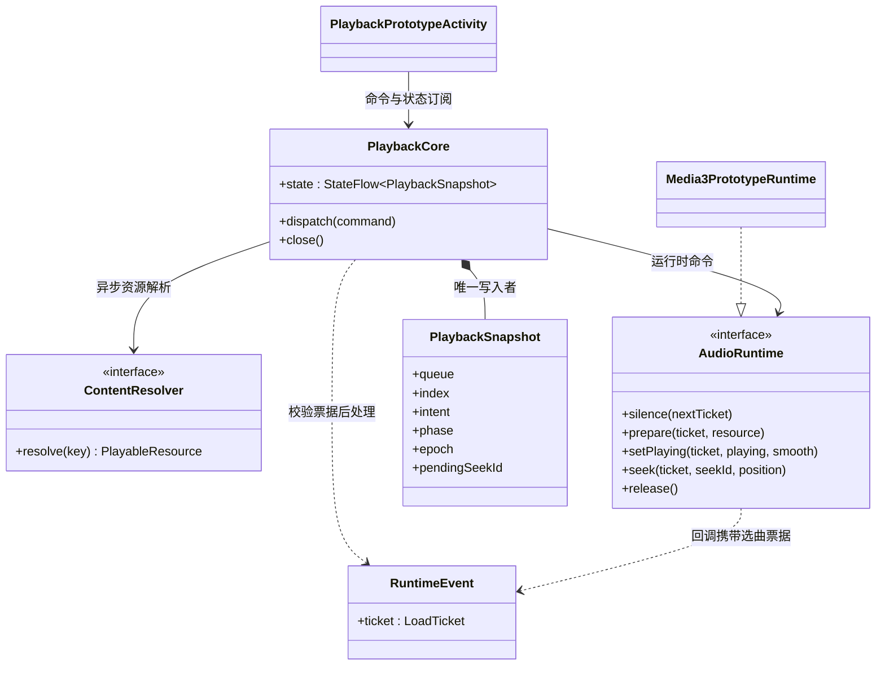

# 方案 B 实施计划与接口约定

状态：用户已认可方案 B，授权自主决策、持续推进及模拟器验证。分支：`codex/playback-core-prototype`。

## 本次最小闭环

先交付独立、可执行的共享播放核心及 Android 真实音频适配，在现有 Android 应用的 debug 专用入口验证。正式播放器、通知与播放页面保持原实现，不在尚未覆盖平台生命周期和行为契约时替换它们。这个入口不是最终产品 UI，也不宣称已完成生产迁移。

最小闭环包含：唯一队列状态、播放意图与准备状态分离、异步解析、过期结果隔离、播放/暂停、手动/自然导航、失败遍历、随机显式下一首、真实引擎定位及短渐变。交叉淡化不实现；单项 Media3 后端不宣称具备目标无缝衔接能力。

## 模块边界

| 模块/目录 | 依赖与责任 |
| --- | --- |
| `lplayer:playback-core` | 仅 Kotlin/协程；不依赖 Compose、Room、Koin、Media3、LAudio。定义稳定 TrackKey、命令、快照、Runtime 事件及纯决策逻辑。构建 Android/JVM/iOS/Web 目标。 |
| `androidApp/src/debug/.../prototype` | 临时 Android 运行时适配与手动验证入口，复用 Media3；将已有 lmedia 查询与解析映射为核心端口。仅 debug 构建包含。 |
| `androidApp/src/androidTest` | 原生 Media3 与新核心联合测试，使用测试生成的本地音频，不依赖用户媒体库或远端服务器。 |
| 现有 `lplayer` / `lmedia` | 第一阶段不改变其生产注册、存储格式与 UI；之后按报告逐项迁移。 |

## 核心接口契约

- `PlaybackCommand`：明确区分点选、手动 Next/Previous、Play/Pause、队列替换、模式、下一首意图、定位；自然结束使用独立的 Runtime 事件。点选同曲不重置状态；选曲不隐式强制播放。
- `PlaybackSnapshot`：完整去重队列、当前身份、播放意图、阶段、模式、选曲代次、定位序号、位置、时长、连续缓冲位置、失败原因、随机待播放意图；只由核心写入。
- `ContentResolver`：异步按 TrackKey 解析资源。任务被取消或迟到，不允许影响当前选曲；其内部可以保留缓存成果。
- `AudioRuntime`：命令为快速接受操作，不能等待网络或准备完成。回调包含完整选曲票据；不同曲目乃至同曲重新加载都有不同票据。原型资源为 URI，后续扩展 ContentHandle 不把来源协议搬进核心。
- `Prepared` 不等于 `Started`。核心根据最新意图授权开始，加载过程中 Pause 不取消必要的准备。
- `SeekSettled` 包含 seekId 和实际位置，不通过 UI 的固定延迟假定成功。旧定位确认不可覆盖新定位。
- 自然结束由运行时上报一次，只有核心决定继续哪首。未来添加 `armNext(plan)` 时另做契约与真实无缝验收，原型不提供虚假的 no-op 接口。
- 所有慢任务在命令循环之外；旧资源退出与新发声的顺序由运行时保障。取消解析不能阻塞新选曲。
- 恢复历史、系统焦点、设备能力及来源缓存分段属于下一阶段明确工作，不伪装成原型已支持。

## 实施顺序与验收

1. 完成契约与核心状态转换；JVM 确定性测试覆盖快切、暂停后准备/失败、失败去重、模式边界、下一首意图和定位票据。
2. 接入 debug Android 原型，提供测试音频和已有媒体库歌曲入口；关闭入口释放资源，进入前停止旧播放器，避免双路同时发声。
3. 编译 debug APK，安装到指定模拟器；运行真实解码、暂停保进度、快速切歌、准备中暂停、定位及自然结束的设备测试，并启动原型查看运行状态。
4. 根据结果修复，记录已验证与未验证项。模拟器不能验证 Hi-Res、绕过 SRC、实际 DAC 行为、音频主观手感或跨格式无缝。
5. 后续迁移 MediaLibrary/ContentAccess 的缓存优先与范围读取，再统一系统媒体会话和正式 UI 接入，最后推进 PCM 调度原型。每步保留现有播放器回退路径，但同一时刻只允许一个播放器拥有音频。

## 决策记录

- 采用 Kotlin Multiplatform 共享核心，暂不选择共享原生音频语言或解码库；先验证决策边界。
- 首个真实后端复用 Media3，只加载当前项，不用原生业务队列或原生随机规则。
- 原型界面为 debug 验证工具，正式播放页的歌词/封面/进度手感不改。迁移至正式入口之前必须补齐系统服务和视觉回归。
- 随机近期排除数原型取 3，在小队列中自动缩小；这是可调实现参数，不追加用户确认。

## 后续每步的交付边界

| 阶段 | 具体工作 | 进入下一步的条件 |
| --- | --- | --- |
| P0 本次原型 | 共享策略核心、单项 Media3 适配、已有来源解析桥、前台验证入口 | 核心行为测试与真实 Media3 测试通过，模拟器安装成功 |
| P1 内容访问 | 稳定来源身份、可缓存目录与元数据、ContentHandle 范围读取、来源禁用后的库更新 | 冷启动离线完整缓存可用；局部扫描失败不误删未访问数据；跳转后按需读取正确范围 |
| P2 正式接入 | 统一系统命令入口、音频焦点/耳机设置/生命周期、快照恢复、UI 队列投影与定位预览 | Android 系统会话和播放页回归通过；当前歌曲、歌词、进度一致；旧后端可回退 |
| P3 无缝音频链路 | 私有候选预选、提前准备、连续音频输出、编码器延迟/尾部填充处理 | 通过输出采样测量边界，覆盖同格式、跨格式、单曲循环、加载不及时与候选失效；不能用“听起来像”作为唯一验收 |
| P4 多端与输出能力 | 接入 iOS/桌面/Web 运行时；输出格式与设备能力探测；原样输出及明确回退状态 | 共享行为测试一致，各端独立报告真实输出能力；模拟器结果不能替代真机/DAC 测量 |

这些是逐步交付，不要求一次预建所有抽象。PCM 调度所需的语言、解码库与平台输出后端在 P3 做受控验证后确定；杜比/空间音频的能力与许可依赖需单独验证，不能因接口存在就宣称支持。交叉淡化与 AI 衔接不在当前实施范围。

## 本次原型依赖与事件关系（UML 类图）

完整现状/目标 UML 仍见 [架构对照报告](player-media-architecture-review.md)。该报告描述最终方向，本页描述已落地的第一步，不能把目标图中的所有能力视为现有实现。

## P0 验证结果（2026-10-26）

状态：最小原型已完成并安装到 `emulator-5554`；P1–P4 尚未实施。代码基线为 `8423ba72`，开发分支为 `codex/playback-core-prototype`。

- JVM 核心测试 **17/17 通过**，包括旧回调隔离、快切期间暂停、失败轮次、随机待播意图、随机上一首方向、重排保持进度、定位序号及自然/手动衔接差异。
- Android 真实 Media3 集成测试 **6/6 通过**：准备完成保持静音；播放后暂停保进度；准备期间快速选曲并暂停；连续定位确认；顺序自然结束与手动首尾导航；失败跳过与单曲循环失败停留。其中独立 Activity 检查确认页面显示 `ReadyPaused` / `Pause`，不是仅验证进程启动。
- `compileKotlinIosSimulatorArm64`、`compileKotlinWasmJs`、`assembleDebug` 和 `assembleDebugAndroidTest` 成功。
- debug APK 与测试 APK 安装成功；调试 Activity 冷启动返回 `Status: ok`。仅操作 Android 模拟器，未安装到连接的实体手机。
- 真实音频测试使用自动生成的 PCM WAV。已有媒体库入口已接通，但未据此宣称远端来源、所有格式或离线缓存已验收。
- 本次没有修改正式播放页/歌词/封面动画实现。未进行主观听感或完整正式 UI 视觉回归；Android Studio 的 Running Devices 未展示该模拟器，因此页面初始化由设备内测试断言确认，不以桌面截图代替运行结果。

构建期间存在工程已有的 Gradle 弃用等警告，未阻止上述构建。复现命令见 [模块 README](../../lplayer/playback-core/README.md)。下一阶段以 P1 内容访问契约和缓存行为测试为起点，不在共享核心中加入数据源专属补偿逻辑。
