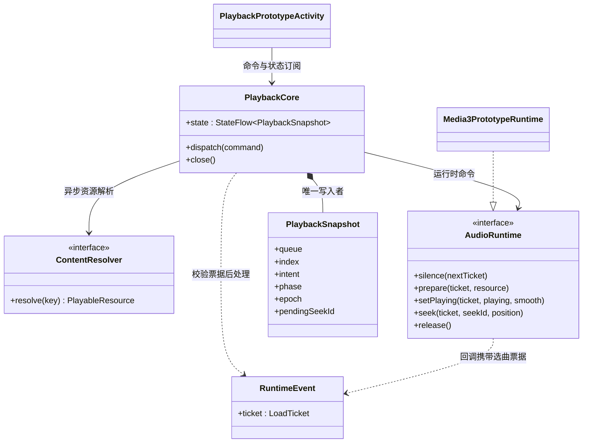

# 方案 B 实施计划与接口约定

状态：用户已认可方案 B，授权自主决策、持续推进及模拟器验证。分支：`codex/playback-core-prototype`。已完成 P4 多端核心接入和 P5 Android 首轮真机体验交付，当前补齐日常使用专项验证。下方 P0–P5 为分阶段历史记录；最新进度见文末及 [体验说明](android-experience-preview.md)。

## P0 最小闭环（历史记录）

先交付独立、可执行的共享播放核心及 Android 真实音频适配，在现有 Android 应用的 debug 专用入口验证。正式播放器、通知与播放页面保持原实现，不在尚未覆盖平台生命周期和行为契约时替换它们。这个入口不是最终产品 UI，也不宣称已完成生产迁移。

最小闭环包含：唯一队列状态、播放意图与准备状态分离、异步解析、过期结果隔离、播放/暂停、手动/自然导航、失败遍历、随机显式下一首、真实引擎定位及短渐变。交叉淡化不实现；单项 Media3 后端不宣称具备目标无缝衔接能力。

## 模块边界

| 模块/目录 | 依赖与责任 |
| --- | --- |
| `lplayer:playback-core` | 仅 Kotlin/协程；不依赖 Compose、Room、Koin、Media3、LAudio。定义稳定 TrackKey、命令、快照、Runtime 事件及纯决策逻辑。构建 Android/JVM/iOS/Web 目标。 |
| `androidApp/src/debug/.../prototype` | 临时 Android 运行时适配与手动验证入口，复用 Media3；将已有 lmedia 查询与解析映射为核心端口。仅 debug 构建包含。 |
| `androidApp/src/androidTest` | 原生 Media3 与新核心联合测试，使用测试生成的本地音频，不依赖用户媒体库或远端服务器。 |
| 现有 `lplayer` / `lmedia` | 第一阶段不改变其生产注册、存储格式与 UI；之后按报告逐项迁移。 |

## 核心接口契约

- `PlaybackCommand`：明确区分点选、手动 Next/Previous、Play/Pause、队列替换、模式、下一首意图、定位；自然结束使用独立的 Runtime 事件。点选同曲不重置状态；选曲不隐式强制播放。
- `PlaybackSnapshot`：完整去重队列、当前身份、播放意图、阶段、模式、选曲代次、定位序号、位置、时长、连续缓冲位置、失败原因、随机待播放意图；只由核心写入。
- `ContentResolver`：异步按 TrackKey 解析资源。任务被取消或迟到，不允许影响当前选曲；其内部可以保留缓存成果。
- `AudioRuntime`：命令为快速接受操作，不能等待网络或准备完成。回调包含完整选曲票据；不同曲目乃至同曲重新加载都有不同票据。原型资源为 URI，后续扩展 ContentHandle 不把来源协议搬进核心。
- `Prepared` 不等于 `Started`。核心根据最新意图授权开始，加载过程中 Pause 不取消必要的准备。
- `SeekSettled` 包含 seekId 和实际位置，不通过 UI 的固定延迟假定成功。旧定位确认不可覆盖新定位。
- 自然结束由运行时上报一次，只有核心决定继续哪首。未来添加 `armNext(plan)` 时另做契约与真实无缝验收，原型不提供虚假的 no-op 接口。
- 所有慢任务在命令循环之外；旧资源退出与新发声的顺序由运行时保障。取消解析不能阻塞新选曲。
- 恢复历史、系统焦点、设备能力及来源缓存分段属于下一阶段明确工作，不伪装成原型已支持。

## 实施顺序与验收

1. 完成契约与核心状态转换；JVM 确定性测试覆盖快切、暂停后准备/失败、失败去重、模式边界、下一首意图和定位票据。
2. 接入 debug Android 原型，提供测试音频和已有媒体库歌曲入口；关闭入口释放资源，进入前停止旧播放器，避免双路同时发声。
3. 编译 debug APK，安装到指定模拟器；运行真实解码、暂停保进度、快速切歌、准备中暂停、定位及自然结束的设备测试，并启动原型查看运行状态。
4. 根据结果修复，记录已验证与未验证项。模拟器不能验证 Hi-Res、绕过 SRC、实际 DAC 行为、音频主观手感或跨格式无缝。
5. 后续迁移 MediaLibrary/ContentAccess 的缓存优先与范围读取，再统一系统媒体会话和正式 UI 接入，最后推进 PCM 调度原型。每步保留现有播放器回退路径，但同一时刻只允许一个播放器拥有音频。

## 决策记录

- 采用 Kotlin Multiplatform 共享核心，暂不选择共享原生音频语言或解码库；先验证决策边界。
- 首个真实后端复用 Media3，只加载当前项，不用原生业务队列或原生随机规则。
- 原型界面为 debug 验证工具，正式播放页的歌词/封面/进度手感不改。迁移至正式入口之前必须补齐系统服务和视觉回归。
- 随机近期排除数原型取 3，在小队列中自动缩小；这是可调实现参数，不追加用户确认。

## 后续每步的交付边界

| 阶段 | 具体工作 | 进入下一步的条件 |
| --- | --- | --- |
| P0 本次原型 | 共享策略核心、单项 Media3 适配、已有来源解析桥、前台验证入口 | 核心行为测试与真实 Media3 测试通过，模拟器安装成功 |
| P1 内容访问 | 稳定来源身份、可缓存目录与元数据、ContentHandle 范围读取、来源禁用后的库更新 | 冷启动离线完整缓存可用；局部扫描失败不误删未访问数据；跳转后按需读取正确范围 |
| P2 正式接入 | 统一系统命令入口、音频焦点/耳机设置/生命周期、快照恢复、UI 队列投影与定位预览 | Android 系统会话和播放页回归通过；当前歌曲、歌词、进度一致；旧后端可回退 |
| P3 无缝音频链路 | 私有候选预选、提前准备、连续音频输出、编码器延迟/尾部填充处理 | 通过输出采样测量边界，覆盖同格式、跨格式、单曲循环、加载不及时与候选失效；不能用“听起来像”作为唯一验收 |
| P4 多端与输出能力 | 接入 iOS/桌面/Web 运行时；输出格式与设备能力探测；原样输出及明确回退状态 | 共享行为测试一致，各端独立报告真实输出能力；模拟器结果不能替代真机/DAC 测量 |

这些是逐步交付，不要求一次预建所有抽象。PCM 调度所需的语言、解码库与平台输出后端在 P3 做受控验证后确定；杜比/空间音频的能力与许可依赖需单独验证，不能因接口存在就宣称支持。交叉淡化与 AI 衔接不在当前实施范围。

## 本次原型依赖与事件关系（UML 类图）



完整现状/目标 UML 仍见 [架构对照报告](player-media-architecture-review.md)。该报告描述最终方向，本页描述已落地的第一步，不能把目标图中的所有能力视为现有实现。

## P0 验证结果（2026-10-26）

当时状态：最小原型已完成并安装到 `emulator-5554`。P1 的后续进展见下节；P2–P4 尚未实施。代码基线为 `8423ba72`，开发分支为 `codex/playback-core-prototype`。

- JVM 核心测试 **17/17 通过**，包括旧回调隔离、快切期间暂停、失败轮次、随机待播意图、随机上一首方向、重排保持进度、定位序号及自然/手动衔接差异。
- Android 真实 Media3 集成测试 **6/6 通过**：准备完成保持静音；播放后暂停保进度；准备期间快速选曲并暂停；连续定位确认；顺序自然结束与手动首尾导航；失败跳过与单曲循环失败停留。其中独立 Activity 检查确认页面显示 `ReadyPaused` / `Pause`，不是仅验证进程启动。
- `compileKotlinIosSimulatorArm64`、`compileKotlinWasmJs`、`assembleDebug` 和 `assembleDebugAndroidTest` 成功。
- debug APK 与测试 APK 安装成功；调试 Activity 冷启动返回 `Status: ok`。仅操作 Android 模拟器，未安装到连接的实体手机。
- 真实音频测试使用自动生成的 PCM WAV。已有媒体库入口已接通，但未据此宣称远端来源、所有格式或离线缓存已验收。
- 本次没有修改正式播放页/歌词/封面动画实现。未进行主观听感或完整正式 UI 视觉回归；Android Studio 的 Running Devices 未展示该模拟器，因此页面初始化由设备内测试断言确认，不以桌面截图代替运行结果。

构建期间存在工程已有的 Gradle 弃用等警告，未阻止上述构建。复现命令见 [模块 README](../../lplayer/playback-core/README.md)。下一阶段以 P1 内容访问契约和缓存行为测试为起点，不在共享核心中加入数据源专属补偿逻辑。

## P1 实施记录（2026-10-26）

内容访问与通用缓存已实现并接入 Android 调试原型；完整接口、实际 UML、执行顺序与限制见 [内容访问与通用缓存说明](content-access-cache.md)。本阶段不迁移正式播放 UI 和系统会话，也不实现交叉淡化。

新增内容：

- `lmedia:lmedia-content`：ContentDescriptor / ContentHandle / RangeReader / CacheStorage，以及范围缓存、原子文件存储、目录缓存和现有来源兼容桥。
- 目录与元数据缓存先于来源就绪读取，含跨来源与账户范围隔离；完整扫描可移除旧项，部分结果只更新返回项；旧刷新结果不能覆盖新状态。
- 分段音频按需读取；内容版本与 HTTP 响应验证、落盘摘要校验、同内容并发去重、缓存容量淘汰和活动句柄保护。写盘 IO 错误不阻断已取得的网络数据。
- WebDAV 声明账户/服务器/根目录范围及 ETag/修改时间版本；子目录失败保留之前完整库并报告错误，不提交残缺全量结果。
- 原型 Media3 DataSource 使用不透明 URI 和真实内容句柄，按最多 64 KiB 读取；缓存目录入口不等待来源扫描。成功来源的完整目录及当前页面元数据可持久化。

验证：内容模块 JVM 测试 **16 项**，WebDAV 回归 **18 项**，原共享播放核心 **17 项**；Android 设备测试包含新增 **4 项**内容访问场景与原有 **6 项**播放场景。最终执行结果与安装信息见下方验收记录。

决策：新缓存与旧缓存使用独立目录，不自动把旧连续前缀视为版本可靠的完整内容；未提供可靠身份/长度/版本的来源沿用原播放解析，不猜测缓存键。目录展示字段与连接凭据分离。范围缓存覆盖不是解码缓冲时间，保留 Media3 当前 bufferedPosition 的语义。

下一阶段仍为 P2：统一系统命令与正式入口、来源完整快照/元数据补丁的持续订阅、生产目录启动路径及用户缓存设置接入，再做正式播放页与歌词回归。其他来源适配、浏览器持久存储、封面/歌词文件缓存和大规模容量性能单独验收；P3 无缝音频链路尚未实施。

### P1 最终验收

| 检查 | 结果 |
| --- | --- |
| 内容模块 JVM | 16/16 通过，含真实磁盘重建测试 |
| WebDAV 来源回归 | 18/18 通过，含局部扫描失败保留旧库 |
| P0 播放核心 JVM | 17/17 通过 |
| Android 模拟器 | 10/10 通过：4 项新缓存测试 + 6 项原播放测试 |
| iOS Simulator / Wasm 共享模块 | 编译通过，未声明对应平台音频运行时已接入 |
| Android debug / androidTest APK | 构建通过，安装到 `emulator-5554` 成功 |

设备验收使用模拟器内部 HTTP 服务：分别验证精确区间读取、服务器忽略 Range 时拒绝缓存、Media3 从开头定位到 140 秒时未请求中间 3,000,000 字节位置，以及完整缓存后关闭服务器并重建存储/缓存/播放器对象仍可播放和定位。后一项是对象与磁盘重建验收，不冒充实际杀进程后全应用恢复测试；正式应用冷启动目录接入属于 P2。原型 Activity 初始化为 `ReadyPaused` / `Pause` 的检查也通过。

实际设备测试输出归档：[P1 Android 验证输出](verification/p1-android.txt)。复现命令见 [内容模块 README](../../lmedia/lmedia-content/README.md)。未触碰连接的实体手机，未运行跨格式无缝、Hi-Res 或主观听感验收。

发现并修复的验证问题：长 WAV 测试样本原先用 Int 中间乘法导致溢出，改为 Long 计算并限制测试时长；同时补充不同来源使用相同账户标识时目录隔离的回归测试。最后一轮安装与设备测试均在这些修正之后完成。


## P2 实施记录（2026-10-26）

Android 正式 `MService` 现持有共享核心；系统媒体会话、原有 `Playback` 入口与通用缓存已接通。模块边界、实际 UML、命令时序及限制见 [P2 正式播放说明](production-playback-session.md)。现有播放页、歌词、封面短过渡与定位预览沿用原组件；随机待播放增加独立意图行。未实现交叉淡化。

交付内容：

- 将原型运行时、范围 DataSource 与内容桥提升为 `lplayer` Android 正式组件，调试入口复用同一实现及独立缓存目录。
- 以 `CoreSessionPlayer` 投影完整共享队列，ExoPlayer 仅执行当前音频；移除应用侧重复的来源等待和失败遍历。
- 系统/应用命令统一，模式原子切换、随机单项待播、播完暂停、焦点抑制/暂停、耳机监听设置与历史位置恢复接入。
- 来源完整目录与补丁持续写入缓存目录；启动补充缺失元数据；缓存完整可用性、版本/停用失效、设置开关及容量变更接入正式 UI。
- Android 缓冲条以引擎连续缓冲位置为准，保留原进度拖动与歌词联动手感。

### P2 最终验收

| 检查 | 结果 |
| --- | --- |
| 共享播放核心 JVM | 20/20 通过，新增准备中恢复位置、系统抑制/暂停、Stop 后定位与播完暂停 |
| 通用内容缓存 JVM | 17/17 通过，新增运行时容量调整、活动句柄保护与淘汰可用性回撤 |
| 原有 UI/历史相关 JVM | 63/63 通过：进度/重组、歌词跟随、背景色、列表滚动、缓冲语义、历史恢复 |
| Android 模拟器 | 11/11 通过：1 个正式应用+系统会话综合场景、4 个缓存场景、6 个运行时场景 |
| 共享核心和内容模块 | iOS Simulator / Wasm 编译通过；不是这些平台音频运行时迁移完成的声明 |
| Android debug / androidTest APK | 构建并安装到 `emulator-5554` 成功，未操作实体手机 |
| 正式播放页 | 启动 MainActivity 并展开原播放页，检查实际截图中的曲目、队列与时间显示；歌词联动由既有测试回归 |

正式场景覆盖：应用替换队列并保持暂停、应用播放、系统暂停/定位、暂停时应用下一首、系统恢复/下一首、元数据归属、应用切换随机模式保持曲目和进度、随机待播替换且不提前改队列、待播实际发声后清除，以及自然单曲重复的媒体会话事件。测试生成带 RIFF 标题的独立 WAV 并导入沙盒来源，结束时恢复原队列/模式/来源启用设置并删除测试音频。

实际设备输出：[P2 Android 验证输出](verification/p2-android.txt)。正式播放页画面：[P2 播放页截图](verification/p2-player-paused.png)。

验证发现并修复：应用直接写模式设置与系统媒体命令竞争，改为所有 Android 操作都经过会话命令，设置仅保存服务确认值；补齐无专用事件的缓冲位置轮询；历史恢复不再在客户端等待来源就绪；Stop 后定位重新准备原歌曲，避免等待已释放运行时的定位回调。测试前置条件也固定来源启用、唯一音频内容及初始模式，避免来源去重或用户原有随机设置影响断言。

验证限制：模拟器拒绝应用及 shell 发送受保护的耳机断开广播，日志明确为系统 Permission Denial，因此没有把该模拟算作耳机断开验收；处理沿用 Media3 设置并映射到共享暂停事件，核心事件测试已通过，实际耳机/蓝牙/USB 断开和焦点打断仍需真机验证。截图与逻辑回归不替代主观听感或完整真实歌词素材的视觉验收。完整应用杀进程后的远端离线恢复与大库性能仍需专门验收。

P3 仍负责真实无缝链路，当前单曲后端自然切歌可能有准备间隙；P4 负责其他平台运行时。交叉淡化不在本次交付范围。

复现主要检查：

```sh
./gradlew :lplayer:playback-core:jvmTest :lmedia:lmedia-content:jvmTest
./gradlew :lplayer:jvmTest --tests 'com.lalilu.lplayer.screen.*Test' --tests 'com.lalilu.lplayer.components.PlaylistScrollPlanTest' --tests 'com.lalilu.lplayer.viewmodel.PlayerLyricContentTest' --tests 'com.lalilu.lplayer.playback.HistoryQueueRestorerTest' --tests 'com.lalilu.lplayer.playback.BufferedPositionResolverTest'
./gradlew :androidApp:assembleDebug :androidApp:assembleDebugAndroidTest
adb -s emulator-5554 install -r androidApp/build/outputs/apk/debug/androidApp-debug.apk
adb -s emulator-5554 install -r androidApp/build/outputs/apk/androidTest/debug/androidApp-debug-androidTest.apk
adb -s emulator-5554 shell am instrument -w -e class com.lalilu.lmusic.prototype.ProductionSessionDeviceTest,com.lalilu.lmusic.prototype.ContentCacheDeviceTest,com.lalilu.lmusic.prototype.PlaybackCoreDeviceTest com.lalilu.lmusic.kmp.test/androidx.test.runner.AndroidJUnitRunner
```

## P3 实施记录（2026-10-26）

实现私有候选预选、可撤销原生执行授权、真实提前缓冲、连续自然衔接，以及默认 48 kHz 体验输出。模块关系、UML 时序、输出格式和验收限制见 [P3 预加载与无缝说明](gapless-preloading.md)。原播放页、歌词、进度联动和短手动过渡组件没有修改；交叉淡化未实现。

P2 的单项音频限制在 Android 体验路径已由“当前＋一个已授权候选”的短执行窗口替代。完整业务队列仍只由共享核心持有，系统媒体会话继续投影核心快照。

### P3 最终验收

| 检查 | 结果 |
| --- | --- |
| 共享核心 JVM | 27/27 通过，含 7 项新预加载协议场景 |
| 内容缓存 JVM | 17/17 通过 |
| 播放页/歌词/历史相关 JVM | 63/63 通过 |
| Android 模拟器 | 20/20 通过：9 项 P3 测量/失效场景 + 11 项原正式会话、缓存及运行时场景 |
| iOS Simulator / Wasm 共享核心 | 编译通过；对应平台运行时仍属 P4 |
| Android debug / androidTest APK | 构建成功并安装到 `emulator-5554`；未操作连接的实体手机 |

实际音频测量：

- WAV→WAV 与 WAV→FLAC：各 96,000 字节 PCM，与合成源逐字节相同；1 个 AudioTrack，0 次中途释放，0 次欠载。当前项暂停时，候选已经 LoadCompleted，正式队列尚未变化。
- WAV→MP3→WAV：128,000 字节，确认中间 MP3 的编码延迟及尾部填充被裁剪；1 个 AudioTrack、0 次释放/欠载。没有把最终停播时的尾部行为当作歌曲间裁剪证明。
- 16 kHz 单声道→44.1 kHz 双声道：生产体验输出共 576,000 字节（3 秒、48 kHz、双声道、16-bit PCM），边界未插入零样本；1 个 AudioTrack、0 次释放/欠载。
- 单曲循环：前两轮 PCM 完整且逐字节相同，业务队列始终只有一项，执行窗口最多两项；1 个 AudioTrack、0 次释放/欠载。
- 原生候选读取失败时，当前曲完整 PCM 没有被截断；候选解析未完成和原生读取阻塞分别验证进入新曲加载状态，暂停或再次选曲不会被迟到准备结果覆盖。

归档：[完整设备结果](verification/p3-android.txt)、[音频测量值](verification/p3-audio-measurements.txt)、[正式播放页截图](verification/p3-player-paused.png)。合成编码夹具可由 [生成脚本](../../scripts/generate-p3-audio-fixtures.py) 重建。

决策与修正：使用 Media3 连续管线而非自行引入第二套解码/输出引擎；业务队列始终在共享核心。为不同采样率的连续输出固定默认体验格式，保留多声道原布局。补充原生边界确认，防止撤销与自动衔接竞争；预加载错误仅影响候选，不提前写入当前歌曲失败状态。没有加入 UI 超时推断或交叉淡化。

限制：这些是 Android 模拟器的软件输出测量，不是声卡/DAC 外部环回验收。更多编解码器、真机路由/蓝牙、多声道布局切换、长时间漂移和压力场景还需专项验证。当前默认 48 kHz 体验输出不是原样/Hi-Res 输出。候选未准备好或被极晚撤销时正确选曲和安静等待优先，不能保证无网络停顿。其他平台运行时继续进入 P4。

复现 P3 核心和音频场景见 [模块 README](../../lplayer/playback-core/README.md)。


## P4 实施记录（2026-10-26）

已把 iOS、桌面 VLC、Web 的正式 `Playback` 入口接入同一 `PlaybackCore`。新增 `CorePlayback` 投影与 `EngineAudioRuntime` 原生执行适配，移除这些入口各自的队列、随机与失败导航实现；Android 延续 P2/P3 的媒体会话及连续输出链路。保留页面、歌词、短元素过渡和约 60 ms 手动音量过渡；不实现交叉淡化。

输出能力采用“用户请求、后端支持、实际激活证明”分离模型。设置页新增原样输出请求和只读能力说明。Android 探测实际 AudioTrack 接口格式及独立的设备声明；iOS 探测会话配置和路由；其他后端无法确认的部分如实保留未知。当前未实现可验证原样输出的后端均正常回退体验模式，不更改当前歌曲/进度，不声称 SRC 旁路或 Hi-Res 已生效。

验证：核心 30＋缓存 17＋UI/歌词/历史 63＋共享适配 9 项 JVM 回归通过，另有 VLC 真实解码 5 项通过；iOS 模拟器 23 项通过；Android 模拟器 20 项通过并安装最终 APK。Wasm 编译通过，浏览器实播未验证。Android 输出报告实际为 48 kHz、双声道、PCM 16 bit，原样请求不会打断播放。

关键边界：P4 统一的是业务决策和输出状态契约；iOS/VLC/Web 仍为现有单项原生解码器，未冒充连续无缝能力。Android 的 P3 无缝能力已回归。各端独占/原样输出、其他端连续调度、硬件路由实测及非 Android 通用缓存运行时适配继续单独验收。

完整类图、顺序图、平台能力对照和证据见 [P4 多端与输出能力](multiplatform-output.md)。后续优先补齐各端连续输出与硬件测量，不进入交叉淡化。

## P5 首轮 Android 真机体验收敛（2026-10-26）

按用户“尽快达到可用并安装真机体验”的要求，近期交付优先 Android 正式入口，不等待其他端连续输出或高级音效全部完成。

本轮将正式点歌/替换列表和开始播放意图合并为一次标准媒体会话请求，消除瞬时失败时重复尝试首曲的窗口。修正未指定起点的列表替换、删除当前末项的选曲与即时 UI 队列，保留播放意图和当前进度。为当前歌曲的真实准备/缓冲增加小型等待提示，保持歌词、进度联动与元素短过渡。

验证包括 128 项相关 JVM 测试，以及 Android 21 项设备测试。正式入口场景增加后台、熄屏继续播放和系统暂停、同曲点击、队列替换及删除边界；既有无缝 PCM、预加载、缓存离线读取测试继续通过。公共代码的 iOS/Wasm 编译通过。

产物为可覆盖安装的 Android debug 体验包，位于 `build/experience/LMusic-plan-b-preview-20261026.apk`，附 SHA-256。仅安装验证模拟器；实体手机尚未覆盖安装。签名不匹配时不能通过卸载清数据来绕过，须先确认保留原数据的安装方式。

[体验说明、验收边界与下一步](android-experience-preview.md)。下一步优先吸收真机听感、耳机/蓝牙/USB 与后台限制反馈，并补完整应用冷启动、远端离线恢复及长时间运行验收，再继续其他端缓存和连续输出。交叉淡化仍不考虑。


## P5 后续：完整应用冷启动与离线恢复（2026-10-26）

此前已将 `98f7c882` 对应体验包覆盖安装到用户连接的 Android 真机，安装成功且未清除数据。本轮保留手机上的版本，只更新模拟器的测试包与验证记录，没有改动生产播放逻辑。

新增 `ColdStartDeviceTest` 和模拟器专用脚本 `scripts/test-android-cold-start.sh`。每个阶段由独立 instrumentation 进程执行，阶段之间真实 `force-stop` 应用；恢复验证额外确认进程 PID 与准备阶段不同。使用真实 MainActivity、LPlayer、MService、媒体会话及生产缓存目录，未使用原型播放器替代正式入口。

已验证：

- 三首合成 WAV 以真实 WebDAV 来源身份写入通用分段缓存和目录缓存；远端端点始终不可用。初始字节由测试直接填入缓存，HTTP 下载正确性仍由既有 ContentCacheDeviceTest 验证。
- 通过正式入口选中第二首，暂停并定位到 3.5 秒，等待正式历史记录器落盘；关闭进程后单独删除这三首的媒体库记录。
- 再次启动应用，仅凭目录缓存恢复歌曲元数据、完整队列、当前项、暂停状态和 3.5 秒进度；完整缓存的离线可用状态也被重建。
- 离线播放可推进；定位到 12 秒成功；连续 11 次切下一首后，最终项从头准备且保持暂停；恢复播放并定位临近结尾后可自然进入下一首。
- 再次关闭进程，删除当前曲的实际缓存片段但保留声称完整的索引。重启后不能把它标记为完整缓存，准备失败停留当前曲且保持暂停。用户主动播放才重试并自动进入后续可播歌曲。
- 清理阶段恢复原来源配置、启用状态、播放历史和相关设置，仅移除本轮歌曲与本轮创建的缓存文件；脚本拒绝实体设备序列号。

本轮六个跨进程阶段通过，清理后再跑正式入口设备回归 1 项通过（含播放页、队列、系统控制、后台及熄屏）。完整缓存/缺失缓存两个恢复场景均经过真实应用启动；这不是仅重新构造一个内存缓存对象。证据归档在 [冷启动设备结果](verification/cold-start-android.txt)。本轮不修改 UI、歌词、短过渡、音频输出或交叉淡化逻辑。

复现：先构建并安装 `:androidApp:assembleDebug` 和 `:androidApp:assembleDebugAndroidTest` 对应 APK 到模拟器，再运行 `scripts/test-android-cold-start.sh emulator-5554`。如果脚本遭遇外部强杀导致未清理，可在同一模拟器上单独执行 `ColdStartDeviceTest`，传入 `-e coldStartPhase cleanup`；不要在真实用户设备上运行夹具。

仍未验收：真实服务端认证失效、长时间断网再恢复、大库/长时间压力、厂商后台限制和真实蓝牙/耳机/USB 路由。自然下一首检查证明离线恢复后仍能继续调度；音频级无缝证明沿用 P3 PCM 测量，本轮没有新增硬件或主观听感结论。下一阶段先根据真机体验反馈处理实际问题，再推进非 Android 通用缓存和连续输出；交叉淡化继续暂缓。
