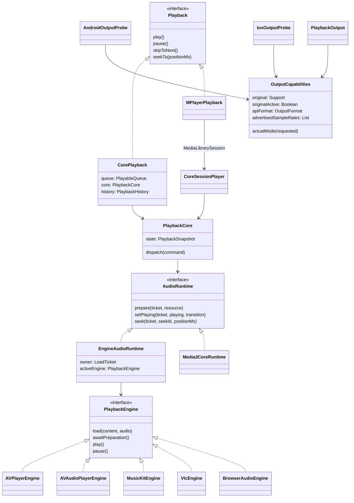
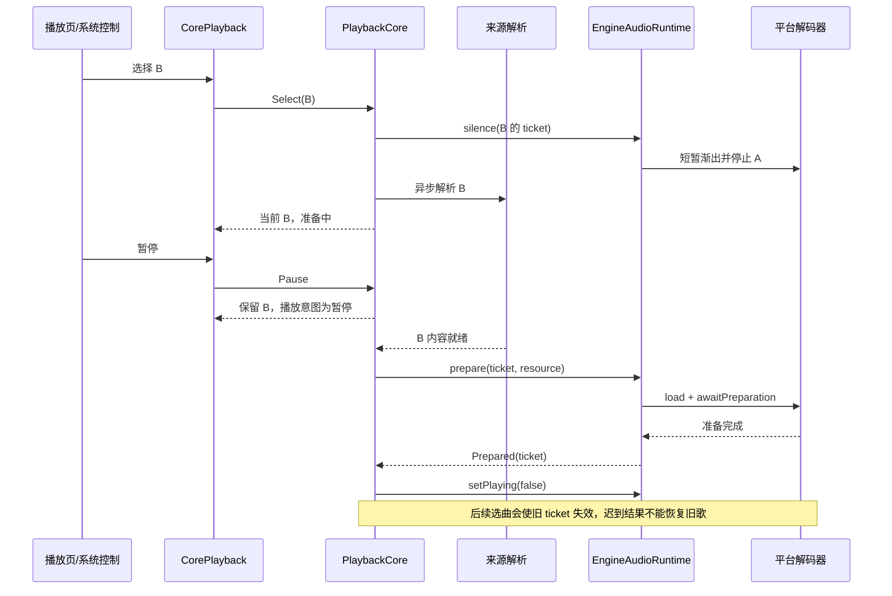
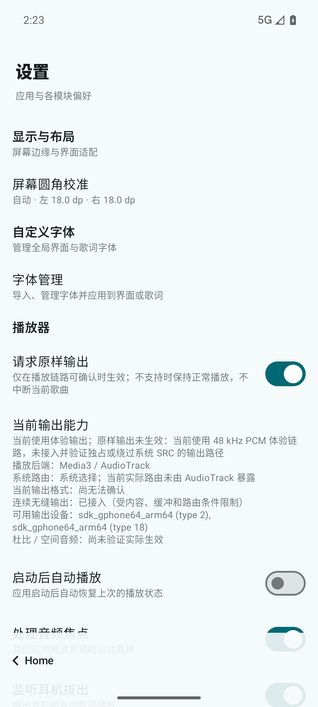

# P4：多端核心接入与输出能力

## 这一步解决什么

Android、iOS、桌面和 Web 现在使用同一个 `PlaybackCore` 决定队列、当前歌曲、播放意图、随机下一首、失败遍历和模式切换。原生后端负责打开内容、解码、定位和发声。播放页、歌词组件及短元素过渡继续使用原来的 `Playback` 接口。

**接入相同的决策核心，不代表原生音频能力相同。** Android 保留 P3 已验证的 Media3 当前项＋私有候选窗口及 48 kHz PCM 连续输出。iOS 的现有单项 AVPlayer/AVAudioPlayer、VLC 和 HTMLAudioElement 仍使用播完后准备下一项的路径；本阶段没有把它们标成无缝输出，也没有引入交叉淡化。

## 当前落地结构（UML 类图）



Android 保持原生媒体会话桥接；其他端由 `CorePlayback` 向现有页面和系统控制投影。`AbstractPlayback` 不再是这三端的正式播放实现；保留它及旧辅助类型供现存测试和其他调用逐步清理，不新增第二套策略。

## 加载与操作时序（UML 顺序图）



解析不占用队列编辑锁；原生准备与淡化不阻塞后续命令。Runtime 为加载、定位和淡化分别管理可取消工作。每次准备只传递一次性内容句柄，歌曲身份仍为来源＋歌曲 ID，URL 不参与身份判断。浏览器每次加载创建独立媒体元素，并释放旧 Blob URL，避免旧 DOM 回调成为新歌事件。

初始模式直接注入核心初始状态，避免启动恢复任务迟到覆盖用户的新模式。队列结构变动进入核心；纯元数据刷新仅更新显示描述，不取消随机待播意图。已有历史恢复器继续负责历史目录补全，共享核心负责准备与保存进度定位。

## 输出能力的含义

| 信息 | 来源和含义 | 不代表什么 |
|---|---|---|
| 用户请求原样输出 | 持久化偏好，默认关闭 | 不是已生效状态 |
| 原样输出支持/未知/不支持 | 当前后端的实现能力 | 不是设备广告参数 |
| 原样输出已生效 | 必须同时具备支持、用户请求和后端实际激活证明 | 仅采样率相等不能证明位一致 |
| 平台接口格式 | Android AudioTrack 初始化配置；iOS AVAudioSession 当前会话配置 | 不是 DAC 外部环回测量 |
| 可用设备和声明采样率 | Android AudioManager 枚举 | 不是当前选中的设备或输出速率 |
| 连续无缝输出 | 当前后端是否具有连续执行链路 | 不保证网络未缓冲时无停顿 |

播放器设置新增“请求原样输出”和“当前输出能力”。目前所有正式后端均未接入可验证的独占/绕过系统 SRC 的原样输出路径，因此请求后显示明确原因，保持体验输出；偏好变更不重建播放器、不更改歌曲和进度。Android 仍使用 48 kHz 体验链路，不能显示为 Hi-Res 原样输出。

iOS 探测在路由变化和音频服务重置后刷新。Android 随输出设备变化更新可用设备，随 AudioTrack 创建/释放更新接口格式。VLC/浏览器无法确认实际输出格式时保留“尚无法确认”。杜比、空间音频不因开启了系统自动空间化策略就宣称已生效。

## 后续边界

- iOS / 桌面 / Web 的连续音频调度需各自验证后才能升级无缝能力报告；不能用双播放器定时启动来冒充采样级连续输出。
- 原样输出需要独立后端、路由协商和实测验收。P4 提供请求/状态/回退契约，本阶段没有伪造实现 Android SRC 旁路、独占 DAC 或杜比授权能力。
- Android 内容访问和通用缓存接入保持 P2/P3 路径；其他端继续使用各自现有来源的内容访问，本次未声称完成 Android 专用缓存 DataSource 的跨端移植。
- 交叉淡化和 AI 衔接仍不在范围内。

## 验证记录

| 验证项 | 结果与边界 |
|---|---|
| 共享核心 JVM | 30 项通过（原 27 项＋3 项输出证据/回退测试） |
| 通用内容缓存 JVM | 17 项通过 |
| 播放页、歌词、时间轴、队列滚动及历史回归 | 63 项通过 |
| 新多端正式适配测试 | JVM 9 项通过；相同 9 项也在 iOS 模拟器运行通过 |
| VLC 3.0.21 真实解码 | 5 项通过，未跳过；使用 dummy 音频输出，仅证明解码、原生定位、暂停/切歌、失败遍历和历史记录，不证明声卡格式/听感 |
| iOS Simulator | 23 项通过：11 项 AVPlayer（含共享入口实播）、3 项 AVAudioPlayer、9 项共享适配；使用已启动 iPhone 17 Pro 模拟器 |
| Android 模拟器 | 20 项通过：P3 无缝测量 9 项、正式会话 1 项（增加真实输出与请求不打断播放断言）、核心 6 项、缓存 4 项 |
| Wasm | `:lplayer:compileKotlinWasmJs` 通过；项目浏览器/Node 测试任务原本关闭，本机未配置浏览器实播环境，因此不宣称 Web 实播通过 |
| 真机/DAC/蓝牙/杜比/空间音频 | 未验证；不将模拟器结果外推到硬件 |

Android 实际报告为 **48,000 Hz / 双声道 / PCM 16 bit**，证据为 AudioTrack 初始化回调。开启原样请求后原曲继续推进，显示体验输出和具体未生效原因。界面代码、歌词联动和短元素过渡未改写。

记录：[`p4-jvm.txt`](verification/p4-jvm.txt)、[`p4-android.txt`](verification/p4-android.txt)、[`p4-ios.txt`](verification/p4-ios.txt)、[`p4-vlc.txt`](verification/p4-vlc.txt)、[`p4-output-report.txt`](verification/p4-output-report.txt)。

实际修复的两个并发问题：初始模式改为同步初始状态，避免迟到恢复覆盖新命令；带开始播放意图的选曲/替换队列作为同一核心决策，避免立即失败时先出现暂停失败、再被后续 Play 意外重试一次。iOS seek 使用原生完成回调；系统中断恢复持有控制版本与加载票据，用户暂停/切歌后不再自动恢复；耳机断开遵守默认开启的监听开关。

设置页实际截图（临时开启原样请求后已恢复关闭）：



### 可复现命令

```sh
./gradlew :lplayer:playback-core:jvmTest :lmedia:lmedia-content:jvmTest
./gradlew :lplayer:jvmTest --tests 'com.lalilu.lplayer.core.CorePlaybackTest'
./gradlew :lplayer:compileKotlinWasmJs :lplayer:linkDebugTestIosSimulatorArm64
LMUSIC_IOS_SIMULATOR_ID=<booted-simulator-udid> scripts/test-ios-player-native.sh
./gradlew :androidApp:assembleDebug :androidApp:assembleDebugAndroidTest
# 安装和 Android instrumentation 命令与 P3 README 相同，明确指定 emulator-5554。
```

VLC 准备使用项目固定版本：`./gradlew :composeApp:vlcExtract --no-configuration-cache`。该插件的提取任务不兼容配置缓存，需要显式关闭。下载/提取后的 `~/.gradle/vlcSetup/vlc/lib` 与 `plugins` 可以在临时测试资源的 `vlc/` 下建立符号链接；设置 `LMUSIC_NATIVE_RESOURCES` 指向包含该 `vlc/` 的目录、`LMUSIC_NATIVE_AUDIO_FIXTURE` 指向合成的 20 秒 WAV，再运行 `:lplayer:jvmTest --tests 'com.lalilu.lplayer.playback.VlcPlaybackNativeTest'`。不修改生产解码依赖，不访问真实媒体源。
