# lplayer / lmedia 架构对照报告

日期：2026-10-26 · 当前代码基线：`8423ba72` · 性质：架构评估与建议，不是已经落地的实现。

本报告以 [已确认需求](../player-requirements.md) 为目标，以当前源码为现状依据。交叉淡化和 AI 衔接暂缓；本轮不修改播放代码。源码静态分析不能证明所有设备上的音频效果，文中将“已存在”“建议”“待原型验证”分开。

## 1. 先看结论：值得自研，但需要选对自研边界

**建议：统一自研播放决策、内容访问与缓存、普通音频的调度管线；复用成熟解码能力，保留必要的平台输出和受管媒体适配。**

你想保留的大部分体验不需要推倒：特殊队列显示、随机换位、歌词与进度联动、元素短过渡、渐进补全媒体信息，都能继续保留。主要变化发生在它们背后的责任分配。

| 你要判断的问题 | 当前 | 建议 | 对使用体验的意义 |
| --- | --- | --- | --- |
| 谁决定播放哪首？ | 共享 Playback、平台实现、Android 原生队列共同参与 | 只有 PlaybackCore 决定，后端执行有身份的计划 | 同一规则不用在不同端反复补齐 |
| 谁判断暂停后能否自动播？ | 平台命令、加载观察者与准备控制共同处理 | 播放意图集中持有，准备完成只报告事实 | 暂停、快切、失败恢复更可预测 |
| 离线启动能否用缓存？ | 目录可能在库中，但音频入口仍等待来源就绪 | 目录先读本地，内容先查有效缓存，缺口才访问远端 | 打开更快，完整缓存不被远端断线阻挡 |
| 定位后从哪里下载？ | 连续前缀缓存，远跳可能先补前面 | 按解码所需区间读取；UI 显示连续可播放时间范围 | 拖到后半段不用先下载前半段 |
| 无缝衔接靠什么？ | 后端能力不一致；多条路径以完成回调推进 | 提前准备，音频输出边界执行一次性衔接计划 | 自然结束与手动切歌可以采用不同策略 |
| 精简意味着什么？ | 多处同步和修正共同维持一致性 | 减少独立决策位置和重复状态；保留必要取消、版本和事务 | 后续新增需求影响范围更小 |

**不建议立刻从零写所有音频编解码器，也不建议长期只在现有四条路径外再包一层接口。** 前者把主要精力投入格式兼容；后者会继续保留现在的规则分叉。迁移期可以复用原有引擎，但最终普通音频的时间、衔接和缓冲应由明确的自研运行时负责。

## 2. 图怎么读，以及本报告的完整性范围

使用标准 UML 的组件图、类图、时序图、状态机图和部署图，通过 PlantUML 生成 SVG；每张图均附可编辑 `.puml` 源文件。类图中的空心三角表示继承或接口实现，实心菱形表示持有的内部对象，虚线箭头表示依赖；时序图从上往下读，`alt` 表示分支。

“完整”指覆盖 lplayer / lmedia 的主要模块、状态所有权、数据与控制路径、平台运行边界及迁移方式；不枚举每个 UI 组件和工具函数。应用外的推荐算法、标签解析器内部、编解码库内部不在本轮逐类展开。现状图按源码还原；建议图中的名称都是设计草案，**不要求每个方框都新建一个模块、服务或线程**。

建议阅读顺序：先看第 1 节及第 3 节两张总图，再看第 9 节取舍与第 10 节迁移；其余图用于核对具体行为。

## 3. 整体架构：从按技术混合，变为按责任分工

### 当前：模块已经分层，但边界没有完全收紧

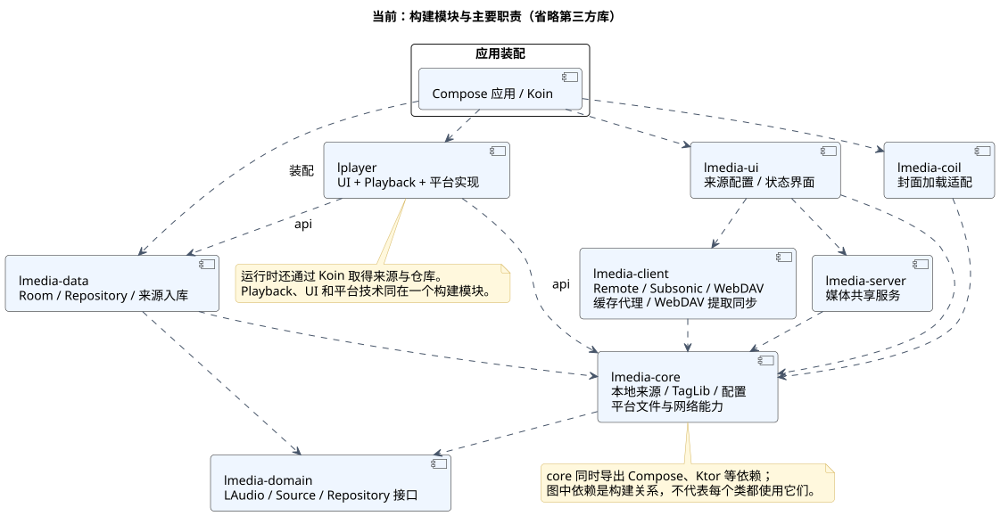

[UML 源文件](uml/01-current-components.puml)

- `lmedia-domain` 已定义歌曲、来源和仓库接口；`lmedia-data` 已承担数据库与来源结果入库。这是可以继续使用的基础，不需要为了重构再造另一套概念。
- `lmedia-core` 同时承载本地来源、平台能力、配置和标签读取，并导出 UI、网络相关依赖；它不是纯粹的最小领域内核。
- `lmedia-client` 同时有远端协议、通用音频缓存以及 WebDAV 特有提取同步。缓存控制器已经通用化，但配额配置仍由 WebDAV 提供。
- `lplayer` 同时包含界面、播放规则和各端技术实现，并直接依赖 `lmedia-core`、`lmedia-data`。共享逻辑能通过 Koin 取得具体服务，依赖关系并非都在构造参数中可见。
- `lmedia-coil` 与 `lmedia-server` 是内容消费者；搜索、专辑、歌手、文件夹等属于目录查询，应继续留在媒体库边界内，不进入音频引擎。

### 建议：三个主责任，两个外部入口

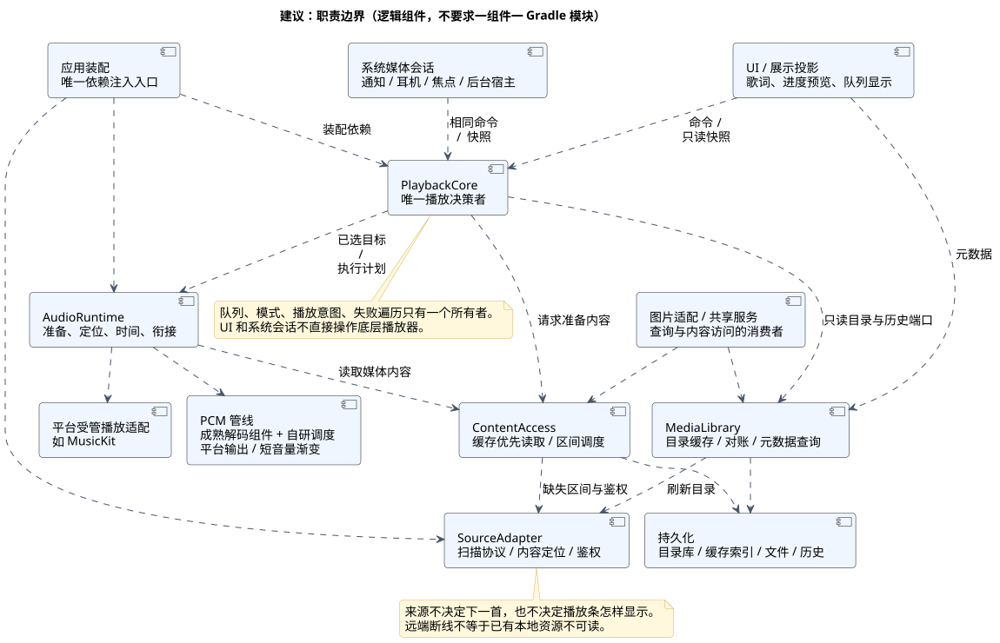

[UML 源文件](uml/02-target-components.puml)

通俗地说：**Media 管“有什么歌、内容在哪里”；Playback 管“现在选谁、接下来做什么”；AudioRuntime 管“如何准时把声音送出去”。** UI 和系统媒体会话都只向 Playback 发命令，再读取同一份状态。

| 边界 | 负责 | 不负责 |
| --- | --- | --- |
| MediaLibrary | 持久化目录、来源刷新、完整范围对账、元数据变化 | 自动选曲、播放进度 |
| ContentAccess | 本地与远端统一读取、区间缓存、鉴权刷新、任务优先级 | 随机规则、进度条动画 |
| PlaybackCore | 队列、模式、意图、失败遍历、预选候选、恢复历史 | 网络协议、原生解码细节 |
| AudioRuntime | 准备、定位、短音量渐变、有效音频时间、自然衔接 | 自行选择下一首、修改业务队列 |
| 展示投影 | 队列旋转、随机待播放元素、手势预览、歌词联动、短动画 | 修正真实播放器状态、猜测加载已完成 |
| 系统适配 | 后台生命周期、通知、耳机、音频焦点、设备能力 | 复制一套选曲与失败规则 |

最初可以在现有 Gradle 模块内建立这些包和端口，再根据实际依赖拆模块。建议最终使播放核心只依赖稳定契约，把平台运行时、UI 和存储实现由应用宿主装配；不要一次创建大量空模块。

## 4. 播放控制：真正要消除的是多个决策位置

### 当前类关系

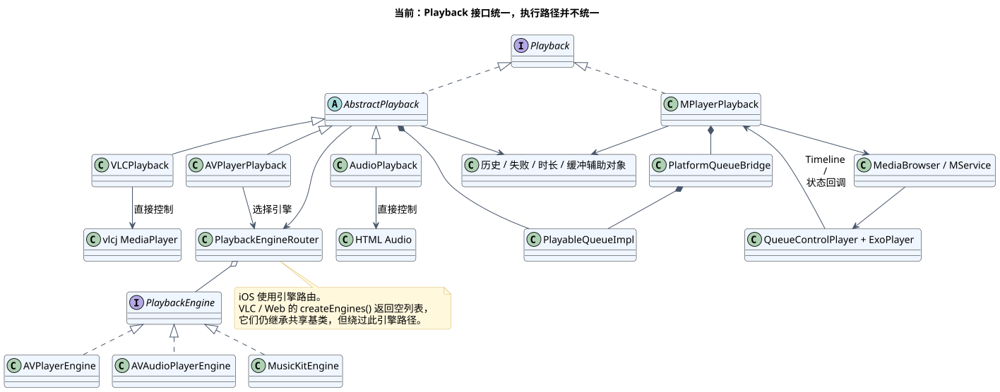

[UML 源文件](uml/03-current-playback-classes.puml)

Android 的 `MPlayerPlayback` 直接实现 `Playback`，通过 `MediaBrowser` 操作 Service 内的播放器；`PlatformQueueBridge` 将应用队列应用到平台，再接收平台快照。`QueueControlPlayer` 在 Media3 层实现特殊选曲和随机顺序。

iOS、桌面和 Web 继承 `AbstractPlayback`，但只有 iOS 使用其 `PlaybackEngineRouter`，路由至 AVPlayer、AVAudioPlayer 或 MusicKit。桌面和 Web 的 `createEngines()` 返回空列表，实际直接操作 VLC 和 HTML Audio。**因此，当前 Engine 接口并不是所有平台真正共享的执行边界。**

这不是“存在多个原生播放器”本身有问题，而是取消、准备、下一首、自然结束及失败处理在多条路径上分别实现。同一个需求容易需要检查多个实现才知道是否成立。

### 建议类关系与状态所有权

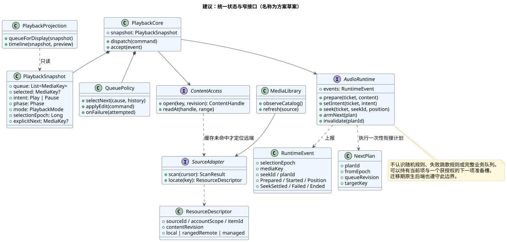

[UML 源文件](uml/04-target-playback-classes.puml)

核心结构保持小：一个串行命令处理器、一个可测试的队列策略、一份权威快照、少量异步任务。无需事件溯源平台或通用工作流框架。

| 状态或事实 | 唯一负责人 | 其他层如何使用 |
| --- | --- | --- |
| 完整队列、当前位置、模式 | PlaybackCore | UI 做显示变换；后端不反向替换完整队列 |
| 用户想播还是暂停 | PlaybackCore | 后端收到最新意图，准备完成不擅自自动播 |
| 实际是否已发声、解码位置 | AudioRuntime | 事件携带媒体身份及代次，核心核对后发布 |
| 预选的下一首 | PlaybackCore 私有准备计划 | 仅可缓存和准备；实际切换前不改队列或 UI |
| 当前手势预览位置 | UI 展示投影 | 进度条与歌词共用预览值，松手发送一次定位 |
| 哪些字节已缓存 | ContentAccess | 供读取与下载管理使用，不直接换算缓冲时间 |
| 当前连续可播放到哪里 | AudioRuntime | UI 显示一个连续时间范围，本地内容仍隐藏在线缓冲条 |

每次选曲产生 `selectionEpoch`，每次定位产生 `seekId`，每次自然衔接计划有 `planId`。这些标识分别解决不同的竞争，不应为了“精简”强行压成一个计数器，也不应让每个适配器再发明相同的业务代次。

原生回调不带身份时，由适配器绑定加载上下文、解绑旧监听或隔离实例；无法可靠归属的事件不能凭全局“当前歌曲”直接贴标签。超时仍可用于失败判定，但不能用超时来假定成功。

## 5. 点歌、快切与暂停：从平台拼接变为共同规则

### 当前主要调用路径

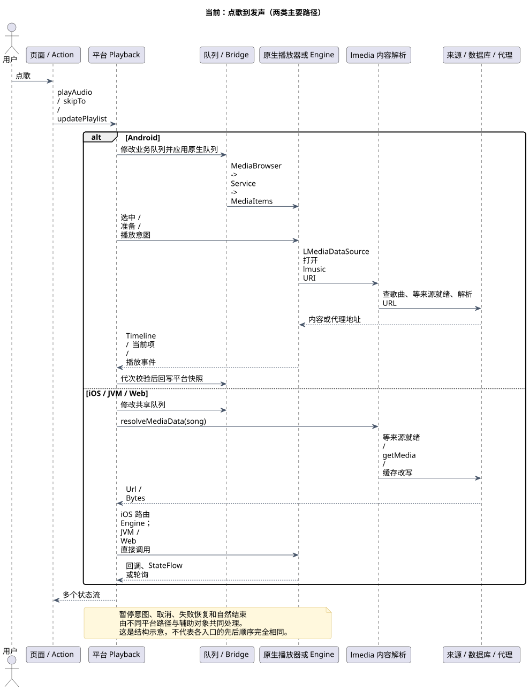

[UML 源文件](uml/05-current-selection.puml)

Android 还有 `lmusic` URI → 数据库歌曲 → 来源内容解析 → 缓存代理的打开路径。其他平台通常先解析内容，再加载具体播放器。于是“队列已变”“媒体已加载”“实际开始播放”出现的先后与控制点并不相同。

现有 `LatestPlaybackCommand`、`PreparationControl`、桥接代次和历史接管机制并非毫无价值：它们在防止旧操作覆盖新操作。问题是这些责任散落在多条链路，不是有锁或取消机制本身不合理。

### 建议：命令立即改变意图，慢任务异步执行

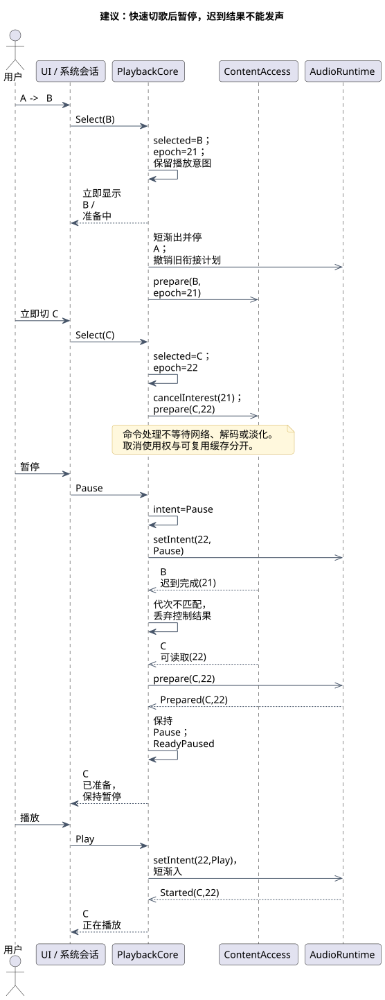

[UML 源文件](uml/06-target-selection.puml)

这个流程直接对应已确认效果：从 A 快切到 B、再到 C 时，选曲立即推进；A 短渐出后停止；B 的迟到完成不会发声；等待 C 时暂停，C 仍可准备，但必须保持暂停。

串行处理器只做短暂决策，网络、解码、淡化和释放在工作任务或运行时中执行，不在命令锁里等待。旧资源需要安全释放时，由运行时隔离其使用权；不能让 UI 选曲排在长时间 `cancelAndJoin` 后面。准备任务可继续沉淀缓存，但必须失去控制播放的权利。

手动切歌时，运行时保证旧曲短渐出结束后才让新曲发声，避免意外变成交叉播放；这个音频输出顺序不阻塞后续选曲命令。加载很快也只允许最新目标接管，加载很慢则保持安静。资源释放与缓存任务还应有明确的生命周期上限，不能仅靠丢弃迟到事件而遗留后台任务。

选曲与发声身份分别记录：手动切歌立即选中目标，旧曲仅有短渐出尾音；自然衔接在新曲真正接管输出时更新当前项。旧封面或歌词作为退出视觉保留，不因此拥有新曲的进度或交互权。

## 6. 来源与缓存：把“能浏览、能读本地、能联网”拆开

### 当前：目录已存在也可能被来源就绪挡住

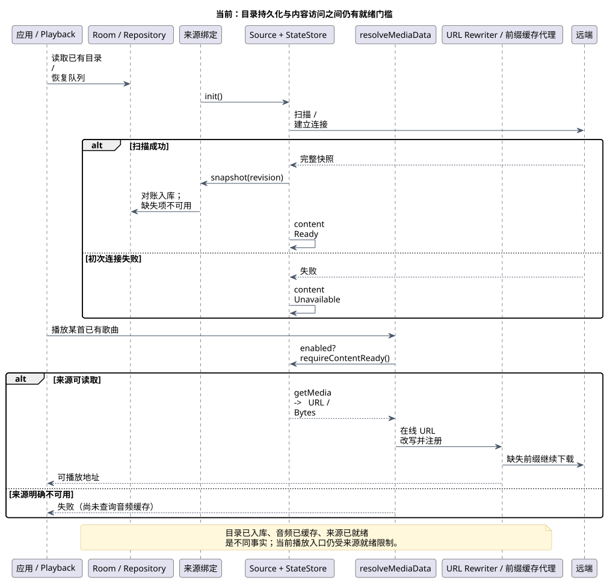

[UML 源文件](uml/07-current-media.puml)

当前已经持久化歌曲目录，不是没有缓存基础。问题在于，`resolveMediaData` 先要求整个来源可读取，再进入 URL 缓存改写；完整音频缓存因此可能被首次远端连接失败挡住。

来源结果、内容就绪与入库状态已分开，这是应保留的区分。建议继续改进资源访问粒度，而不是重新合并为一个含糊的 `isReady`。

### 建议：复用现有目录库，扩展通用资源索引与分段缓存

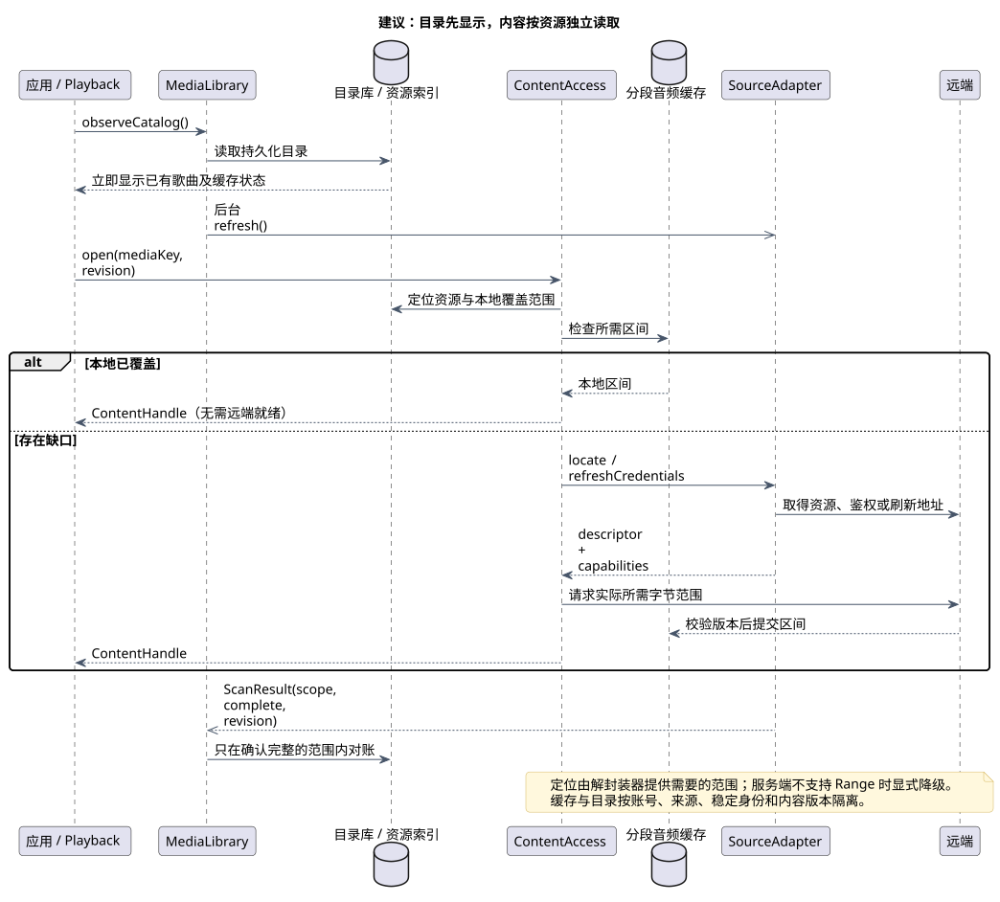

[UML 源文件](uml/08-target-media.puml)

不要再维护一份与 Room 歌曲库完全重复的“列表缓存”。由现有目录库承担可恢复目录，增加刷新时间、来源身份、内容版本和扫描范围信息；有游标或原始快照需要时再单独保存。

| 情况 | 建议行为与机制 |
| --- | --- |
| 冷启动、已有目录 | 立即显示；后台刷新；远端状态与本地可用性分别标记 |
| 远端离线、完整有效音频缓存 | 从本地读取，不先等待远端恢复；受管媒体仍遵守其平台授权能力 |
| 只有部分音频缓存 | 命中区间可读，缺口按当前网络和播放意图加载；不能把缺口伪装成已缓存 |
| 拖动到后半段 | 解封装器定位需要的字节，优先请求目标区间；保留已缓存的其他区间 |
| 文件头、索引或尾部信息必需 | 允许读取必要的附加范围；“从目标缓存”不等于所有格式都能只请求一个精确时间点 |
| 服务端不支持 Range | 明确降级为顺序读取或无法立即远跳，不循环请求错误范围，不宣称支持随机读取 |
| 远端文件内容变化 | 按内容版本隔离区间，禁止拼接不同版本的文件；处理 ETag、长度与修改时间的可信程度 |
| 子目录扫描失败 | `ScanResult` 表达覆盖范围和完整性，只在已确认完整范围内删除缺失项；具体协议由来源适配实现 |
| 来源停用 | 目录查询不再展示该来源的库内歌曲；物理清理遵循独立策略。当前播放内容句柄的释放不强制绑定目录移除，本轮不增加立即暂停要求 |
| 配额或网络策略变化 | 通用缓存策略处理，不能由某一个来源初始化时接管全局规则 |

稳定身份建议为 `SourceInstanceId + AccountScope + ItemId`，音频区间再加 `ContentRevision`。当前 MediaKey 的“来源 + ID”可作为迁移基础；签名 URL 是临时定位信息，不能作为唯一身份。已有缓存没有可靠版本时采用保守兼容或重建，不能仅按同名文件复用。

底层提供 `readAt` 和范围覆盖信息。能接受自定义读取的后端直接接入；需要 URL 的后端可使用本地 Range 网关，网关只负责协议适配，不再另起一套缓存。鉴权与新鲜 URL 由来源按需提供。

歌曲列表、标签、封面、歌词和音频可以共享身份及失效规则，但不共享一种存储格式：目录适合数据库，音频适合区间文件，封面与歌词适合资源缓存。不要为“通用”引入一个处理所有数据的万能缓存类。

**缓冲条与缓存下载进度必须分开。** 即使文件已缓存 90%，也不能把 90% 当作时间位置；变码率、容器索引和缓存缺口都可能使其错误。播放页使用运行时确认的“从当前位置连续可播放到哪里”，缺乏可信信息时宁可不展示虚假延伸。分段总量可供缓存管理页查看。

## 7. 无缝播放与音频运行时：决定自研是否有实际价值

### 播放状态的组织方式

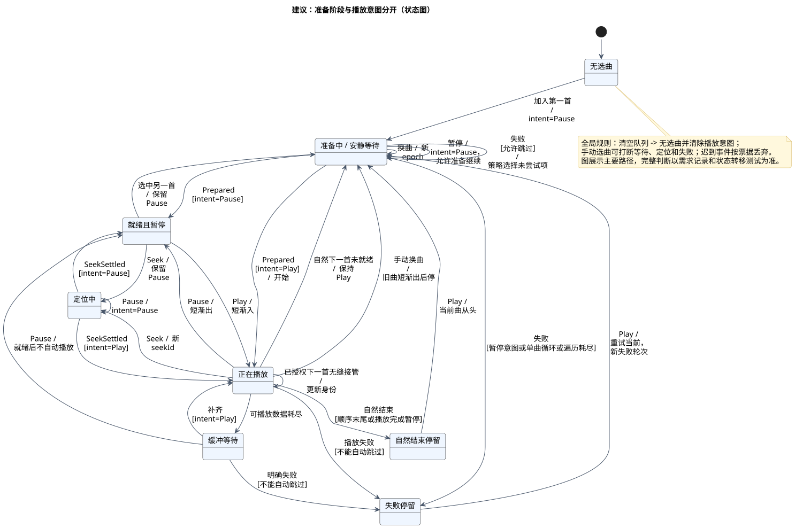

[UML 源文件](uml/09-target-state.puml)

这张图展示主要路径，不是把所有信息压成一个大枚举。`intent=Play/Pause` 与 `phase=Preparing/Ready/Seeking/Failed` 分开：准备中可以想播放，也可以已暂停；两者不能都用 `isPlaying=false` 代替。

失败规则集中在 PlaybackCore：暂停时不自动选曲；单曲循环失败停留；其他模式按设置与方向尝试未失败项；一轮最多每首一次；确认实际开始播放后结束这一轮。历史恢复也只向核心提交一次恢复命令，默认暂停，后来的用户命令优先。

### 自然衔接必须提前授权

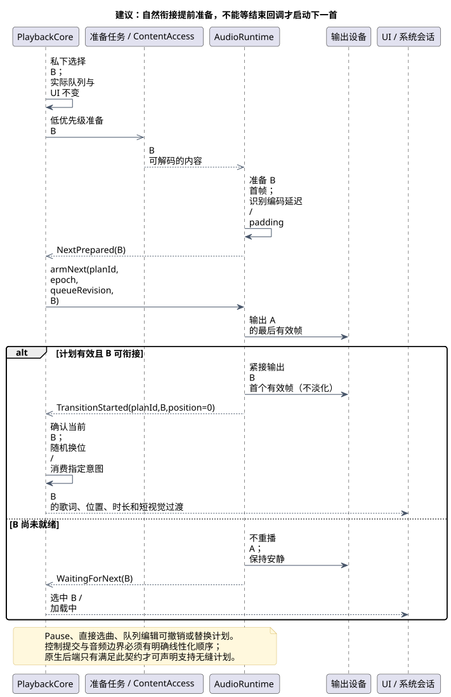

[UML 源文件](uml/10-target-gapless.puml)

不能只把原生队列禁用，然后等 `Completion` 回调里调用下一首，这会把间隙带回来。建议核心私下决定候选，运行时准备下一项；临近边界时获得一次性衔接计划，按输出时钟将下一首首帧接到上一首末帧后面。

准备槽不等于第二份业务队列。它只知道被授权的当前内容和下一内容，不自行随机、不递归跳过失败项。自然衔接不叠加音频、不做淡化；当前阶段不引入交叉混音状态。

预加载失败不提前跳歌、不进入本轮播放失败计数；到实际选择该项时才按播放失败规则处理。暂停允许当前项继续准备，但不启动新的下一首预准备；队列编辑、显式下一首或模式变化按需求使旧候选失效。元数据更新不应误伤仍有效的准备计划。

关键契约包括：计划失效、暂停与音频边界有明确先后；完成或失败事件只能报告一次；成功交接携带实际媒体身份和输出时间。若边界先发生，暂停作用于已接管的新曲；若暂停先提交，禁止继续自动衔接。这需要运行时级别的原子处理，不能只靠 UI 收到事件后修正。

| 音频层级 | 建议自研程度 | 要验证的事项 |
| --- | --- | --- |
| 业务播放规则 | 完全自研、KMP 共享 | 所有已确认队列与意图规则 |
| 内容读取与缓存 | 自研统一策略，复用文件/网络库 | 范围正确性、取消、断网、版本一致、缓存恢复 |
| 解封装与解码 | 复用成熟组件，封装为稳定接口 | 格式覆盖、定位精度、编码延迟与尾部填充、许可与包体 |
| PCM 调度与音频时间 | 普通音频目标为自研共享运行时 | 无缝、短渐变、欠载、真实输出时钟、后台稳定性 |
| 设备输出 | 薄平台适配 | 重采样、设备切换、延迟、路由与能力验证 |
| MusicKit 等受管媒体 | 保留专用后端 | 只声明该后端真正能提供的控制和离线能力 |

普通音频目标管线为：`区间读取 → 解封装/解码 → PCM 准备缓冲 → 格式适配/短音量包络 → 平台输出`。实时音频回调中不做网络、数据库、阻塞锁或大对象分配；耗时工作在非实时线程完成。共享原生运行时通过批量缓冲与粗粒度事件对接 KMP，避免每个采样块都穿过业务状态流。

共享原生代码用 C/C++ 还是 Rust、采用哪个解码组件，留给原型的跨端构建、调试和运行结果决定；此报告不假定语言选择能自动解决架构问题。浏览器需要独立验证 Web Audio / 工作线程与部署约束，可先声明降级能力。

Hi-Res、绕过 SRC、杜比和空间音频保留能力入口，**不作为首阶段已解决的问题**。原样输出需报告请求格式、实际应用输出与可验证的设备事实，未知就显示未知；受系统混音或设备处理影响的部分不能承诺 bit-perfect。现有 `AudioTrackBypassAudioPlayer` 是 PCM 旁路/校准相关基础，不等于整个音乐播放链已经绕过系统 SRC。

## 8. 多端运行：保留平台差异，移走平台中的业务规则

### 当前部署路径

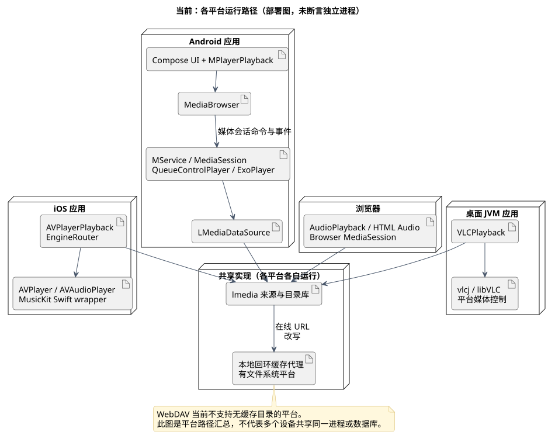

[UML 源文件](uml/11-current-deployment.puml)

### 建议部署路径

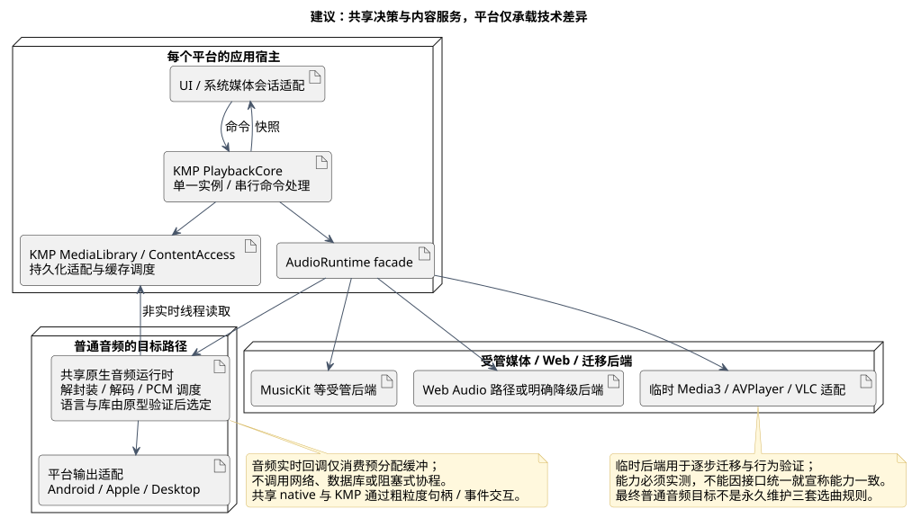

[UML 源文件](uml/12-target-deployment.puml)

Android 的后台宿主仍应满足媒体服务生命周期；核心由长生命周期宿主持有，界面与系统控制访问同一实例。不是让 Activity 和 Service 各自创建一个 PlaybackCore。若未来跨进程，只传命令与只读快照，不复制业务状态机。

Android 可以通过实现 Media3 `Player` 契约的适配器把共享核心暴露给 MediaSession。官方提供 `SimpleBasePlayer` 辅助实现自定义 Player，但这只是接入点，仍需验证命令、可用操作、队列元数据和系统恢复，不是“换个类就迁移完成”。参见 [Media3 Player 接口](https://developer.android.com/media/media3/session/player)。

迁移后端若需要原生播放列表，可以仅映射获授权的执行窗口；原生当前项变化作为带计划身份的执行结果回报。若后端不能可靠撤销旧计划，先不启用其自动衔接能力；不能回退到把整个原生 Timeline 当作业务队列权威。

iOS 的 AVPlayer 与 MusicKit、桌面的系统媒体控制、Web 的媒体会话仍是平台适配。操作系统焦点、耳机断开先转换为核心事件；已确认的“耳机断开监听默认开启、可关闭”等用户规则留在共享政策中。平台必须立即停止音频的强制中断则如实上报，不等待业务批准。

## 9. 方案取舍：推荐中间路线，最终掌握普通音频管线

| 路线 | 能得到什么 | 主要代价 | 本报告判断 |
| --- | --- | --- | --- |
| A. 继续修当前架构 | 改动最小，已有功能继续工作 | 每次规则变更仍需多端追踪，缓存和准备边界难统一 | 可做短期维护，不适合作为最终目标 |
| B. 统一核心与缓存，逐步自研普通音频运行时 | 规则统一、内容可复用、音频能力可以自主迭代 | 必须做契约迁移与音频原型，不能一步到位 | **推荐** |
| C. 立即从零重写全栈，包括所有编解码器 | 理论控制面最大 | 格式、授权、设备兼容成为长期主体，仍无法消除受管媒体限制 | 当前没有必要 |

路线 B 的“精简”不保证第一天文件更少。迁移期间短暂增加适配代码是正常的；完成后的标准是：同一业务规则只有一个实现、同一状态只有一个写入者、来源不侵入播放器政策、后端不侵入队列政策。

| 当前机制 | 建议处理 | 原因 |
| --- | --- | --- |
| MediaKey、歌曲/专辑/歌手模型、目录库 | 保留并迁移扩展 | 已有稳定身份和持久化基础 |
| 来源扫描与入库区分、增量补丁 | 保留语义，收紧完整范围和版本契约 | 这些差异是实际业务需要 |
| 沙盒导入、稳定改名、事务式删除 | 保留行为与已有测试 | 防止数据损失的机制不是多余复杂度 |
| 队列特殊显示、歌词预览、短视觉过渡 | 保留效果，移到展示投影 | 视觉需求不应决定底层队列或加载状态 |
| PlatformQueueBridge 双向业务同步 | 迁移后删除，暂由兼容适配承接 | 新核心不再从平台 Timeline 重建权威业务队列 |
| 多端失败遍历、选曲、播放意图恢复 | 合并到核心 | 去掉重复规则，平台只报告事实 |
| 时长/定位的猜测与补偿 | 用带身份的时长、SeekSettled 替代推测，保留显示平滑 | 当前定位含容差确认和 600ms 超时回落；目标以实际结果驱动，不靠 UI 自行推断 |
| 连续前缀缓存与字节比例缓冲 | 迁移至范围缓存和真实时间范围 | 满足远跳下载及缓冲条需求 |
| 全局 Koin 隐式查找 | 收敛到装配入口与兼容边界 | 核心测试不依赖完整应用容器 |

最需要警惕的是把所有责任搬进一个巨型 PlaybackCore。它应只做决策和组合，队列策略保持纯计算，内容服务和运行时通过端口工作；数据库、解码与 UI 动画不进命令处理器。

## 10. 分步迁移与验收：每一步都可回退

| 阶段 | 做什么 | 通过条件 | 回退方式 |
| --- | --- | --- | --- |
| P0 行为基线 | 将需求记录转为核心场景与已知差异清单，保留现有音频/视觉样本 | 区分“要保留的效果”与“当前恰好如此” | 仅新增验证材料 |
| P1 新核心最小闭环 | FakeRuntime 驱动选曲、暂停、失败、队列编辑、历史恢复；旧 API 适配到命令 | 快切/暂停/迟到事件等确定性测试通过；无平台分支的规则 | 开关选择旧核心；一次只允许一个核心拥有播放 |
| P2 统一媒体访问 | 复用目录库，加入资源索引、范围缓存与扫描范围契约 | 断网冷启动播放完整缓存、远跳范围请求、部分扫描不误删、版本变化不拼接 | 按版本保留旧缓存读取或显式重建；不破坏原库 |
| P3 原生后端迁移 | 用现有引擎接新 AudioRuntime 契约，系统命令走同一核心 | 各端选曲/意图/失败一致；后端能力如实报告 | 每个平台独立回退，不能双路同时发声 |
| P4 自研音频垂直原型 | 选普通本地/HTTP 音频，跑通读取、解码、输出、定位与下一首准备 | 真机输出验证无缝、低延迟短渐变、连续快切、后台与资源释放 | 原型后端切回成熟后端，核心和缓存不回退 |
| P5 扩展覆盖并清理 | 扩格式、设备和平台，移除旧规则与桥接；受管媒体留专用后端 | 回归矩阵通过，旧决策路径不再被调用 | 保留有明确期限的后端回退开关 |
| 后续能力 | 原样输出与设备验证；再重新讨论交叉、AI、空间音频 | 每项独立能力测试和可解释回退 | 不影响默认基础播放 |

P2 与 P4 可在接口确定后交错验证，但不能为了赶进度在尚未验证的引擎上宣布“跨端无缝已完成”。迁移期间使用同一组命令轨迹比较核心状态，不同时运行两个真实音频输出。

核心验收例子：

1. A → B → C 连续快切，B 迟到完成；只允许最终 C 发声，旧 A 短渐出后安静。
2. C 加载中暂停，随后准备完成或失败；均不能自动播放、不能自动跳歌。
3. 随机提前准备 B 后用户指定 D；D 优先，B 不提前影响队列；指定意图清除遵守已确认规则。
4. 同曲重复选择不重启；重排或新列表仍包含当前项时保留位置；删空后再加歌保持暂停。
5. 单曲循环失败停留；普通失败遍历每首最多一次；真正开始播放才结束失败轮次。
6. 拖动时歌词跟随预览、原音频继续；提交后按 seekId 等待定位确认；不得仅凭经过 600ms 推断定位结果。
7. 冷启动断网，目录立即可见，完整缓存可播；部分缓存遇到缺口如实等待/失败。
8. 拖到远处，网络日志证明请求目标必需范围；缓冲条不显示离散块，也不按累计缓存比例伪造位置。
9. 自然衔接检查实际 PCM/录音的帧连续性，覆盖编码 delay/padding、不同格式与采样率；只看回调时间或耳听一次不足以验证。
10. Android 服务重建、系统通知控制、耳机断开开关、焦点中断、设备切换及 iOS/Web 特有约束分别回归。

CPU、内存、功耗、切歌与定位延迟都需采集基线后对比；不先虚构性能提升比例。普通无缝与不同输出格式的硬件重开分别记录，不能用一个“支持无缝”的布尔值掩盖差异。

## 11. 源码证据与外部能力依据

以下是图中结构和结论的主要入口；源码链接相对仓库可追溯，HTML 阅读版提供同样入口。

| 结论 | 主要代码 |
| --- | --- |
| lplayer 直接依赖 core/data，UI 与平台在同一模块 | [lplayer/build.gradle.kts](../../lplayer/build.gradle.kts) |
| 共享基类含队列、引擎路由、历史和来源查找 | [AbstractPlayback.kt](../../lplayer/src/commonMain/kotlin/com/lalilu/lplayer/playback/AbstractPlayback.kt) |
| Android 通过 Browser 与桥接同步队列 | [MPlayerPlayback.kt](../../lplayer/src/androidMain/kotlin/com/lalilu/lplayer/playback/MPlayerPlayback.kt)、[PlatformQueueBridge.kt](../../lplayer/src/commonMain/kotlin/com/lalilu/lplayer/playback/PlatformQueueBridge.kt) |
| Android Service 与原生队列规则 | [MService.kt](../../lplayer/src/androidMain/kotlin/com/lalilu/lplayer/service/MService.kt)、[QueueControlPlayer.kt](../../lplayer/src/androidMain/kotlin/com/lalilu/lplayer/extensions/QueueControlPlayer.kt) |
| 三端共享基类但执行路径不同 | [VLCPlayback.kt](../../lplayer/src/jvmMain/kotlin/com/lalilu/lplayer/playback/VLCPlayback.kt)、[AVPlayerPlayback.kt](../../lplayer/src/iosMain/kotlin/com/lalilu/lplayer/playback/AVPlayerPlayback.kt)、[AudioPlayback.kt](../../lplayer/src/webMain/kotlin/com/lalilu/lplayer/playback/AudioPlayback.kt) |
| 当前引擎接口没有统一的预准备/衔接计划契约 | [PlaybackEngine.kt](../../lplayer/src/commonMain/kotlin/com/lalilu/lplayer/playback/PlaybackEngine.kt) |
| UI 统一时间轴但仍有定位超时与容差判断 | [PlaybackTimelineState.kt](../../lplayer/src/commonMain/kotlin/com/lalilu/lplayer/screen/PlaybackTimelineState.kt) |
| 数据库元数据刷新不删除缺失队列项 | [QueueMetadataRefresher.kt](../../lplayer/src/commonMain/kotlin/com/lalilu/lplayer/playback/QueueMetadataRefresher.kt) |
| 来源就绪先于缓存解析 | [MediaContentResolver.kt](../../lmedia/lmedia-domain/src/commonMain/kotlin/com/lalilu/lmedia/domain/source/MediaContentResolver.kt) |
| 扫描、内容与入库分离 | [MediaSourceStateStore.kt](../../lmedia/lmedia-domain/src/commonMain/kotlin/com/lalilu/lmedia/domain/source/MediaSourceStateStore.kt)、[MediaSourceBindingRepositoryImpl.kt](../../lmedia/lmedia-data/src/commonMain/kotlin/com/lalilu/lmedia/data/repository/MediaSourceBindingRepositoryImpl.kt) |
| 通用缓存、前缀读取与 WebDAV 补全 | [MediaCacheController.kt](../../lmedia/lmedia-client/src/commonMain/kotlin/com/lalilu/lmedia/cache/MediaCacheController.kt)、[LoopbackRangeProxy.kt](../../lmedia/lmedia-client/src/commonMain/kotlin/com/lalilu/lmedia/cache/LoopbackRangeProxy.kt)、[WebDavSource.kt](../../lmedia/lmedia-client/src/commonMain/kotlin/com/lalilu/lmedia/source/webdav/WebDavSource.kt) |
| 当前 PCM 旁路实现范围 | [AudioTrackBypassAudioPlayer.kt](../../lplayer/src/androidMain/kotlin/com/lalilu/lplayer/playback/AudioTrackBypassAudioPlayer.kt) |

补充核查了官方资料：Media3 的 [Player / 自定义实现接入](https://developer.android.com/media/media3/session/player)、[SimpleBasePlayer](https://developer.android.com/reference/androidx/media3/common/SimpleBasePlayer) 和 [ExoPlayer bufferedPosition](https://developer.android.com/reference/androidx/media3/exoplayer/ExoPlayer)；其缓冲位置是当前内容的时间位置估计，不等于整个文件的下载比例。Apple 的 [AVQueuePlayer](https://developer.apple.com/documentation/avfoundation/avqueueplayer) 提供顺序管理能力，但有队列能力本身不构成本项目各格式、设备无缝验证的替代品。

代码基线使用 Media3 `1.10.1`、vlcj `4.11.0`；官方在线资料可能更新，实施时需针对锁定版本验证具体 API。报告未运行播放器或修改产品代码，未测量设备输出；UML 已本地渲染，后续原型负责验证音频与平台能力。

## 12. 现在只需判断方向，不必再确认细节

本报告推荐的方向可以概括为三点：**播放规则只有一个所有者；来源和缓存提供独立可读的资源；普通音频逐步由自己的运行时掌握时间与衔接。**

已有需求足以推进这一方案的原型设计。具体语言、解码库、区间大小、线程数和淡化参数通过验证决定；不会再逐条要求你做这些实现选择。若你发现总图中的职责分配或迁移终点不符合预期，指出那一处即可，其余细节由方案继续落实。
