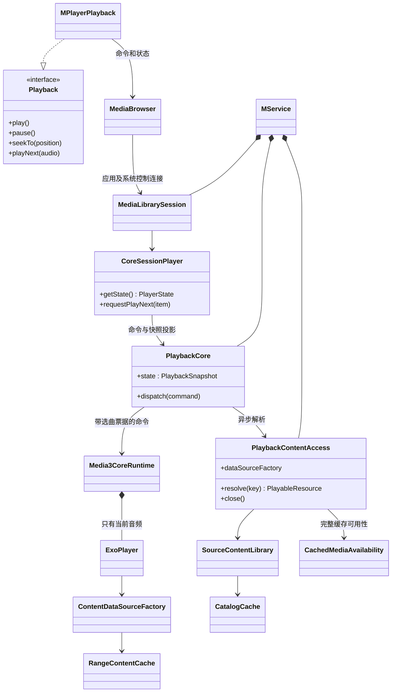
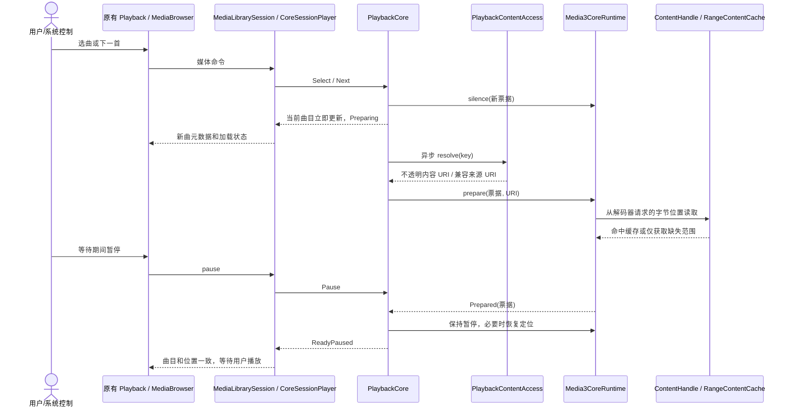

# P2：Android 正式播放入口、系统会话与缓存

本页记录 P2 时点。P3 已扩展为当前项＋私有候选的连续执行窗口，最新音频链路与验证见 [P3 说明](gapless-preloading.md)。

P2 将 P0/P1 已验证的核心与内容访问接到 Android 正式服务。播放页仍使用原来的 `Playback` 接口，歌词、封面短过渡、拖动预览与列表滚动保持原组件。交叉淡化不在本阶段实现范围。

## 改变了什么

以前应用侧和 Media3 侧都参与队列导航、来源等待及失败跳转。现在 `MService` 持有唯一的 `PlaybackCore`，应用、通知、耳机及系统媒体控制最终操作同一个核心。`CoreSessionPlayer` 只是把核心快照翻译成 Media3 的完整时间线；底层 ExoPlayer 只负责当前音频的准备、解码与输出。

| 边界 | 唯一职责 | 不再承担 |
| --- | --- | --- |
| `MPlayerPlayback` | 将原有 UI 操作发送到 MediaBrowser，将会话状态映射回原有 UI/历史接口 | 来源等待、随机决策、失败遍历 |
| `CoreSessionPlayer` | Player 命令与共享命令互译，发布完整队列、当前项、进度、模式、错误及自然衔接事件 | 音频解析、缓存网络请求 |
| `PlaybackCore` | 队列、当前项、播放意图、定位代次、随机待播、失败处理、播完暂停 | 平台 UI、来源协议、原生队列管理 |
| `Media3CoreRuntime` | 单曲准备、实际发声/暂停、短音量渐变、原生定位、焦点/耳机事件 | 随机和下一首选择 |
| `PlaybackContentAccess` | 来源兼容桥、目录恢复/持续更新、缓存策略与生命周期 | 播放队列和 UI 动画 |
| `RangeContentCache` | 按范围读写、版本隔离、完整性检查、容量与活动句柄保护 | 时间轴缓冲条和歌曲导航 |

调试原型改为复用正式运行时与 DataSource，使用独立缓存目录，不保留另一份音频实现。Android 正式服务已迁移；桌面、iOS 和 Web 的音频运行时仍按 P4 分步处理。

## 已落地结构（UML 类图）

## 从点击到发声（UML 时序图）

## 正式接入的行为约定

- 模式切换仅改变规则；应用设置四种模式时以一次核心命令更新，避免“先重复、后随机”的中间状态。
- 随机待播通过 session extras 发布，UI 在当前项上方显示一个“待播放”意图元素，不修改实际队列。播放成功、失败或用户覆盖操作按核心规则清除。
- 系统下一首/上一首与应用命令走同一核心。重复点选当前歌曲不重置进度。
- 播放/暂停意图与真正发声分离。音频焦点暂时抑制作为独立状态；永久焦点丢失、开启监听时的耳机断开会转为暂停意图。
- 保留 `handleAudioFocus`、`handleBecomeNoisy`、自动恢复播放、系统 EQ 和状态栏歌词设置。关闭耳机断开监听时不主动暂停。
- 历史恢复把队列、当前项和保存位置交给核心，来源未就绪不再阻挡位置恢复。核心在 Prepared 后执行带序号定位，确认后才按最新意图播放。UI 显式播放控制放弃迟到的历史当前位置恢复。
- 播完暂停由核心处理并通过会话回传已消费状态。系统自然换曲/单曲重复事件携带真实原因，播放统计观察正式会话，不再依赖单项 ExoPlayer 的队列事件。
- 手动切歌短渐出/渐入复用已验证的 60 ms 参数；自然结束不加音量淡化。共享核心负责立即推进选曲，音量动画不阻塞后续命令。

## 缓存接入与边界

生产服务持有一个缓存实例。缓存目录为 `plan-b-content`，目录元数据为 `plan-b-catalog`；调试入口使用 `plan-b-debug` 前缀。账户凭据和原始 URL 不进入可展示目录缓存或媒体会话 URI。

启动时恢复已缓存的展示元数据，只补充数据库缺失项，不覆盖较新的行；随后持续订阅成功完整快照及单曲元数据补丁。完整音频缓存经校验后可使列表歌曲在来源暂未就绪时可点击。来源停用、账户/内容版本改变、关闭缓存或容量淘汰后撤销对应可用性。

WebDAV 使用 P1 的可靠版本和账户身份接入分段缓存。尚未提供可靠内容身份的来源继续使用既有解析路径，不猜测缓存键。设置中的音频缓存开关与容量控制这套通用缓存；关闭后从下次选曲生效，兼容来源自身的存储策略仍由来源管理。容量减少时不删除正在使用的句柄，释放后再淘汰。

缓冲条使用 Media3 从当前位置向后连续可播放的时间位置；不把磁盘上离散字节段的总比例画成时间进度。Android 客户端定期读取该位置，避免仅等待没有专门事件的缓冲变化。其他平台迁移时也需采用相同语义。

## 未宣称完成的能力

- 单项 Media3 后端尚未提供提前准备和连续 PCM 输出，**自然切歌仍可能存在准备间隙**；P3 必须完成并测量无缝衔接，当前不可当作无缝成品发布。
- 已保留播放页和歌词实现，并做对应逻辑回归及模拟器画面检查；模拟器无法替代真机听感、蓝牙/DAC、Hi-Res、绕过 SRC 或各种格式测试。
- P1 的离线测试覆盖关闭服务器后重建缓存/播放器对象；P2 的完整应用杀进程后远端离线恢复、大媒体库启动性能还需专门场景验收，不等同于本次本地歌曲系统会话测试。
- 旧 Android 服务实现可由 P1 提交 `e6755cbc` 回退。未增加同时运行两套服务的运行时开关，避免出现两个音频所有者。

验证命令、结果与后续入口见 [实施计划](implementation-plan.md)。
