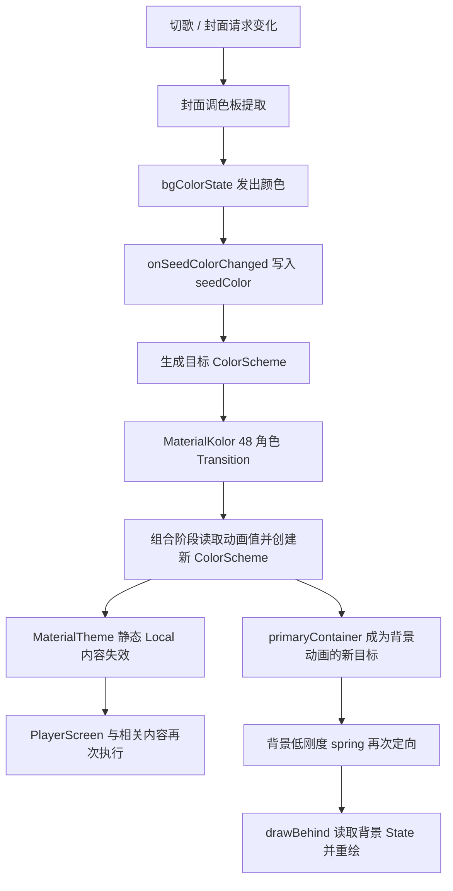

# MaterialKolor 颜色动画与 PlayerScreen 重组分析

后续状态（2026-10-10）：已按用户决定将应用 `LMusicTheme` 改为 `animate = false`，保留现有局部背景 spring，并稳定播放器的四个下游回调。以下描述的是库开启动画时的实现与原始诊断；关闭后的排查与采样见 [后续报告](player-screen-theme-disabled-analysis.md)。

## 结论

当前 MaterialKolor 4.0.4 的 `animate = true` 实现会在组合阶段读取逐帧颜色，重新发布 Material3 `ColorScheme`。当颜色确实发生过渡时，动画期组合更新是这个实现方式的必然结果。Material3 的静态颜色 CompositionLocal 又把失效传播到 provider 的内容，影响范围可以包括不读取主题颜色的组件。

但“颜色动画必须让整个 PlayerScreen 重组”不成立。颜色 State 在绘制阶段读取时，可以只触发重绘。问题是当前的**全局主题动画发布方式**，不能单靠给业务参数加稳定性注解解决。

本轮验证了该机制；尚未把真实切歌日志中的每一次重组逐一归因给它，也没有测量它占用的帧时间。重组次数与卡顿程度应分别验证。

## 分析范围与证据

- 基于 `feat/player-cover-fast-anim` 的当前工作区，MaterialKolor 4.0.4、Compose Multiplatform 1.11.0、JVM Material3 1.9.0。
- 直接读取 Gradle 缓存中对应版本的源码 jar；在线 API 用于交叉确认，在线文档版本不替代已安装源码。
- MaterialKolor：`DynamicMaterialTheme.kt`、`DynamicMaterialThemeState.kt`、`ktx/ColorScheme.kt`、动态调色板生成实现。
- Material3：`MaterialTheme.kt`、`ColorScheme.kt`。
- Compose Animation：`ColorVectorConverter.kt`；Animation Core：`Transition.kt`；Runtime：`CompositionLocal.kt`、`GapComposer.kt` 等 provider/skip 实现。
- 自动化实验：`lplayer/src/jvmTest/kotlin/com/lalilu/lplayer/screen/MaterialKolorRecompositionTest.kt`。

## 颜色动画是怎么实现的

### 1. 封面种子色生成最终调色板

`LMusicTheme` 保存一个 `MutableState<Color>`，把 `seedColorState.value` 传给 `DynamicMaterialTheme`，明确设置 `animate = true`。库的公开 API 默认关闭动画，当前行为来自应用主动开启。[MaterialKolor API](https://docs.materialkolor.com/material-kolor/com.materialkolor/-dynamic-material-theme.html)

种子色、明暗模式、风格、对比度等作为 remember 的键，构造主题状态并生成目标 `ColorScheme`。在这些键和修改回调保持不变时，目标调色板被缓存。

因此它不是“每个动画帧重新提取封面颜色”，也不是“逐帧改变 seed 并运行整套 HCT 调色板算法”。它先得到最终的 48 个颜色角色，再对这些角色做过渡。

### 2. 一个 Transition 驱动 48 个颜色角色

`animateColorScheme(target)` 创建一个 `updateTransition(targetState = target)`，分组注册 `transition.animateColor`：

| 分组 | 颜色角色数量 |
| --- | ---: |
| primary | 5 |
| secondary | 4 |
| tertiary | 4 |
| surface | 12 |
| background / error | 6 |
| utility | 5 |
| fixed | 12 |
| 合计 | 48 |

每个子动画维护自己的 `State<Color>`，共享 Transition 的时间推进。颜色通过 Oklab 的 alpha/L/a/b 四维向量插值，再转换回目标颜色空间。这里插值的是各角色颜色，不是种子色。

库默认使用 `spring<Color>()`，默认无弹跳阻尼和中等刚度，没有固定毫秒时长。连续换色会重新定向现有 Transition，实际结束时间取决于目标和动画规格。全部子动画完成后，Transition 停止逐帧推进。[Compose Transition 文档](https://developer.android.com/develop/ui/compose/animation/value-based)

48 个子动画不等于每帧 48 次独立重组。状态写入与失效可以在同一个帧中合并，必须实测组合执行次数。

### 3. 动画值在组合阶段被读取

关键路径的示意代码如下；省略了分组与角色列表：

```kotlin
val transition = updateTransition(targetScheme)
val primary by transition.animateColor { it.primary }
// 其他 47 个角色也在组合阶段读取 State.value
val animatedScheme = targetScheme.copy(primary = primary, /* 其他角色 */)
MaterialTheme(colorScheme = animatedScheme, content = content)
```

组内 helper 返回 `List<Color>`；总 helper 返回 `ColorScheme`，并非 `State<ColorScheme>`。每次实际执行该 helper，会组装 7 个颜色列表和一个新的 ColorScheme。动画对象被 remember，列表和最终 copy 的颜色方案没有按当前颜色整体缓存。

动画 State 在组合阶段读取，所以动画值变化会使其所属组合作用域失效。把调用抽到一个返回 State 的 composable helper，不能自动得到独立 restart scope；本项目 `rememberPlayerBackgroundColor` 就属于这种情况。

### 4. 新 ColorScheme 通过静态 Local 向内容传播

Material3 1.9.0 的 `ColorScheme` 是带 `@Immutable` 的普通 class，没有按颜色字段实现 `equals`。`copy()` 创建一个新对象，即便全部颜色相同，新旧对象也不相等。

`@Immutable` 表示稳定性契约，不提供结构相等，更不会屏蔽 CompositionLocal 的变化。

`MaterialTheme` 使用 `LocalColorScheme`，后者是 `staticCompositionLocalOf`。Runtime 比较新旧提供值时发现 ColorScheme 身份变化，provider 的内容因此失效。普通参数没有变化、启用 strong skipping，也不能直接绕过该 provider 的失效状态。[Compose 对静态 Local 的说明](https://developer.android.com/develop/ui/compose/compositionlocal)

这里的“内容失效”不是所有组件、所有子组合、所有嵌套主题必然执行一次的精确计数承诺。嵌套 provider 的覆盖、作用域和子组合边界仍会影响传播。下面的实验明确验证了普通内容中一个完全不读取主题的组件也会执行。

另外两条 Local 不应混淆：应用的 `LocalSeedColor` 提供同一个 MutableState 容器，写容器的 value 不等于替换这个静态 Local；库的 `LocalDynamicMaterialThemeSeed` 提供纯 Color，换 seed 时也会使内容失效，但动画帧期间 seed 不变，它不是每帧失效的来源。

## 自动化对照结果

使用真实 MaterialKolor 与 MaterialTheme，手动推进 Compose UI 测试时钟。计数器是普通对象，通过 SideEffect 统计成功提交，避免计数本身成为 Snapshot 读写反馈。固定 `tween(160)` 仅用于确定性实验，生产仍是 spring。

红色 seed 切到蓝色 seed 后，相对初始状态的提交增量：

| 探针 | animate = true | animate = false |
| --- | ---: | ---: |
| 主题上方的调用者 | 1 | 1 |
| 读取主题 primary 的子组件 | 12 | 1 |
| 固定黑色、完全不读取主题的子组件 | 12 | 1 |
| 观察到的不同 primary 值，含初始值 | 10 | 2 |
| 结束后再推进 8 帧的新增提交 | 0 | 0 |

12 是本次时钟与动画规格下的结果，不是生产切歌的固定预算。测试断言开启动画比关闭动画更多，以及结束后停止，不依赖精确的 12。

另外四项测试：

1. 重复写入同一个 seed：上述三个组合探针均增加 0 次。相同 Color 的状态写入不会必然重新启动动画。
2. 提供颜色完全相同的 `ColorScheme.copy()`：不读取主题的子组件仍增加 1 次，验证对象身份的影响。
3. 动画静止后强制实际执行 `animateColorScheme` helper 三次：颜色始终相同，下游仍增加 3 次。说明 helper 的新对象分配能放大无实际颜色变化的更新；但不能推导为任意父组件执行都会穿过可跳过的库包装层。
4. 将 `animateColorAsState` 返回的 State 传给绘制组件，仅在 `drawBehind` 读取：截图颜色确实从红变蓝，该绘制组件增加 0 次组合提交。

五项测试均通过。重跑命令：

```bash
./gradlew :lplayer:jvmTest --tests '*MaterialKolorRecompositionTest'
```

## 与 PlayerScreen 的实际关系



`DefaultBlurBackground` 用 `LaunchedEffect(imageData())` 加载封面；主题导致它执行组合，不等于启动了新加载，只要 effect 的实际封面键没变，加载不会因此重启。调色板通过 StateFlow 发出，相同颜色也会被合并。现有代码与实验没有证明“主题变化 → 重取调色板 → 写 seed → 无限动画”的循环。

播放器还有第二层颜色动画：`rememberPlayerBackgroundColor` 把主题的 `primaryContainer` 作为目标，使用 `Spring.StiffnessLow`。当全局主题动画运行时，这个目标自身逐帧移动，背景 spring 因而不断重新定向；全局主题结束后，局部背景仍可能继续追赶。

这会改变视觉响应与持续时间，是否造成可感知延迟需要实测。背景 State 目前在 drawBehind 中读取，背景 spring 的每帧输出本身不要求 PlayerScreen 每帧组合；使页面执行的是上游主题发布及其他组合阶段状态读取。

先前真实切歌日志中多个函数各出现 6 个事件，仍混合了 currentItem、duration、歌词、封面状态以及主题变化。此次对照证明主题是一个确定的传播来源，没有证明 6 个事件全都来自它。

## 可行优化与边界

| 方法 | 能解决什么 | 边界 |
| --- | --- | --- |
| 全局主题发布最终方案，背景/封面局部动画 | 消除全局逐帧 ColorScheme 发布；背景只重绘 | 整体主题颜色会直接切换，需验证观感；换 seed 的一次更新仍存在 |
| 缩小动画 MaterialTheme 的覆盖范围 | 将主题动画失效限制到需要过渡的区域 | 该区域内静态 Local 仍会广泛失效；外层主题也必须稳定 |
| 自定义颜色 State，在 drawBehind/graphicsLayer 读取 | 视觉逐帧变化而无需对应的每帧组合 | 普通 Material3 组件通常接收 Color，不能只替换一个 API 就全部转为绘制期读取 |
| 按 48 个实际颜色值复用 ColorScheme | 避免颜色没变却因新对象而重复发布 | 真正的动画帧颜色变化仍会失效；需维护库适配与缓存开销 |
| 改为动态 CompositionLocal | 可缩小到实际读取此 Local 的作用域 | 所有主题读取者仍随颜色更新；需要 Material3 层改造，应用另建一个 Local 不会改变原 Local |

仅加 `@Stable`/`@Immutable`、只稳定 lambda、抽出返回 State 的 helper，不能消除静态主题 Local 的逐帧传播。`remember(seed)` 缓存动画中间 ColorScheme 还会冻结后续帧；`derivedStateOf` 也不能在每帧颜色确实不同的情况下自动降频。

Compose 官方建议将仅影响绘制的状态读取推迟到绘制阶段；这与本轮绘制探针的结果一致。[Compose 性能最佳实践](https://developer.android.com/develop/ui/compose/performance/bestpractices)

下一步真实场景排查应关联同一次切歌的 seed 写入、目标方案变化、主题中间值、播放器提交及动画结束时间，再做 animate 开关对照，并单独观察封面/歌词状态。由此区分业务必要更新、全局主题传播和局部动画绘制，才能为 PlayerScreen 建立有意义的自动测试预算。

本轮仅新增诊断测试与报告，没有改变产品主题动画配置，也没有处理另一个会话中的 KRouter 工作。
