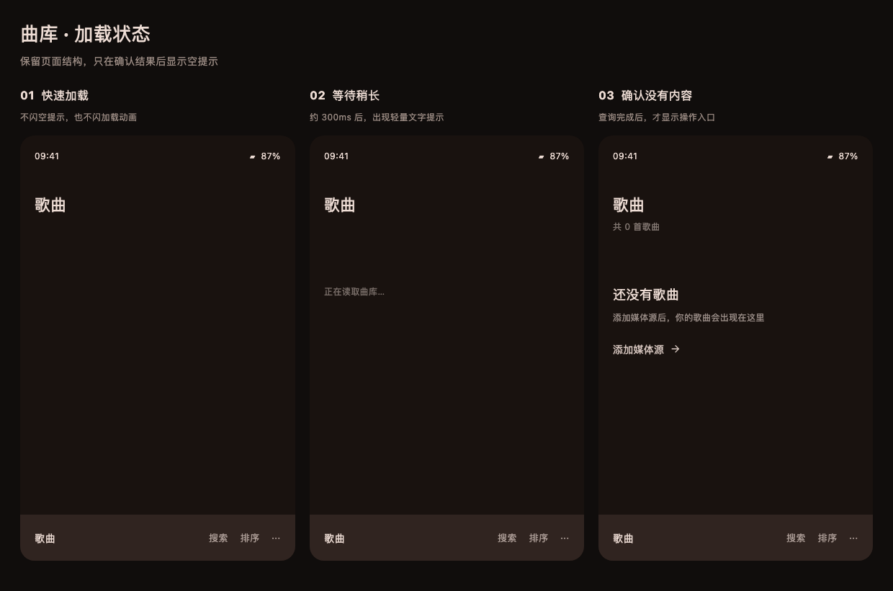

# 曲库统一加载状态提案

状态：视觉方案已确认，已接入正式页面；验证记录见下方实施部分。

## 视觉

图片由现有 Compose 的 NavigatorHeader、LibraryEmptyState 与 MaterialTheme 渲染；底部导航仅为布局示意，并非完整可交互 SmartBar。

- 首次查询：保留标题及副标题行空间，内容区安静留白，不显示“共 0 首”或空状态入口。
- 查询超过约 300ms：显示淡色“正在读取曲库…”；搜索使用“正在搜索…”。此阈值仅控制等待提示，不能用来判断数据是否为空，也不强制最小加载时间。
- 成功返回空结果：立即显示现有场景对应的空状态。
- 成功返回内容：显示列表，标题数量同步更新；不额外叠加整页进出动画。
- 已有结果后刷新：保留列表与滚动位置，成功后更新；失败保留内容并提供重试。
- 等待提示不使用转圈、骨架卡片、假进度；不改变现有播放页的加载状态 UI。

## 已确认的代码原因

- `lmedia/lmedia-core/.../sortable/SimplePreference.kt` 的 `doSortState` 以 `SortResult.empty()` 初始化，未查询和查询完成为空无法区分。歌曲、专辑、歌手及对应详情内列表共用此路径。
- `PlaylistsVM` 的 `toState(emptyList())` 存在同样问题。
- `HomeScreenModel` 的最近添加与每日推荐 `stateIn(initialValue = emptyList())` 存在同样问题；首页最近播放还需接入相同展示协议。
- `HistoryScreen` 已检查 Paging 的 `LoadState.NotLoading` 后才显示空状态，可把其加载/错误映射到同一展示层，而不替换 Paging。
- AudioRepositoryImpl 直接传递数据库 Flow 结果。首轮真实查询完成与页面提供的初始空值需要在呈现层区分。

## 建议接入方式

1. 共用呈现状态区分 Loading / Ready / Error，保存当前请求标识和最后成功结果。Ready 内的空集合才代表真实空结果，不把加载标志塞进纯排序结果，也不改写所有 empty() 的语义。
2. 在完成查询、筛选和排序后发布 Ready。搜索请求绑定关键词/筛选参数，取消旧请求并拒收旧结果；不拿旧关键词结果判定新关键词无结果。
3. 排序列表统一封装带状态的收集方法；普通 Flow 与 Paging 分别适配同一呈现协议，复用视觉组件及等待提示延时规则。
4. 首次加载占位与真实空状态共用横向对齐、上方间距；副标题预留高度，避免数量出现时推移内容。
5. 数据源扫描与数据库查询是不同过程：不能等待所有远端源扫描完成才展示已缓存曲库。首次扫描导致数据库暂时为空时，需结合已有扫描状态显示“正在整理曲库”，失败提供错误/重试，不无限加载。
6. 覆盖歌曲、专辑、歌手、歌单及其详情、添加到歌单弹窗、首页最近添加/最近播放/每日推荐、搜索及历史页。保留各场景已有空提示文案和操作入口。

## 实施验证

覆盖首帧慢查询、立即返回空结果、立即返回非空结果、慢查询提示显示/取消、刷新保留内容、失败与重试、快速切换搜索关键词的乱序结果、滚动位置保持。对 UI 逐帧检查加载期间不存在空提示与假零数量。

`LoadingStatesPreviewTest.kt` 是设计稿渲染源，放入 lhome JVM test 目录可重新生成；不是正式功能测试。本轮渲染已成功并检查图片。

## 2026-10-29 实施

- `LibraryQueryState` 独立保存首次加载、最后成功结果与错误；`queryState` 按查询键取消旧请求并提供重试。排序结果本身保持纯数据结构，未修改 `SortResult.empty()` 的语义。
- `LibraryQueryContent` 给局部页面提供一致的呈现状态，现有 `LibraryEmptyState` 在查询期间显示延迟 300ms 的等待文字，失败时显示重试，成功为空才显示原来的场景文案。
- 标题副文字在首次查询时用同字号空白占位，适配系统字体缩放，不显示假零数量。
- 接入歌曲、专辑、歌手列表与详情内歌曲、歌单列表/详情/添加弹窗，首页最近添加、每日推荐和最近播放；历史分页保留 Paging 状态判定并补充统一等待提示。
- 聚合搜索按单个关键词一起发布三类结果，保留已有内容直到新查询完成，避免多个独立初始空列表/不同关键词结果交错。
- 本轮处理数据库查询与 UI 首次订阅的加载状态，不把远端来源后台扫描当作页面加载；已缓存内容无需等待扫描完成。后台首次导入期间数据库真实为空仍保留对应业务空态，来源扫描进度另由来源模块负责。
- 新增真实 Compose UI 回归与查询取消/重试测试；首次加载不出现空提示/零数量，成功为空才出现操作入口，延迟文字在结果返回后移除。

验证完成：lhome 12 项、lsearch 4 项测试全部通过；最终 Android Release 构建成功（3m9s），45 个 Compose 图标检查通过，真机保留数据覆盖安装返回 Success。此次安装包含 SeekBar 普通拖动松手不振动的修复。尚需用户确认真机观感，不把自动化测试等同于实机体验验收。

### 提交前 review

发现并修复了错误边界遗漏：创建查询本身抛错、或上游查询参数流（例如歌单成员读取）失败时，原实现可能退出收集，重试失效。现在重试会重新订阅完整查询链，创建查询与流收集都进入错误处理边界。新增覆盖“上游失败 → 重试时查询创建失败 → 再重试成功”的回归，正常加载/搜索体验不变。
